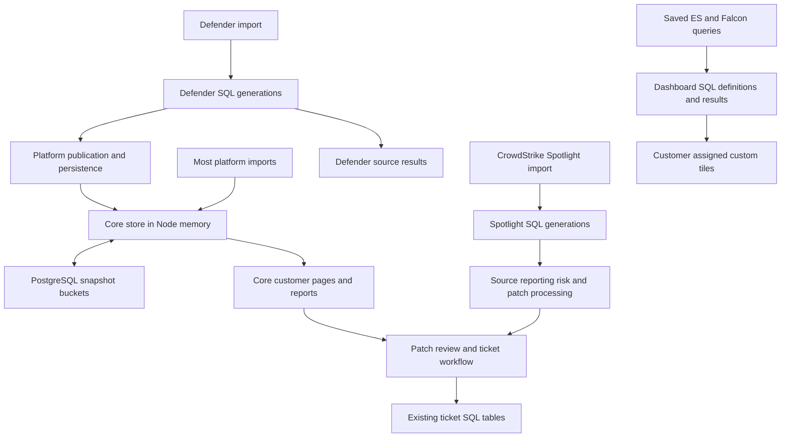
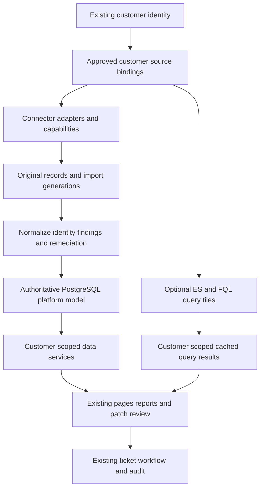

# GMI Vuln platform change proposal

## Decision summary

**Combined change plan: retain the existing application, gradually move it to a shared, customer-scoped PostgreSQL data model, and consolidate reporting, prioritization and patch tickets into Remediation.** Keep each connector's original records and capabilities, but make customer pages, reporting and patch workflows use consistent data services. Start by placing those services over the current implementations; replace storage behind them in bounded steps.

This is the authorized implementation plan and evidence record, not a claim that the redesign has been deployed. It covers the current architecture, the proposed architecture, regression exposure, migration stages and release criteria. Production release still requires a concrete reviewed scope. It does not promise zero regressions.

**Current status: implementation started on October 9, 2026.** The user authorized the work. The first checkpoint preserves a private recovery baseline and introduces a disabled Remediation layout using the existing reporting services. Development is on `Vuln2.0`; no production application deployment, schema cutover or change to customer permissions has occurred. Progress and verification limits are recorded below.

**October 9, 2026 update:** The user approved the clickable Remediation workflow as the direction for the new layout and requested its inclusion in this change plan alongside the backend overhaul. Layout and workflow approval does not mean implementation, merge or deployment has occurred. The mockup uses fictional CVEs, hosts, board names and ticket references; it is not evidence of production integration behavior.

**Prepared October 9, 2026.** The code baseline is `gmi-security/Vuln` main revision `a6c485b39b11e681602b1eb8019e18b31c5b9e14`, fetched and checked on that date. Current behavior below describes this code. The customer inventory section records subsequent read-only database evidence and its limits. Active worker processes, the deployed build and runtime database/source configuration still require reconciliation before migration.

The change is not simply adding a database. The application already has PostgreSQL, customer IDs, source-specific tables, normalized findings and correlation logic. The proposal makes storage ownership, source selection and publication consistent across the application.

## Delivery approach agreed for this work

- **Development branch:** `Vuln2.0`. At the October 9 branch check, it and `main` both pointed to `a6c485b`; the server checkout was on `main` at that revision. Reconfirm the deployed build and branch heads before any release. No other developers are expected to work on this project today, so routine synchronization with others is not part of today's workflow; still check that the destination branch has not moved before a merge.
- **No separate staging environment:** Develop and validate locally using tests, fixtures and disposable test data where necessary. Prepare the production release separately from the running application directory. Do not start a second application or worker against the live database as a substitute for staging.
- **Small checkpoints:** Commit each bounded change to `Vuln2.0` after the relevant checks. Keep the existing production version available. Review the exact changes before releasing them; do not merge or deploy automatically just because a development step is complete.
- **Protect data first:** Before the first production mutation, preserve a usable database backup, configuration and encryption keys securely, and a known-working application build. Establish restore verification and recovery steps; a Git branch or successful backup command alone is not evidence of recoverability.
- **One coordinated production rollout, approved October 10:** Prepare and test UI, connector assignments, SQL reads and authoritative writes as separate commits, then assemble one reviewed release. Retain compatibility paths and rehearse the ordered migration before deployment. There is no earlier UI-only production release under the current direction.
- **Re-ingestion is supplementary recovery:** Prefer rebuilding from retained completed source generations before making a full vendor pull. Re-ingestion cannot replace ticket/workflow records, settings or historical measurements.

### Combined rollout: October 10, 2026

The user now wants everything prepared for one coordinated rollout. This supersedes the earlier four-production-release sequence and historical next-step notes. The four areas below remain the implementation order and acceptance boundaries, but they will ship together after the combined release is ready and reviewed. The already prepared UI branch is a tested component of that release, not a separate deployment request.

| Workstream | Deliverable | Required boundary |
| --- | --- | --- |
| 1 Remediation layout | Finish the customer Overview, Prioritize and Tickets workflow over existing storage, including shared CVE actions and retained threat enrichment | Preserve current readers/writers, saved tiles, permissions and ticket references. Prepare the exact release diff, route/browser checks and UI rollback instructions before production review. No shadow reader or writer activation |
| 2 Customer connector assignments | Review/import existing assignments and consistently select each customer's configured sources | Verify tenant/dataset/target scope and existing credentials by reference; do not activate ambiguous matches. Check every affected connector and mixed-source customer case |
| 3 SQL reporting reads | Move compatible reporting services to verified summaries, customer by customer | Verify source-specific parity, freshness, customer isolation, completed-generation alignment and performance. Leave existing writers authoritative and retain a reversible read path |
| 4 Authoritative database writes | Complete ingestion, workflow changes, publication and recovery against the shared model | Verify all affected connector adapters, restart/retry/closure behavior and acknowledged-write durability before switching ownership. Complete reversal safeguards and retire old storage only after stabilization |

Before the combined rollout, every affected connector/read/write transition must pass its acceptance checks; Defender results cannot stand in for another connector's evidence. Planned integrations remain unavailable. Any intentionally retained legacy path must be identified and reviewed as an exception rather than counted as completed migration.

The production sequence is: preserve a fresh recovery point and compatible build; install reviewed additive schema/index changes; quiesce all affected writers; capture final source/workflow changes; verify counts, identities, relationships and ticket state; switch the application and authoritative ownership in the rehearsed order; run customer checks; then resume the intended import/job owners. Stop at a failed gate instead of advancing with partial data. A single rollout still has ordered steps and a bounded maintenance window; it is not a single unverified restart. After new writes are accepted, recovery must preserve them rather than restore an older snapshot.

## What changes and what stays

| Area | Current system | Proposed system |
| --- | --- | --- |
| Core platform storage | Companies, assets, scans and findings are loaded into mutable Node.js memory and persisted in JSONB snapshot buckets | Transactional PostgreSQL records are authoritative; bounded caches are optional and disposable |
| Customer connections | Mapping is spread across environment variables, source-specific connection records, tile ownership and some Atlas-specific logic | A registry explicitly binds each customer to approved connections, tenants and datasets |
| Connector integration | Several source-specific import and reporting paths | Adapters implement shared ingestion and capability contracts while preserving vendor details |
| Defender | Dedicated source import followed by publication into the in-memory platform store and a durable save | Completed source generation published to the shared model with a durable publication state |
| CrowdStrike Spotlight | Full records and current-generation pointers already live in dedicated SQL tables | Retain those records; expose common customer metrics and findings through indexed SQL projections and shared services |
| Reporting | Core reporting traverses the platform store; source views and custom queries follow additional paths | Existing reporting features use shared definitions, customer scope and explicit freshness |
| Navigation and remediation | Reporting and Prioritize are separate entry points; supported reporting CVEs expose patch actions | Six main sections; Remediation contains Overview, Prioritize and Tickets, with the same CVE-to-ticket panel available from every view |
| Dashboard tiles | Cached query results and definitions have their own storage and saved source connections | Preserve existing tiles and caches; bind queries explicitly to approved customer source scopes |
| Updates | Some platform changes are acknowledged before the periodic snapshot save | A successful write means the database transaction committed |
| Background work | Multiple in-process schedulers, with a mixture of memory state and durable jobs | Durable job ownership, checkpoints and publication records, introduced incrementally |
| Database topology | Application tables use `DATABASE_URL`; dashboard and ticket tables may use `ELASTIC_VULN_DATABASE_URL` | Application data starts with `DATABASE_URL`; existing dashboard/ticket storage stays in place during the initial migration |

Existing capabilities, customer IDs, saved tile IDs, permissions, ticket references, history and audit records are preservation requirements. The approved layout changes navigation and workflow presentation and includes the explicitly requested default Threat Intelligence tile in Prioritize. It does not authorize other new standard tiles, change risk formulas, enable new integrations, or delete existing pages and data. Sample metrics in the mockup do not authorize a new default tile collection.

## Approved experience: Remediation

**Approved for the change plan on October 9, 2026.** Use the existing GMI Vuln theme with readable supporting text, compact layouts and bounded long lists. The purpose is to bring reporting, prioritization and patch requests into one customer workflow, not introduce workspaces or another customer selector.

### Main navigation

| Section | Responsibility |
| --- | --- |
| Remediation | Customer reporting, saved tiles, prioritized findings/remediations and ticket tracking |
| Companies | Customer records and entry points to their assets, findings, coverage and related detail pages |
| AppSec | Existing application and repository security functions |
| Scanner Telemetry | Existing scanner activity, results, failures and troubleshooting |
| Connectors | Customer source assignments, existing connection configuration, import health and freshness |
| Settings | Existing platform configuration, policies and schedule settings within current permissions |

Retain findings, scans, scan scheduling, coverage, attack paths, compliance and remediation SLA capabilities as appropriate drill-downs or settings destinations. Final link placement requires a route inventory before implementation. Preserve existing URLs, or provide compatible redirects retaining customer/filter context; removing sidebar entries must not remove the underlying functionality.

### Customer connectors and scan actions

Use the existing customer selector to scope Connectors. The setup flow is **select customer -> view assigned connectors -> add or reuse a connection -> verify tenant/dataset mapping -> test -> save -> initial import -> publish complete results**. Reuse existing credentials and mappings where verified rather than require re-entry. Keep global/shared connection configuration separate from the customer's explicit binding. Current account permissions remain unchanged; selecting a customer does not grant configuration access.

Retain **Start scan** on the customer detail page and provide the customer-list action: **customer -> configured/enabled scanner -> approved targets and profile -> review -> launch -> progress and results**. Use a customer Scans tab for progress/history and Scanner Telemetry for operational detail. Keep **Sync now** separate for importing CrowdStrike/Defender and other upstream results. Review the customer and target scope before creating work, and publish completed results only to that customer. Preserve existing schedule behavior and authorization.

SpiderFoot is a shared scanner connection, not a credential set per customer. Its current bulk launcher selects client records with domains derived from existing inventory/findings; importing completed results is a separate step. Nine customer records had SpiderFoot findings in the audit, which does not establish that only nine can use it. The current importer matches scan names/targets to customer names heuristically. The new binding must retain explicit approved target domains and source scan-to-customer IDs, with ambiguous legacy scans held for review. Show available, enabled for this customer, last scanned and imported-result states separately. Preserve the bulk scan capability with explicit scope review; do not automatically enable scanning for every customer during migration.

### One customer selection, three views

The existing customer selector owns the page context. Switching views preserves that customer. Switching customers clears or rebinds open CVE details and drafts so another customer's findings, hosts or routing cannot carry over. Cached results and requests must include customer scope; a late response from the previous selection must not populate the new customer's view.

| View | Content | Ticket access |
| --- | --- | --- |
| Overview | That customer's existing reporting and saved tiles, using only approved source bindings | Click any CVE to open the shared details and patch-request panel |
| Prioritize | Worklist using existing risk rules and affected-device counts; optional grouping by shared remediation; default Threat Intelligence tile | Click any CVE for the same panel; a remediation group can prepare a scoped request for its covered CVEs |
| Tickets | Existing and newly created patch requests, their CVE/remediation links and recorded ConnectWise references/status | Click any CVE for the same panel, including its existing tickets and available actions |

Tickets is a tracking view, not a required stop before creating a ticket. Preserve saved tiles, IDs, customer ownership, query text, display/refresh settings, order, cached successful results and history. The approved scope does not add another tile customer selector. A tile saved from a customer page continues to belong to the currently selected customer.

Footprint with Defender should show its supported Defender/platform information. It must not inherit Atlas Elastic or CrowdStrike tiles. Atlas may display its approved CrowdStrike and Elastic results without counting mirrored records twice. Unavailable source capabilities remain explicit rather than displaying zero or substituting another customer's connection.

### Shared CVE panel and patch-request flow

**Any CVE in any Remediation view -> shared customer-scoped panel -> prepare request -> review ticket and host CSV -> create ConnectWise ticket -> show its reference everywhere -> verify resolution against later source evidence.**

1. Open the CVE with customer identity, source provenance, available severity/scores, affected devices and recommended remediations. Reuse the current reporting workflow instead of maintaining three ticket implementations.
2. Show existing linked requests and tickets before offering creation. Their scope may cover one CVE, multiple CVEs, or only some affected devices; a partial ticket must not imply the whole CVE is covered.
3. Prepare a patch packet for the selected customer and supported source evidence. Keep original source IDs and generation/timestamps so the user can see what the request represents. Unsupported packet capabilities need an explicit explanation, not a silent CrowdStrike fallback for a Defender customer.
4. Let the user review the summary, contents, customer routing, actual ConnectWise board names and affected-host CSV. Keep host lists in the CSV, not the ticket body. Preserve the agreed recommended-remediation rules; do not reintroduce minimum-remediation duplicate rows. Preserve current default priority/status behavior rather than adding new required controls.
5. Create only after the user's explicit action using the existing authorized server-side integration. Preserve request identity, delivery/audit state, CSV attachment handling and reconciliation for uncertain responses. Do not automatically retry a timed-out create as a new ticket.
6. Persist the reference against the customer and covered CVEs/findings/remediation group, then display it in all three views and the panel. Existing request/ticket IDs and audit history remain intact.
7. Track ticket progress separately from vulnerability verification. Closing a ticket does not by itself establish that a vulnerability is fixed; later complete, correctly scoped source observations provide verification under the existing lifecycle rules.

For a grouped remediation, calculate unique affected devices within the selected customer and retain the covered CVE-to-device relationships in the packet. Do not add per-CVE device counts together or attach unrelated findings. Preserve per-CVE scoring evidence rather than inventing a group CVSS or ExPRT value.

### Shared implementation boundary

Use one customer context, one reusable CVE panel and one patch-request service across Overview, Prioritize and Tickets. CVE actions from saved tiles must resolve validated customer/source identities; the displayed CVE string alone is not permission to retrieve another tenant's hosts. All authorization remains server-side and current role behavior is preserved.

This UI consumes the customer-scoped services described below. Initially those services can wrap the existing stores. Later SQL-backed implementations should not require another UI rewrite. Review packet data freshness and scope again before delivery, and require a new review if materially changed scope would alter the request.

### Default Prioritize tile: Threat Intelligence

**Added to the approved scope October 9, 2026:** Carry the current threat-enrichment capability into the redesigned platform and make it visible in a default tile in Prioritize. This is the explicitly approved exception to the earlier decision not to add a new collection of standard tiles. It is a plan requirement, not a production implementation or a change to existing permissions.

The tile is present for each selected customer and shows only CVEs associated with that customer's current open findings. It reads stored enrichment and customer-scoped risk services, rather than making MISP/OpenCTI calls during page rendering. Existing configured threat sources can remain shared services; their enrichment must be joined to the selected customer's findings before displaying CVEs, affected-device counts or ticket associations. It works independently of whether the customer's vulnerability source is CrowdStrike or Defender.

| Tile element | Required behavior |
| --- | --- |
| Summary | Count unique customer CVEs with qualifying threat evidence; show unique affected devices separately. Do not sum overlapping source or CVE counts. Clearly name confirmed exploitation, threat associations and other signals rather than presenting them all as confirmed exploitation |
| CVE list | Bounded, paginated list with CVE, severity, customer-specific affected devices, signal type, source, last successful check, risk tier and existing ticket reference |
| Evidence | Preserve MISP sightings, OpenCTI relationship details and provenance; show relevant existing CISA KEV/EPSS or IntelOwl enrichment with distinct labels when available. Do not represent missing fields as zero or source absence as a clean assessment |
| CVE interaction | Clicking any CVE opens the same shared panel and Prepare patch request flow used throughout Remediation; no navigation to Tickets is required |
| Freshness and health | Distinguish unconfigured, not checked, no qualifying evidence, stale, and failed lookup. Retain last successful evidence with its timestamp during an outage; an aggregate refresh success alone is not proof that each source succeeded |
| Score explanation | Explain how qualifying evidence contributes to the existing risk score/tier, with vendor/source evidence accessible from the panel. Keep threat enrichment distinct from CVSS severity, ExPRT and proof of compromise on a customer device |

The migration must preserve evidence and its origin rather than reduce multiple feeds to one unexplained boolean. Define per-source observation/check times, signal types, confidence or qualification, and policy for expiry/retraction. Preserve existing enrichment records during migration; do not fabricate historical evidence that the current cache did not retain.

Three current implementation limitations require an explicit reviewed treatment before promoting the new tile as trustworthy exploitation evidence: OpenCTI currently counts any returned relationship rather than verifying its type/target; the existing active-exploitation persistence uses an OR update and does not clear a prior true flag; the UI currently hides much of the source provenance behind a generic explanation. A MISP sighting also needs a defined evidence interpretation before it is labelled confirmed exploitation. Preserve the integration capability, not these ambiguous semantics. Any resulting score/tier change must be measured, versioned and reviewed separately from navigation changes, including effects on ticket automation.

Acceptance requires customer isolation across shared CVEs; correct deduplication across MISP/OpenCTI and multiple devices; working CVE-to-ticket actions; source-specific stale/error/unconfigured states; coverage for both CrowdStrike and Defender customers; preservation of existing ticket references; no live feed calls during normal rendering; and fixtures for valid/irrelevant OpenCTI relationships, evidence expiry/retraction and failed refreshes. Retained legacy signals must be identifiable when their underlying evidence cannot be reconstructed.

### Current position and next steps

**Latest implementation (checkpoint 41):** Reviewed runtime routing now covers Automate, Intune, Tidal and CrowdStrike host inventory. Tidal preserves portal company IDs and only visits approved sessions; Falcon host imports select an exact configuration and validate every returned CID/device batch. The explicit v2 route migration prevents duplicate CID and connection ownership. Name-only Tidal CSV is withheld while reviewed routing is enabled. The existing Falcon adapter's over-10,000 and empty/unverifiable inventories fail explicitly in reviewed mode. Intune remains disabled. Nothing is deployed or enabled; Spotlight findings, scanner/source consumers, SQL reporting replacement and authoritative writer handoff remain outstanding. See the latest checkpoint and rollout status for validation.

**October 10 UI component candidate:** `release/remediation-ui` contains the isolated UI component over `main` at `a6c485b`. Commit `23a5da0` isolates manual-draft automation protections; `ba46eae` adds the layout, shared CVE workflow, tests and `docs/remediation-ui-release.md`. It excludes shadow schemas/readers, summary workers, connector registry activation and authoritative-write prototypes. It has not been pushed, merged or deployed. Preserve its fixes/tests when assembling the combined candidate; its prior UI-only release instructions are superseded by the combined rollout decision.

**Release-candidate verification:** production build/type check passed; 122 regression tests passed with two older database suites skipped; seven actual PostgreSQL CVE checks passed in a new disposable database; authenticated HTTP passed with the UI flag off and on; five browser scenario groups passed with synthetic API responses and zero real tickets sent. Browser checks now verify reopened ticket references across all three views, customer history navigation, late-response isolation and a readable error for mismatched customer responses. Desktop/mobile screenshots were inspected. The disposable database was removed and the private cluster stopped. Production remains at `a6c485b`, with its existing local script changes preserved. Detailed limits and deployment/rollback instructions are in the release-branch document and the readable `GMI Vuln Remediation Release Review.html` download.

**Rollback finding:** the original code does not recognize new `manualOnly` draft packets. Normal rollback must disable `VULN_REMEDIATION_UI` while keeping the compatible candidate running. A full code rollback after draft creation must retain the isolated automation protections in a validated build or explicitly quiesce and reconcile the affected automation. Do not silently restore the original build or an older database over new drafts/tickets.

- Completed: approved navigation/workflow concept and a clickable mockup covering all three views, shared CVE details, request review, CSV preview, demo creation and customer separation.
- Approved addition: default Threat Intelligence tile in Prioritize, retaining enrichment with visible evidence, freshness and the shared CVE-to-ticket workflow. The existing mockup does not yet depict this new tile.
- Implemented locally: `/remediation` with Overview, Prioritize and Tickets, the existing single customer selector, customer/view URL state, six-section navigation and links to original tools. The route and new navigation require `VULN_REMEDIATION_UI=true` plus the existing dashboard feature/access. The new flag defaults off. `/reporting` keeps its existing layout and behavior.
- Each view mounts only its own sections. Switching customers, views or refreshing remounts the customer-bound content, so a previous customer's open dialog or late response cannot become the next customer's content. Prioritize and Tickets do not request the full customer report. Existing source queries, definitions, caches, ownership, IDs and ordering are reused.
- First shared service boundary: `resolveCustomerScope` resolves an explicit app company ID through the existing store. Reporting reads, customer tile reads and tile ownership validation reuse it. Missing/malformed, unknown, demo or mismatched identities are rejected; client and internal companies remain supported. Authentication remains in the existing route guards, and source-tenant ownership is not inferred by this helper.
- Second local checkpoint: shared customer-scoped CVE panel and manual patch preparation, connected to CVE links in the three Remediation views; a saved-evidence Threat Intelligence tile is present in Prioritize. Details, CSVs and drafts use the selected company's published findings or completed Spotlight import. Existing live, broadly scoped Falcon collection is not reused for this panel. See the second checkpoint below for limits and verification.
- Not implemented: active connector bindings or registry-backed source routing, authoritative SQL model migration, new source-specific threat evidence/expiry semantics, production navigation switch or deployment. These are disabled local implementation checkpoints, not a completed or release-ready Vuln2.0 overhaul.
- Third local checkpoint: seven real PostgreSQL checks and four browser workflow scenarios passed. Restored-data timing identified a full-generation scan for every CVE read; two candidate indexes reduced the sampled SQL work substantially. The indexes were applied only to the private restored copy and saved as an explicit, reversible rollout script. See the measurements below; no production indexes or application deployment changed.
- Fourth local checkpoint: a read-only connector import preview now collects existing references and flags unverified customer/tenant/query scope. It was validated on the private restored data and creates no registry tables or assignments. See the fourth checkpoint below.
- Fifth local checkpoint: explicit SQL migration and transactional services now store disabled connector proposals and before/after audit history. Repeated imports do not duplicate records, changed/missing source evidence invalidates review, and existing human proposals are retained. The code has no production initializer, endpoint or activation method. See the fifth checkpoint below.
- Sixth local checkpoint: Connectors now has a read-only customer status view behind the existing disabled Vuln2.0 UI flag, with one reused customer selector, scoped navigation, explicit inactive review states and a separate link to unchanged shared tools. No registry mutation or activation endpoint was added. See the sixth checkpoint below.
- Seventh local checkpoint: a versioned saved-source read contract and Defender adapter now return customer-scoped summary counts and paginated CVEs without hydration, source API calls or publication. Restored-source parity, import/prune concurrency, zero-versus-missing data and freshness were checked. The adapter has no production caller. See the seventh checkpoint below.
- Eighth local checkpoint: the saved-source contract now supports completed CrowdStrike Spotlight imports, including source CVSS severity, suppression qualifiers, unknown inventory/revision evidence and verified generation counts where available. PostgreSQL fixture checks passed. A restored Atlas read hit the 15-second aggregate limit, so the raw reader is an offline reference implementation and is not suitable for page requests. See the eighth checkpoint below.
- Ninth local checkpoint: a separate saved Spotlight summary builder and reader now pass full restored-source parity against the independent batch audit, including all CVE rows. Building the retained Atlas generation took 85 seconds once; summary/page reads took 21–27 ms and the summary tables/indexes used 3.3 MiB. The slow whole-generation SQL reference remains unwired. No worker, page or production migration calls the new builder/reader. See the ninth checkpoint below.
- Tenth local checkpoint: a separately compiled, disabled-by-default Spotlight summary worker now discovers allowlisted completed imports, records durable jobs, limits retries, renews and fences leases, and recovers interrupted work. Real PostgreSQL tests include killing and restarting the CLI and rejecting a second overlapping process. See the tenth checkpoint below for full-data results and limits. No production process or reporting route calls it.
- Eleventh local checkpoint: derived-summary retention now has a read-only preview and an explicit bounded apply service. It protects current/source-current summaries, the newest three generations, active jobs and consistent in-flight saved reads. Eight real PostgreSQL scenarios pass; no production cleanup or recurring caller was added. See the eleventh checkpoint below for proposed retention defaults and limits.
- Twelfth local checkpoint: a disabled, authenticated saved-source preview now connects Overview and Prioritize to the Defender/Spotlight readers with explicit customer/source scope, honest pending/stale states, bounded CVE pages and the shared patch panel. It is additive validation, not replacement of the current report or risk services. See the twelfth checkpoint below.
- Thirteenth local checkpoint: an offline endpoint source-selection model now checks reviewed customer scope, mirror origins, overlapping primaries, adapter availability and source freshness evidence. It cannot activate bindings or produce summed platform totals. Six fixtures using actual legacy projection/reporting code document why source counts can differ from platform open totals. See the thirteenth checkpoint below.
- Fourteenth local checkpoint: a bounded read-only restore audit matched every current Defender device/CVE pair to the published generation, explained 2,970 retained older open findings, and measured the separate Atlas legacy-platform and completed Spotlight populations. The audit ran in 14 seconds without hydrating the application or changing SQL data. See the fourteenth checkpoint below; this does not establish full cross-source or risk parity.
- Fifteenth local checkpoint: the first versioned Defender platform shadow projection now separates identity, workflow, saved assessment and source evidence while preserving remaining fields. All 288,878 restored Footprint findings reconstructed exactly, including retained older open findings and resolved history. Build time was 150.5 seconds, target tables/indexes about 630 MiB, and Node peak RSS 197 MiB. See the fifteenth checkpoint below; these disposable tables are not an active application store.
- Sixteenth local checkpoint: saved summaries and bounded finding/CVE pages now read verified Defender shadow generations without full aggregation on requests. All 288,878 restored findings, 215,891 open records and 10,229 CVE groups matched independent reference traversal. Saved-summary reads measured 2.0-2.6 ms and sampled 100-finding pages 7.7-19.2 ms on the private restore. See the sixteenth checkpoint below; no runtime route or page consumes these readers.
- Seventeenth local checkpoint: bounded CVE details now reconstruct complete evidence from verified Defender shadow generations and compare pure patch preparation with the existing customer-CVE model. Fixture and restored-data measurements are recorded below; this reader has no runtime caller or ticket writes.
- Eighteenth local checkpoint: a disabled, explicitly scoped customer-CVE adapter now combines verified Defender evidence with saved threat enrichment and existing ticket references/exclusions. It preserves separate application and dashboard database connections. Actual legacy service, exclusion and pure patch output matched disposable PostgreSQL fixtures; see the eighteenth checkpoint below.
- Nineteenth local checkpoint: the shared CVE panel now offers a read-only Defender comparison behind a separate disabled flag and authenticated GET endpoint. It uses a trusted customer/generation allowlist, explicit read connections and saved customer metadata. Build, type, route/service and browser checks are recorded below; no live page default or ticket-write path was switched.
- Twentieth local checkpoint: the real authenticated comparison HTTP endpoint now passes small PostgreSQL fixture checks with separate and shared application/ticket storage. Actual legacy detail output matches; customer isolation, public-only serialization, failure recovery and unchanged fixture data are verified. The test app used SELECT-only credentials and a network guard; see the twentieth checkpoint below.
- Twenty-first local checkpoint: verified Defender shadow generations and completed saved reads now reject ordinary SQL mutations. A separate customer publication pointer, revision check and append-only audit support atomic switches and explicit rollback. Nine PostgreSQL publication scenarios passed, including competing publishers and stale transaction snapshots; see the twenty-first checkpoint below. The service refuses production targets and has no application caller.
- Twenty-second local checkpoint: the immutable-generation build and published reader passed full retained Defender validation: all 288,878 findings, 215,891 open findings and 10,229 CVE groups matched, across 5,154 published reads. A fresh-target planner problem was fixed by refreshing key statistics after the first batch. Protected base/derived builds took 118.9/29.8 seconds; summary reads took 1.7-2.6 ms. See the twenty-second checkpoint for baseline comparison and limits. No production reader or writer was activated.
- Twenty-third local checkpoint: the disabled CVE comparison adapter/HTTP endpoint now supports explicit customer publication selection while preserving existing fixed-UUID bindings. Real HTTP requests passed concurrent switching, rollback, missing publication/schema, customer isolation and unchanged legacy enrichment/ticket output in shared and separate storage configurations. Build/type checks and 37 local tests passed. No default UI, production setting, publication control or ticket-write path changed; see the twenty-third checkpoint below.
- Twenty-fourth local checkpoint: a disabled authenticated comparison endpoint now returns publication-selected summaries and bounded finding/CVE pages. Tests verify missing versus zero data, 100-row limits, page ordering, customer/cursor scope, concurrent publication, restart after a generation change and rejection of oversized page data before transfer. Build/type checks, 40 local tests and real PostgreSQL/HTTP suites passed. No UI/default tiles or production reads changed; see the twenty-fourth checkpoint below.
- Twenty-fifth local checkpoint: the existing Remediation customer selector now scopes an optional, initially closed published Defender comparison in Overview and Prioritize. It shows saved summary counts and bounded, scrollable finding/CVE pages; listed CVEs open the shared panel in comparison-only mode. Customer changes, late replies, publication changes and missing/empty data are handled explicitly. Normal tiles and patch preparation remain unchanged. See the twenty-fifth checkpoint below for browser and build evidence.
- Twenty-sixth local checkpoint: an offline completed-import reader, pure refresh candidate planner and disposable SQL writer now preserve the existing Defender projection rules. Fixture candidates match actual legacy output; retries of an applied run preserve subsequent manual resolutions, interrupted builds stay unreadable, and candidate builds do not select a publication. The retained source read processed 212,921 device/CVE pairs and 2,348 devices in 6.1 seconds at about 275 MiB peak RSS. That is the source read only; full-size candidate planning/writing remains unmeasured. See the twenty-sixth checkpoint below.
- Twenty-seventh local checkpoint: an isolated collector now reads the saved customer baseline and completed source import from one SQL snapshot. A captured threat/control context makes candidate scoring independent of later cache changes; saved-state checks detect committed changes before/after writing. A SQL rule blocks all refresh-candidate publication because pending in-memory analyst edits still cannot be fenced. The full retained same-run build verified 288,878 findings and matched open/CVE summaries in 160.4 seconds at about 1,004 MiB peak RSS. Seven SQL fixture groups, 25 local tests and the production build/type check passed. See the twenty-seventh checkpoint below.
- Twenty-eighth local checkpoint: isolated workflow tables now store versioned status/assignee decisions and automatic before/after audit records. Competing edits use expected revisions; refresh candidates merge decisions only when their source/workflow bases remain compatible, and revision changes invalidate a build. Ten PostgreSQL fixture groups, 29 local tests and build/type checks passed. This is an offline contract with no live writer or endpoint, and candidate publication remains blocked. See the twenty-eighth checkpoint below.
- Twenty-ninth local checkpoint: traced manual edits, imports, scan polling/reconciliation, rescoring, company changes, deletion/reset and persistence paths. A test-only handoff rehearsal now uses the actual edit/flush/bucket writer to capture pending decisions or refuse on failed saves, active writers, changed memory or changed saved state. Fourteen PostgreSQL groups, 39 local tests and the type check passed. Production writers and publication remain unchanged; see the twenty-ninth checkpoint and `docs/defender-workflow-handoff.md`.
- Thirtieth local checkpoint: an isolated durable ownership model now records phases, revisions, epochs, registered processes, drain acknowledgements and before/after audit. Its transaction guard rejects old writer tokens and waits for active SQL writes; reconnection, interrupted transitions, competing completions and reversal preconditions pass real database checks. Eighteen PostgreSQL groups, 42 local tests and build/type checks passed. It governs fixture writes only; no live writer or publication changed. See `docs/defender-writer-ownership.md` and the checkpoint below.
- Thirty-first local checkpoint: the actual isolated workflow editor now commits ownership checks, edits and audit in one transaction; the old editor cannot bypass registered ownership. Forward handoff completion requires a verified candidate and derives its evidence from immutable records, rejecting declared checksums and stale source/workflow state. Twenty-one PostgreSQL groups, 44 local tests and build/type checks passed. Reverse completion is blocked until a verified export exists; no live writer or publication changed. See the checkpoint below.
- Thirty-second local checkpoint: a bounded workflow-only reverse artifact now preserves status, assignment and original resolution time through the actual legacy snapshot writer/fresh reader in disposable storage. It rejects changed finding evidence, source generations, customer scope, concurrent workflow changes and altered artifacts; failed saves retain the previous snapshot. Twenty-four PostgreSQL groups, 47 local tests and build/type checks passed. The artifact does not authorize reversal or publication; see the checkpoint below.
- Thirty-third local checkpoint: reverse artifacts are now stored against an acknowledged reverse attempt and the ownership-selected generation. Independent SQL reads verify the complete restored legacy snapshot before recording an append-only receipt. A lost receipt connection after a committed restore recovers without rewriting the snapshot or duplicating the receipt. Aborting preserves selected-generation evidence while invalidating writer registrations. Twenty-seven PostgreSQL groups, 50 local tests and build/type checks passed. Reverse completion and live publication remain blocked; see the checkpoint below.
- Thirty-fourth local checkpoint: export/receipt preparation now verifies the 927.6 MiB retained legacy snapshot incrementally instead of copying it. Full-size tests passed across 288,878 Defender findings: export preparation took 185-191 seconds at about 1.20 GiB peak RSS; independent verification took about 38 seconds at 503-508 MiB. A one-assignment export was correctly rejected as unrestored. Fifty-one local tests, 27 PostgreSQL groups and build/type checks passed. The retained source stayed read-only; full-size changed-data write-back remains unimplemented. See the checkpoint below.
- Thirty-seventh local checkpoint: the disabled saved-source preview can now select a reviewed customer Defender binding instead of the temporary environment allowlist. Source selection rejects stale/conflicting scopes; the actual SQL reader rechecks tenant, connection revision and import revision before loading CVEs. Forty-eight local tests, 19 private PostgreSQL groups, ten browser groups and build/type checks passed. This is separate-source preview routing only; see the checkpoint below.
- Thirty-eighth local checkpoint: all 20 integration types now have shared data-role contracts and review checks, with connector-specific regression coverage. Spotlight summary v2 records whole-generation CID evidence and its registry preview checks that evidence before returning CVEs. Incomplete/malformed inventory and scanner responses now fail explicitly. Live scanner checks found Artemis connection refusal and a ZAP timeout. The five unconfigured integrations remain available but disabled at the user's direction. See [connector rollout status](connector-rollout-status.md) and the checkpoint below.
- Thirty-ninth local checkpoint: an independent full-source audit proved all 343 CID-less rows were exact locally generated unresolved placeholders. Spotlight summary v3 preserves every existing count and all 11,710 CVEs while the tenant guard now passes. Actual legacy import entrypoints also reject ambiguous customer mappings and conflicting stored scan ownership. See the checkpoint below for results and remaining scope limits.
- Next implementation for the combined rollout: enforce reviewed source scopes across the remaining runtime importers/consumers, resolve primary/mirror authority, and integrate SQL reporting and authoritative writes into the combined candidate. Repair/recheck Artemis and ZAP and verify actual customer/tenant/dataset/target mappings before activation. The all-connector contract tests do not establish these live mappings or complete the backend migration. Preserve the isolated UI candidate's fixes and manual-draft protections. Before deployment, reconcile PM2/runtime configuration and writer owners, preserve server changes, verify a fresh recovery point, rehearse migration/recovery, and review the complete release with the user. Live provider scope and ConnectWise delivery remain unverified; no real ticket is implied. Member permissions remain unchanged.
- Develop on `Vuln2.0` in bounded commits and prepare one coordinated UI/backend rollout, without a separate staging environment. The rollout must retain independently reversible UI/read switches and an explicit safeguarded writer handoff; a single release does not remove those recovery boundaries.
- Review reference: the standalone file `GMI Vuln Ticket Workflow.html` accompanies the readable proposal in Downloads. It is a workflow demonstration, not an implementation dependency.

### First checkpoint: recovery and service boundaries

The deployed checkout and both remote branch heads were verified at `a6c485b39b11e681602b1eb8019e18b31c5b9e14` before work began. The running build ID was `gwayjA6gd3o4a-vQKuMRI`. A local annotated tag, `vuln2-baseline-20261009`, preserves that code reference. Two server-local script changes were preserved in the private archive; they were not overwritten or copied into this branch. The app, `.git`, installed dependencies, built output and configuration files were archived outside the web root. No credentials or raw customer records are in this plan.

Recovery files are private to the operator account under `/home/codex/vuln-recovery/baseline-uVic9i`. The application archive is 210,693,160 bytes; the PostgreSQL custom-format dump is 3,084,215,619 bytes. Both database settings resolved to the same physical target in the loaded configuration, so the dump was taken once. It used an exported read-only snapshot with critical-table counts from that same snapshot. SHA-256 hashes, timestamps, versions and counts are in the private manifest. Archive listing and a full archive decode completed successfully, followed by the actual isolated restore test below. Backup collection took about 8 minutes 59 seconds; the database snapshot is from October 9 at 18:01:13 UTC.

The PostgreSQL restore test used an unprivileged, disposable cluster reachable only through a private Unix socket on the droplet. No application process, scheduler or external integration pointed at it. PostgreSQL server packages were extracted into the operator's private directory; the system PostgreSQL service was not installed or changed. The test restored with original ownership and grants omitted. It completed at 18:25:23 UTC after about 15 minutes 37 seconds, matched all seven saved table counts, found zero invalid indexes and stopped the disposable server. Verification is recorded in `restore-6hXR1M/verification.json` under the private baseline directory. This verifies data/schema restoration, not production role/grant recreation, application startup with recovered encryption keys or end-to-end ticket operations; the measured duration is not an end-to-end recovery-time guarantee.

Matched counts: 91 platform snapshot rows, one Defender connection, 16 saved queries, five single-CVE patch requests, 132,063 grouped patch requests, one customer routing record and 15,234 enrichment records. These are table row counts, not counts of created ConnectWise tickets. Production still had the original commit/build and the same two local script changes after verification; the health endpoint returned HTTP 200 in approximately 45 ms.

Recovery remains incomplete for disaster recovery until there is an approved off-server copy and a documented root PM2/runtime-environment handoff. The archive includes file-based configuration but not root's PM2 runtime configuration. The online backup does not include writes or external tickets created after its snapshot. A fresh recovery point is required at an eventual storage cutover; do not restore this older snapshot over new ticket activity.

| View / operation | Existing service reused in the first UI checkpoint | Current authority and boundary |
| --- | --- | --- |
| Customer selector and Overview report | `reportingSetup`, `reportingCustomer`, `buildCustomerReportingModel` | Explicit existing company ID; hydrated platform findings/assets/scans plus stored history. Nonexistent/demo customers rejected; no selection loads no customer results |
| Overview custom tiles | `readCustomerTiles`, `ElasticQueryDashboard` | Existing saved-query SQL cache and verified persisted/legacy ownership; no new tiles or ownership rewrites |
| Defender source detail | Existing `DefenderCustomerPanel` and results route | Completed source import for the selected company; keep source-instance counts distinct from normalized finding counts |
| Prioritize worklist | `TopFixes`, `RiskDashboard` | Existing company-filtered patch-group and risk SQL services; retain current rankings and scoring policy |
| Tickets | `PatchReviewQueue`, `PatchTicketTracker` | Existing company-scoped drafts, reviews, ConnectWise references and routing; global tracker actions remain disabled in customer context |
| Access and rollout | Existing `dashboardAccess`; new UI-only flag | Existing member/admin behavior is preserved. The flag controls no workers, storage writers or database migrations |

**CVE action issue found during implementation:** `PatchRequestPanel` does not carry an app customer ID, and its live CrowdStrike collection can span visible tenants. `PatchConsolidationPanel` carries a customer label but the collector's tenant filter is independently supplied; the customer label alone does not prove tenant ownership. Do not generalize these paths into the shared panel unchanged. The next service must derive allowed tenants from verified bindings, validate every returned record and scope stored-finding packets by company. No new automatic ticket action was introduced in this checkpoint.

**Writer inventory for the later cutover:** the app boot hook starts hydration, dashboard refresh/jobs, reporting queue generation, ticket-status sync, SLA escalation, draft deduplication, draft/routing/priority backfills, automatic ticket creation, closure validation, risk refresh and Defender imports. The core store also has a snapshot flusher and independent scanner-export and Vulners-bridge timers. Manual import, scan, query-refresh and ticket routes can start work separately. `VULN_DISABLE_SCHEDULER` is therefore not a complete maintenance lock. This is a code inventory; current external cron/n8n jobs, active leases and every runtime owner still need reconciliation at release time. None of these production workers were changed or restarted during this checkpoint.

**Validation at this checkpoint:** production build and TypeScript completed; 30 reporting, customer-tile, tenant-scope, consolidation and new customer-scope/route-access tests passed. Eleven additional existing dashboard unit tests passed; the dashboard PostgreSQL integration test was skipped because no fixture database was configured. A local production-build HTTP test passed with the flag off and on, checking login protection, the unchanged original reporting route, empty customer selection and separation of the three views. The HTTP test uses disposable session keys and no production database or provider credentials. Full browser interaction, real customer CVE packets and ticket-delivery tests remain release gates. ESLint could not run because this checkout has no ESLint configuration. The dependency install reported five high-severity advisories; dependency upgrades were not bundled into this UI change.

Local implementation commits: `24706ea` adds the private recovery tools; `7bd878e` adds the gated views and customer-scope boundary. These checkpoints and the baseline tag have not been pushed or merged. The first checkpoint establishes recovery evidence and a disabled UI foundation; the complete Stage 0 operational recovery handoff, shared CVE workflow and storage migration remain open.

### Second checkpoint: shared CVE workflow and retained threat evidence

Implemented locally on October 9. The existing `VULN_REMEDIATION_UI` flag remains off by default. No production code, data, configuration, service or external ticket was changed during this checkpoint.

| Area | Implemented behavior | Existing behavior retained |
| --- | --- | --- |
| CVE entry points | CVE links in saved-tile tables/charts, report sections, Top Fixes, risk rows and ticket/review entries open the same side panel inside Remediation | Original reporting and tools keep their existing interactions outside the new provider |
| Customer evidence | Resolve the selected app company; read exact company/CVE platform findings and the company's current completed Spotlight generation | No title-based ownership inference, broad live Falcon lookup or conversion of aggregate tiles into finding records |
| Preparation | Fresh saved-evidence read on each prepare; recommended CrowdStrike actions; source scores; host CSV; editable ticket contents through the existing ConnectWise review form | Existing packet builders, scoring formulas, real routing options, CSV attachment and ticket audit machinery |
| Missing data | Reject the complete preparation if eligible findings lack required remediation details, exceed 10,000 source findings or exceed 32 MiB of prepared output | Never present a truncated host scope as complete; a query tile without underlying saved source evidence cannot produce a patch request |
| Drafts and sending | Persist manual-only drafts with the selected company, reuse an unchanged pending scope, require approval and explicit sending | Same member permissions, no new mandatory priority/status; host lists remain in CSVs rather than ticket text |
| Automation protection | Exclude manual drafts from auto-create selection, approval and send; exclude them from background draft dismissal; recognize equivalent legacy/manual remediation IDs in the existing exact-scope duplicate check | Existing automated-draft behavior is unchanged for records without the new marker; no worker was enabled or unpaused |
| Threat Intelligence | Show recorded KEV, EPSS and legacy MISP/OpenCTI/IntelOwl signal source/detail for customer CVEs; 50-row scrollable view, timestamp, retry and last-result retention on refresh failure | Read the existing enrichment cache; no live feed calls, signal rewrites, score changes or automatic tickets during rendering |

CrowdStrike CSVs contain one row per source tenant/device/CVE per recommended action, retaining contributing finding IDs and source scores. Different recommended actions may legitimately produce separate drafts for the same device/CVE. Normalized platform sources retain their existing finding and remediation grouping. Device identities are **not** newly correlated across connectors. The saved draft's JSON/CSV keeps fractional source scores; only the existing integer `max_risk` summary column receives a rounded value to remain schema-compatible.

The Spotlight read pins `spotlight_import_current.run_id` in a read-only repeatable-read transaction, filters both `tenant_key` and `company_id` using the app company ID, and limits each source read to 15 seconds. A completed source generation takes precedence over older normalized CrowdStrike findings, including when the latest generation has no matching open CVE. Confirmed suppressed source findings are excluded. Source observation times are shown separately; the page does not claim this is a fresh vendor query or an atomic cross-source snapshot. Published platform findings remain dependent on the current RAM/snapshot service until the later storage migration.

The new panel lists grouped requests with explicit app-company ownership. Legacy single-CVE requests and unassigned legacy groups remain in the existing tracker; they are not newly relabelled or exposed through the panel. Active single and grouped tickets still contribute exact source-device/CVE exclusions during preparation. The existing exact-scope send guard now recognizes both manual and legacy identities for the same remediation; partial scope overlaps and races with the older single-CVE flow are still limitations of the legacy ticket model and require a later common reservation policy.

**Threat evidence boundary:** retained positive flags are explicitly labelled legacy evidence, not confirmation of current exploitation. The cache cannot distinguish all per-source unconfigured, failed, stale, retracted or successful-negative states. One shared cache update timestamp is not a source check timestamp. The new tile exposes available provenance without inventing these missing states; source-specific evidence storage and qualification remain an acceptance gate for the final redesign.

**Validation:** 106 unit/orchestration/regression tests passed across customer scope, packets, reporting, saved tiles, charts, ConnectWise transport/routing, grouped-ticket automation, duplicate checks and reconciliation. Two PostgreSQL integration tests were skipped because no fixture connection was supplied. Production build and TypeScript passed. Local production-build HTTP checks passed with the flag off and on, including login enforcement, cross-origin preparation rejection, missing-customer rejection, original reporting availability, and view-specific tile rendering. Tests used synthetic data and mocked integrations; no real tickets, provider queries or imports were triggered.

**Remaining release gates:** browser interaction and keyboard/focus testing of the full side-panel workflow; actual database draft transaction/reuse/rollback tests; production-sized per-CVE SQL timing and indexes; source-generation reconciliation against representative customer findings; routing/attachment confirmation using an approved test destination. The feature must remain disabled until these gates are reviewed. No schema migration, connector registry, backend storage cutover, push, merge or deployment is included in this checkpoint.

### Third checkpoint: browser, database and performance validation

Completed locally on October 9 against commit `ef41a2a`. This checkpoint adds repeatable validation scripts and candidate read indexes. It does not enable the UI, change production code/configuration, run imports or send external tickets.

**Database behavior:** `tests/customer-cve-postgres.mjs` created a disposable database in the private socket-only restore cluster, used the existing ticket-table DDL, and exercised the actual services against PostgreSQL. Seven checks passed: customer isolation; four concurrent prepares reusing one pending draft with complete audit and fractional packet scores; full rollback after an injected audit failure; active-ticket exclusions and reference retention; completed-generation Spotlight filtering and recommended packet persistence; manual draft protection from the real SQL cleanup sweep; and customer isolation in the shared threat cache. The fixture database was dropped afterward. These test source fixtures are synthetic; no vendor or ticket API is invoked.

**Browser behavior:** `tests/remediation-browser.mjs` ran Chromium against the actual local production build with intercepted synthetic API responses. Four scenario groups passed: table/graph CVE links and focus restoration; failed preparation, scoped CSV download, approval and an explicitly clicked simulated ticket creation; shared actions from Prioritize/Threat Intelligence/Tickets with retained evidence after failed refresh; and customer switching with an intentionally delayed old response, mobile fit and focus containment. The fixture ConnectWise company and board were selected by name. No unhandled API requests or browser runtime errors were recorded. This tests UI behavior, not actual ConnectWise delivery or tenant permissions.

**Restored-data measurements:** the original query found each requested CVE by scanning a completed generation of 2,119,658 Spotlight records. The two fixed samples returned 1,228 and 1,233 records respectively. PostgreSQL inspected about 476,411 shared-buffer pages per source lookup before filtering. This is an observed bottleneck in the new read path on the restored dataset; it is not a diagnosis of every existing production slowdown.

| Operation | Before candidate indexes | With candidate indexes | Meaning |
| --- | --- | --- | --- |
| Source lookup, first run for each fixed sample | 2,479 ms / 2,415 ms | 14.9 ms / 13.9 ms | PostgreSQL `EXPLAIN ANALYZE` execution time; follows the same query and sample IDs |
| Source lookup, immediate repeat | 2,286 ms / 2,445 ms | 1.68 ms / 1.67 ms | Shows buffer-cache effects; not a guaranteed production latency |
| Customer ticket-reference lookup | 162 ms / 178 ms | 0.82 ms / 0.72 ms | Replaces a scan of 132,063 grouped requests with a CVE index lookup |
| Full source rows transferred and decoded in Node, indexed | Not measured | 121 ms / 120 ms | About 7.28 MB / 7.14 MB of JSON; excludes normalization, other services and browser rendering |

After stopping and restarting the isolated cluster, indexed source SQL was approximately 21–22 ms before immediate repeats. The benchmark uses one worker, a 15-second statement timeout and the existing 128 MB shared-buffer setting. Samples and database cache state matter: this is a two-CVE comparison, not concurrency, worst-case-CVE, sustained import or whole-page load certification. Every sampled record contained an action in its saved remediation entities; complete recommended-action coverage is still validated by the packet builder for each request.

Candidate script: `docs/sql/remediation-read-indexes.sql`. It adds a partial composite index on open/reopened Spotlight records keyed by run, tenant, company, CVE and source ID, plus a GIN index on grouped ticket CVE arrays. On the restored copy their sizes were 329,719,808 bytes and 1,884,160 bytes (about 316 MiB together), and both were valid. Import write overhead and future growth must be considered at rollout. There is no automatic startup migration. Apply each `CREATE INDEX CONCURRENTLY` outside a transaction on the database owning its table; check validity after interruption. The script includes index-only rollback commands and does not alter source, ticket or customer records.

Sanitized timing evidence is stored in `docs/evidence/cve-query-benchmark-20261009.json`. The collector reads the actual SQL from the service and keeps fixed sample CVE identifiers only in a private file next to the restore socket; those identifiers and source payloads are excluded from the committed report. Remote aggregate logs are under `/home/codex/vuln-recovery/cve-validation-X9da4Q`. The restored copy now contains the two test indexes; the original baseline dump remains unchanged. The isolated cluster was stopped after testing. Production remained at `a6c485b` with its pre-existing two local script changes; its health check returned HTTP 200 after the database work.

Reproduction: run `node --experimental-vm-modules tests/customer-cve-postgres.mjs PRIVATE_RESTORE_SOCKET` and `node scripts/benchmark-customer-cve.cjs PRIVATE_RESTORE_SOCKET` only against the isolated recovery cluster. For UI checks, use a clean checkout with no app `.env` files, run a production build, then `node tests/remediation-browser.mjs`; it accepts `PLAYWRIGHT_MODULE` pointing to an already installed Playwright module. All app/provider credentials are excluded from the local server environment, and API responses are intercepted with test data. Do not point these fixtures at production or use a real ConnectWise destination for the simulated creation step.

This closes the initial browser/transaction validation gap. Remaining gates include real routing/attachment confirmation in an approved destination, larger and concurrent read/write workloads, source-to-platform parity and ownership reconciliation, the connector registry, and deployment review. No push, merge or production deployment occurred.

### Fourth checkpoint: customer connector import preview

Implemented locally on October 9. `lib/customer-connector-preview.ts` defines migration candidates with an existing connection reference, customer, vendor tenant where actually known, capability, source revision, evidence kind and review reasons. Every candidate is `pending-review`, disabled and has no assigned source authority. These are preview records, not active registry bindings; no application route or worker consumes them yet.

The standalone collector reads company metadata, saved Defender bindings, completed Spotlight pointers, dashboard connection revisions and active tile ownership. It inspects configured scanner/inventory/threat environment keys without exporting credential values or endpoints. It does not hydrate the platform store, fetch findings, decrypt stored credentials, test upstream APIs, invoke a schema initializer or create database tables. Existing credential locations remain authoritative. ConnectWise ticket routing is outside this data-source preview and remains in its existing tables.

| Evidence | How the preview treats it |
| --- | --- |
| Saved Defender customer/tenant binding | Explicit existing mapping; retain its revision and require tenant/authority review |
| Environment customer IDs or names | Candidate mapping only; reject ambiguous names, flag missing credentials, conflicting tenants and numbered Falcon gaps |
| Shared scanners, inventory and MISP/OpenCTI/IntelOwl | Available configuration, not permission to attach the connection to every customer |
| Saved tile ownership | Preserve persisted ownership, including explicit null, ahead of legacy environment mappings; query tenant/dataset scope still needs review |
| Completed Spotlight pointer | Historical import evidence only; the app's tenant key is not a verified Falcon CID or a live connection |

The collector uses read-only, repeatable-read transactions, a 15-second statement timeout, a two-second lock timeout and a 10,000-row metadata ceiling. Application and dashboard databases are collected separately using their existing configuration settings; their snapshots are not globally atomic. Failed or oversized reads abort rather than produce a partial successful report. The CLI has a two-minute deadline, writes a new private report with no overwrite, and logs aggregate counts or sanitized errors. Its environment represents a supplied file plus process overrides, not verified root PM2 runtime settings.

**Restored-data result:** 40 non-demo customer records and 26 evidence entries collected in approximately 0.91 seconds. The entries comprised one saved Defender binding, three environment mappings, 11 shared configurations, ten active saved tiles and one Spotlight import pointer. Two active tiles had resolved customer ownership and eight remained unassigned under the collected configuration. No ownership was changed and no tile was deleted. Multiple evidence entries may describe one provider/connection; 26 does not mean 26 independent sources or customers. Tenant and customer names/IDs remain in the private report outside the repository.

**Validation:** 16 new unit checks plus 28 existing customer-scope/CVE/tile regression checks passed. Seven real PostgreSQL fixture scenarios passed, covering empty-schema no-write behavior, metadata-only reads, ownership precedence and unchanged records, database-enforced read-only rejection, serialized Map/legacy snapshot handling, malformed/missing-table failures, and rejection of oversized metadata. The restored-data check exposed a serialized-Map assumption and the legacy `elastic` source identifier; both were corrected and the PostgreSQL checks and preview rerun successfully. The production build passed, and TypeScript was rerun after the final normalization changes. Fixtures were dropped and the private restore cluster stopped afterward.

Operator instructions are in `docs/customer-connector-registry.md`. The full review report is private under `/home/codex/vuln-recovery/connector-validation-jKsTCD/preview-final.json`. It uses the October 9 recovery snapshot with file-based configuration observed during this checkpoint, not a current production inventory guarantee. Production stayed on `a6c485b`; no push, merge, deployment, production schema write, permission change, sync or ticket creation occurred.

**Remaining:** persisted draft bindings and review/audit transactions, vendor tenant/dataset verification, source authority and mirror rules, historical scanner/inventory mapping reconciliation, root runtime configuration reconciliation, and per-customer reader parity. The fingerprint identifies sanitized preview metadata; it does not detect environment secret rotation and cannot authorize an import. Recollect and revalidate actual connection revisions before any eventual activation.

### Fifth checkpoint: durable connector drafts and review audit

Implemented locally on October 9. `docs/sql/customer-connector-drafts.sql` is an explicit, additive migration for the application database; it is not invoked at startup and has not been applied to production. `lib/customer-connector-drafts.ts` exposes injected-database services for import, proposal review/dismissal and bounded customer-scoped draft reads. There is no production singleton, HTTP mutation endpoint, operator write CLI or change to current access rules.

| New table | Purpose | Activation behavior |
| --- | --- | --- |
| `connector_registry_imports` | Fingerprint, actor, timestamp and candidate count for each changed import batch | No source execution |
| `customer_connector_drafts` | Latest source evidence, connection dependencies, preserved human proposal, source presence, review state and revision | `enabled=false` enforced by PostgreSQL; reviewed remains disabled |
| `customer_connector_audit` | Actor, action, revision, review note and before/after evidence/proposal snapshots | Written atomically with every substantive draft change |

Imports acquire a registry-only transaction lock, recollect trusted source metadata and compare the expected preview fingerprint before writing. A replay of the current fingerprint is a no-op. Unchanged drafts retain human decisions. Changed, missing or returning evidence increments the draft revision and marks it `needs-review`, preserving the previous proposal and reviewer history. Missing sources are never deleted. A change to a shared dashboard connection also invalidates reviews of its dependent tiles even when their query definitions are unchanged. Daily Spotlight generation changes now update one evidence identity per company instead of creating a new registry entry every day.

Review uses an expected draft revision and evidence hash to reject stale editors. A reviewed proposal needs an existing non-demo customer, a present configured connection, supported authority and recorded tenant/dataset/approved targets as applicable. Existing explicit customer and tenant mappings cannot be reassigned through review; conflicts must be resolved and recollected. Saving a proposal clears its review status. Dismissal and review are audited. These checks record an operator's declared scope; they do not contact a vendor, prove upstream API authorization, resolve all mirrors or enable collection. Environment credential changes without metadata/revision changes still require separate runtime reconciliation.

**Validation:** 13 real PostgreSQL scenarios passed in a disposable fixture database inside the private socket-only cluster. They covered migration absence without schema initialization; four concurrent imports creating one batch; disabled review and customer-scoped reads; stale revision/hash and ownership/tenant/demo rejection; preservation of human proposals after changed evidence; missing/returning sources; stable daily generation identity; required query/scanner scope; shared-connection dependency invalidation; unchanged dismissals; full review/import rollback after an injected audit failure; rejection of unexpected credential fields and database rejection of activation; and import/replay of the restored customer metadata. That last check created 26 disabled drafts for the 40-customer evidence set exclusively in the disposable fixture database. No actual customer proposal was approved. The fixture database was dropped and the private cluster stopped.

The 44 related unit/customer-scope/CVE/tile regression tests passed, as did the production build and a final TypeScript check after dependency-invalidation changes. No browser test was required for this backend-only checkpoint; no UI was changed. Production was rechecked at `a6c485b` with its original two local script changes and returned HTTP 200. No push, merge, deployment, production schema/data write, vendor sync or external ticket occurred.

**Remaining:** permission-preserving UI/adapter integration; actual tenant/dataset verification; handling of runtime-only configuration and credential rotation; final authority/mirror conflict rules; registry read-model parity; and a separate activation/cutover migration. Reviewed drafts must never be consumed as active bindings. Retain these unused draft/audit tables during any later code rollback rather than deleting review history. Backend instructions and verification commands are in `docs/customer-connector-registry.md`.

### Sixth checkpoint: read-only customer Connectors view

Implemented locally on October 9. With `VULN_REMEDIATION_UI=true` and the existing dashboard feature/access enabled, `/connectors` displays customer-specific configuration and review status. With the UI flag off it renders the original connector tools. `?view=shared` retains those original tools under the gated layout, with an explicit notice that their actions can affect multiple customers and a link back to the selected customer's view. Existing buttons, source endpoints and role behavior are retained; no new configuration privileges or source mutations are exposed.

The customer selector reuses the reporting selector component and reads the persisted customer list through a lightweight metadata endpoint. The selected company stays in the URL and in navigation between Remediation and Connectors. Only the selected company's configuration and proposals are projected to the browser. Shared unassigned connections are not displayed as if they belonged to every customer. Raw tenant values, credential references, target/dataset lists, audit notes and other customer records are excluded from the response.

The new `GET /api/elastic-dashboard/customer-connectors` uses the existing organization-member dashboard guard and UI flag. A customer request requires an explicit valid, non-demo company; a separate setup request returns only customer names/IDs. The service reads metadata and optional draft tables in read-only transactions, without calling dashboard schema initializers, hydrating findings, probing vendors, running imports, writing draft reviews or starting scans. A bounded dedicated pool is used only when dashboard metadata lives in its separately configured database.

The view distinguishes recorded configuration, incomplete configuration, historical imports, proposed assignments and missing/changed ownership. Reviewed drafts are labelled inactive. Current evidence is compared with the saved draft and its shared connection dependencies; changed evidence displays `Needs review` without updating the database. An absent draft table is explicitly shown as an uninitialized registry, while actual database/query failures remain errors. Configuration check time is not presented as source ingestion freshness or live API health. The persisted customer list can lag an in-memory customer edit until that edit is durably saved.

Switching customers immediately remounts scoped results and cancels the prior request. Late responses cannot repopulate another customer's view. A failed same-customer refresh retains previously loaded configuration with an explicit stale warning. Source cards have bounded scrolling, readable supporting text and responsive layouts; a single source uses the available row width. No approval, credential, enable, scan or sync controls exist in this new view.

**Validation:** 53 unit/access/customer-scope/CVE/tile regression tests passed, including eight new status projection/service/route checks. All 13 PostgreSQL draft/import scenarios passed after sharing the evidence hash helper, including the restored 40-customer/26-draft fixture import. Three Chromium scenario groups passed against the actual local production build with synthetic intercepted data: single selector/scoped links/missing-registry explanations; retained results on refresh failure plus late-response isolation/browser history/empty customers; and mobile fit with no mutation or live health/sync requests. The selector's accessible name was corrected during testing. Desktop/mobile screenshots were visually inspected. The production build and TypeScript checks passed.

These browser checks use synthetic responses and are not proof of a live Connectors request against production. Source metadata and registry reads remain separate snapshots; activation will require renewed scope/revision checks. The new read view is disabled by default, and mutation adapters, active binding routing and a source data-model cutover remain unimplemented. No push, merge, production deployment, production database change or permission change occurred.

### Seventh checkpoint: saved-source contract and Defender parity

The first read-model adapter uses existing Defender storage; it adds no database tables, copies, indexes or migrations. `lib/customer-source-read-model.ts` defines the initial versioned result contract and `lib/defender-source-read-model.ts` implements a dependency-injected reader. This contract is an initial source boundary, not the final normalized schema or an authority rule for combining connectors. It currently supports Defender and is not called by a route, scheduler, singleton or existing page.

The caller must authorize the explicit application company ID. The reader then selects only that company's saved connection and verifies the current import belongs to the same company and succeeded. A read-only repeatable-read transaction pins the generation across metadata, aggregates and CVE rows, even if an import publishes or old rows are pruned concurrently. Each statement has a 15-second limit, lock waits have a two-second limit, idle transactions have a 30-second limit, and pages contain at most 100 CVEs. No credentials, vendor tenant IDs, raw payloads or private import error text enter the result.

| Returned information | Definition and limitation |
| --- | --- |
| Source instances | Saved Defender device/CVE/software-version instances, using the completed import summary; not unique CVEs. |
| Device/CVE findings | Sum of distinct devices per saved CVE aggregate. This deduplicates software versions within a device/CVE, but is not a count of all published platform findings. |
| Unique CVEs and affected devices | Each CVE or device counted once within this generation. |
| Inventory devices | Separate inventory count; does not claim all inventory devices received a vulnerability assessment. |
| Severity distributions | Separate instance and unique-CVE distributions. CVE severity uses the import's existing highest severity for that CVE; source UNKNOWN/NONE values and nullable CVSS are retained. |
| CVE page | Existing severity-first, affected-device-descending, CVE ordering; summary totals apply to the full generation rather than the page. |
| Generation and freshness | Import ID, completion time, import/connection revision match, explicit age and caller-specified stale threshold. Completion time is not a per-device assessment time; future timestamps produce unknown freshness. |
| Latest attempt | Queued/running/succeeded/failed and timestamps, separate from the completed generation. A failed newer attempt does not erase the previous successful result. |
| Unavailable states | Not installed, not configured, no completed import, or inconsistent. These return null metrics, never fabricated zeroes. Database failures propagate; a completed empty generation legitimately returns zero. |

Summary and CVE aggregate totals must reconcile before returning data. The lightweight reader does not scan raw source instances on every page; the separate parity audit compares its counts against raw records. It also does not load the large platform RAM snapshot. Existing publication can merge sources, preserve workflow/enrichment, or retain findings for devices without a newer heartbeat, so agreement with source grouping is not proof of agreement with every published-platform count or risk calculation. No platform reader is replaced in this checkpoint.

**Restored-copy validation:** the retained Footprint generation contained 286,068 software instances, 212,921 distinct device/CVE pairs, 10,215 unique CVEs, 585 affected devices and 2,348 inventory devices. All five counts, instance severity and the first 100 CVEs matched independent raw SQL and the existing CVE ordering. These are the October 9 backup's measurements, not current production counts. It was correctly reported stale at validation time, with matching revisions and a successful latest attempt.

The validated run returned the summary and 100-row CVE page in 18.2 ms, 10.5 ms and 9.8 ms on the private restored database; the independent raw parity audit took about 2.0 seconds. These are a small restored-copy sample, not a production latency guarantee or a benchmark of the existing full platform reader. No source indexes were added for this test.

Validation files: `tests/defender-source-read-model.test.mjs` and `tests/defender-source-read-model-postgres.mjs`, with restricted standalone loader `scripts/source-read-model-loader.mjs`. Seven focused unit checks and seven PostgreSQL scenarios cover isolation, bounded pages, malformed summaries, missing versus empty data, concurrent replacement/pruning, revision/freshness, failure cleanup and database-enforced read-only behavior. The PostgreSQL script creates and removes a disposable fixture database on the private recovery cluster; optional restored-source validation uses read-only sessions. Its initial teardown exposed a pool/socket close race, corrected by awaiting socket end events before dropping the fixture. No production database was queried or written by the test.

The combined customer/connector/reporting/CVE regression suite passed all 60 checks, TypeScript validation passed, and the production build completed. Both disposable source-reader test databases were confirmed removed and the private PostgreSQL recovery cluster was stopped after validation. No production build, PM2 restart, deployment or registry activation occurred.

Remaining gates: other source adapters, a capability contract for source-specific fields, mixed-source authority/deduplication, comparison with published platform lifecycle and risk behavior, authorization wiring for actual callers, and reviewed routing/cutover. Existing pages, saved tiles, ticket workflows and connectors continue on their original readers and workers.

### Eighth checkpoint: Spotlight semantics and full-generation performance gate

`lib/spotlight-source-read-model.ts` adds a customer-scoped reference reader over the completed Spotlight generation. It has no route, singleton, timer or production caller. A read-only repeatable-read transaction checks the current pointer's run/customer ownership and rejects misplaced source rows. For resumable imports it reconciles all source rows with expected/hydrated counts before producing results; legacy imports expose the weaker `completion-marker-only` evidence rather than pretending their count was verified. The adapter uses the same explicit-customer and 100-row page bounds as Defender. Its normal statement limit remains 15 seconds.

The existing import's `severity` column is derived from ExPRT in `parseSpotlightResource`; it is not a reliable source for this CVSS distribution. The reader uses retained `raw.cve.severity` and `raw.cve.base_score`, preserves unknown severity and nullable scores, and ranks CVEs by their highest observed CVSS severity, affected devices, then CVE. Existing risk formulas and published findings are unchanged.

| Comparison | Defender | CrowdStrike Spotlight |
| --- | --- | --- |
| Source instance | Device/CVE/software-version record | Stable Spotlight finding ID |
| Device identity within source | Defender device ID | Falcon CID plus agent ID; matching hostname/IP is not enough |
| Device/CVE count | Distinct device/CVE pairs | Distinct CID/agent/CVE triples |
| Severity basis | Source CVSS severity | Retained raw CVSS severity; not the import's ExPRT-derived column |
| Suppression | Not recorded by this source adapter | Confirmed JSON boolean true excluded; missing/non-boolean status included and counted as unknown |
| Inventory total | Retained Defender inventory generation | Null: the Spotlight vulnerability generation does not establish inventory totals |
| Connection revision match | Compared with the saved import revision | Null: this import schema does not record the credential revision |
| Freshness | Completed-import age | Completed-import age; not a claim that all devices were assessed then |

Only open/reopened CVE records contribute to the Spotlight metrics. Closed records and import tombstones do not contribute; non-CVE open entries are counted separately as exclusions. A confirmed suppressed entry is counted in the suppression exclusion bucket first. An eligible CVE record with a missing CID/agent identity, conflicting raw CVE/status, or mismatched source ID invalidates the whole result rather than silently dropping devices. Summary counts cover the entire eligible generation; the selected page cannot change totals. No inferred connector permission or verified Falcon CID binding comes from the legacy `tenant_key`, which stores the application company ID.

The shared contract now explicitly describes source instance units and suppression policy and allows null inventory/revision evidence. It does not combine different sources. Elasticsearch mirrors must not be added to CrowdStrike totals; matching CVE names alone cannot merge devices across Defender and CrowdStrike. Unknown capability is not a zero, and neither source's count directly replaces published-platform lifecycle/risk calculations.

Seven real PostgreSQL fixture scenarios passed: missing versus empty data, CVSS/ExPRT distinction, suppression and identity semantics, paginated ordering, invalid ownership/counts/raw evidence, failed newer attempts, legacy count evidence, concurrent publication/pruning, and database-enforced read-only access. Five focused unit tests cover contract behavior, request bounds and timeout rollback; the combined customer/Defender/reporting suite passed all 65 tests. TypeScript and the production build passed. Tests create/remove their own private fixture database and make no production database or upstream API calls.

The first full Atlas read on the private restore took about 17.1 seconds including metadata/integrity work before the aggregate hit its 15-second statement timeout. It returned no partial successful totals. Unlike Defender, Spotlight currently has no retained per-generation CVE summary for this reader, so bounded result size alone does not make its full-generation calculation cheap. **Performance gate: do not connect this reference reader to reporting or refresh timers.** Build and verify saved per-generation summaries before page integration; do not solve this by raising the live query timeout.

`tests/spotlight-restored-parity.mjs` is a separate, restore-only diagnostic: it may allow the reference aggregate up to 120 seconds and independently recalculate results in 2,000-record batches, with a five-minute batch-audit deadline. The higher limit exists only in this guarded harness; it is not an application setting. A timeout is explicitly reported as unverified reference parity, even if the independent batch baseline succeeds.

The batched audit of restored Atlas (`CO-147284`) read all 2,119,658 retained records twice, in 82.3 and 85.2 seconds, and independently calculated the same 2,112,296 eligible open CVE findings, 2,094,134 distinct device/CVE pairs, 11,710 unique CVEs and 1,439 affected devices. It recorded 6,305 open non-CVE entries as exclusions, no confirmed suppressed open entries, and no unknown suppression flags among eligible CVE findings. The other 1,057 retained records were outside the open/reopened filter. These are backup-generation measurements, not current Falcon or production totals. The standalone audits peaked at approximately 333–336 MiB RSS; this is not a proposed web-process memory load.

Its CVSS distribution was 81,724 critical / 1,516,955 high / 491,992 medium / 21,625 low instances and 1,173 critical / 6,590 high / 3,605 medium / 342 low unique CVEs. None/Unknown were zero in this retained generation. This independent calculation supplies a baseline for the summary projection; fixture success alone is not full restored-source parity.

The final SQL implementation extracts each raw record through `jsonb_to_record` and groups explicit device/CVE identities instead of repeated composite `COUNT(DISTINCT ...)` expressions. It passes the real PostgreSQL fixtures, but the full-generation aggregate still exceeded the diagnostic 120-second cap. Full aggregate-to-batch parity therefore remains **unverified**. Do not promote this reader or infer page-readiness from the successful fixture tests. Use the batched baseline to validate the next summary-builder checkpoint, and retain the production readers until that performance and parity gate passes.

The private fixture database was removed by the successful test run, and the recovery PostgreSQL cluster was stopped after the final audit. No source tables, indexes, imports, saved tiles, permissions, production workers or live routes were changed. This checkpoint is local to `Vuln2.0`; no push or deployment occurred.

### Ninth checkpoint: saved Spotlight summaries with full-source parity

The new path computes a summary once for each completed source generation and serves small stored results. It does not use the slow full-generation SQL aggregate from checkpoint eight. `lib/spotlight-summary-model.ts` implements bounded accumulation, `lib/spotlight-summary-store.ts` implements build/publication/read services, and `docs/sql/spotlight-source-summaries.sql` is an explicit additive migration. There is no schema initializer, singleton, API route, scheduler or production caller. The service requires an injected application database pool; customer authorization must remain with the eventual caller.

| New table | Purpose |
| --- | --- |
| `spotlight_summary_generations` | Immutable completed summaries keyed by customer, original import ID and model version. Retains original import completion time, source-row count, count-verification evidence, build time and builder identity. |
| `spotlight_summary_cves` | One small row per CVE with source CVSS severity, nullable CVSS, affected-device count and source-instance count. Indexed for severity, affected devices and deterministic CVE ordering. |
| `spotlight_summary_current` | One pointer per customer to a fully published summary. Foreign keys prevent pointers or CVE rows without their summary header. |

Original Spotlight records, import pointers, credentials and ticket records are not rewritten. Summaries have no cascading foreign key to source imports, so pruning an older source generation cannot remove a retained summary. This is useful history, but summary retention still needs an explicit policy before scheduled production builds are enabled. Rollback SQL removes only these new tables after consumers are switched off.

**Build and publication behavior:** a database advisory lock permits one summary build at a time across workers. The builder pins one complete source generation in a read-only repeatable-read transaction, checks source ownership and expected/hydrated counts where recorded, and reads 2,000 narrow records per batch. It counts all retained records, including explicit exclusions, and verifies the final scanned count. Raw descriptions, hostnames, remediation payloads and credentials are not loaded or copied. Device/CVE sets live only during the build; they are not persisted as another full finding store.

The builder uses a five-minute deadline checked between batches, 15-second statement limits, and explicit caps of five million source rows, three million distinct device/CVE pairs, 100,000 devices and 100,000 CVEs. Exceeding a cap fails the build instead of truncating totals. A dedicated worker, rather than a page request or existing web-process hydration, is required before operational wiring; the injected pool needs at least two connections.

After scanning, a short write transaction locks the customer's source pointer and rechecks it. If another import completed during the build, the older build is discarded as superseded. Otherwise the summary header, all CVE rows and current pointer commit together. A failed insert or interrupted transaction leaves the previous summary visible. Replaying the current generation/model version returns the saved result without another raw scan. No new source generation is published by this code.

**Read behavior:** the reader accesses only import metadata and the three summary tables. It validates the small saved CVE aggregates against the stored totals and returns at most 100 CVEs. It never selects from `spotlight_import_records`. Before the first build it returns `summary-pending` with null totals. When a newer source import exists, it serves the previous complete summary with an explicit pending projection state and the original observation time. A completed empty generation legitimately replaces counts with zero. Failed newer import attempts, unknown inventory/revision information and suppression/exclusion qualifiers stay visible. Inconsistent saved totals fail closed.

**Measured on the private October 9 restore:**

| Measurement | Result |
| --- | --- |
| Retained Atlas records scanned | 2,119,658 |
| Eligible open CVE instances / device-CVE pairs | 2,112,296 / 2,094,134 |
| Unique CVEs / affected devices | 11,710 / 1,439 |
| Count and row parity | All totals, both severity distributions and all 11,710 saved CVE rows exactly matched the separately implemented batch audit. First, middle, final and beyond-end pagination also matched. |
| One-time build | 84,957 ms |
| Summary plus first 100 CVEs | 24.5, 22.8, 26.6, 20.9 and 21.6 ms in repeated reads after building |
| Replay of the same import | 20 ms; no raw-record read or duplicate summary rows |
| CVE table / indexes | 1,327,104 / 2,080,768 bytes |
| All three summary tables and indexes | 3,473,408 bytes, approximately 3.31 MiB |
| Standalone build-and-validation process peak | Approximately 350 MiB RSS; not a web-process memory measurement |

These are restored-copy measurements, not a production latency guarantee or a live Falcon accuracy audit. The saved-summary path now has complete parity against the independent retained-source baseline; the earlier monolithic SQL reference still lacks full-data parity and remains unused. The source itself can contain incomplete assessment coverage, stale imports, or unknown inventory; those limitations are not solved by faster reads.

If an Atlas-sized summary were retained once daily at this measured size, 365 generations would be roughly 1.18 GiB before backups, database bloat and growth in CVEs. This is a sizing illustration, not the chosen retention policy. No scheduled retention or deletion is implemented in this checkpoint.

Validation: six accumulator unit tests and eight real PostgreSQL scenarios cover units, suppression, caps, corruption, missing versus empty data, explicit migration, replay, customer isolation, no raw page reads, worker serialization, failed-publication rollback, concurrent readers, source supersession and source pruning. The full 71-test customer/reporting/source suite and the production build passed. An intermittent existing CVE test-loader race was fixed by linking its VM module graph once; no CVE application behavior changed. The standalone full-source validator created only the three summary tables in the private restored database, compared them to a private aggregate-only baseline, measured them and removed them afterward. Its synthetic fixture database was also removed, and the private recovery cluster was stopped.

Remaining gates: durable job scheduling/status/retries, dedicated-worker resource allocation, retention, production migration approval, authorization wiring, UI treatment of pending summaries, published-platform lifecycle/risk comparisons and cross-source authority. Existing pages, saved tiles, source workers, permissions and production storage continue unchanged. This checkpoint is local to `Vuln2.0`; nothing was pushed or deployed.

### Tenth checkpoint: disabled dedicated summary worker and durable recovery

`lib/spotlight-summary-jobs.ts`, `lib/spotlight-summary-worker.ts`, and `scripts/spotlight-summary-worker.mjs` add a separate execution path for the saved summaries. `docs/sql/spotlight-summary-jobs.sql` adds only the durable job table. `docs/spotlight-summary-worker.md` documents configuration, job states and operational limits. There is no application bootstrap, API endpoint, PM2 entry, source-ingest change, privilege change or automatic migration.

The CLI exits before loading database code unless `VULN_SPOTLIGHT_SUMMARY_WORKER_ENABLED` is exactly `true`. An enabled process also requires an explicit list of 1–100 customer IDs and a database connection supplied through its process environment. It never loads `.env.local` or assumes all customers. This allowlist is an operator execution scope, not approval of a connector binding. Actual source authority remains a later gate.

The worker compiles independently with `npm run build:summary-worker`. Its dedicated npm command uses a 512 MiB JavaScript heap ceiling and a four-connection pool; that heap setting does not cap total process or database memory. A singleton database lock prevents two CLIs from running together, while the existing builder lock prevents overlapping manual builds. The loop waits 60 seconds after each tick, processes at most one job per tick and never runs on page requests. `--once` is available for explicit validation. Existing production imports still own data collection and completed-source publication.

| Behavior | Implementation |
| --- | --- |
| Durable identity | One `spotlight_summary_jobs` row per customer, completed import and model version. Repeated discovery does not create duplicates. |
| Scope and supersession | Only explicit customers with an owned completed import are discovered. Queued work for an old source pointer is superseded; a claimed job cannot build a different import. |
| Progress and lease | Running jobs record scanned source rows, a private token and a 60-second lease, renewed at checkpoints approximately every 15 seconds. Status reads are customer-scoped and omit the token. |
| Retry policy | At most three consumed attempts. Failure or lease expiry waits one minute before attempt two and five minutes before attempt three. A busy builder defers work without consuming an attempt. Failed jobs remain failed until a separately reviewed recovery action; no retry UI exists yet. |
| Publication fence | The worker validates and locks its current lease inside the atomic summary publication transaction. A stale token cannot publish, acknowledge or revive an expired lease. |
| Interrupted process | Cooperative shutdown leaves retryable work. A killed process leaves an expiring lease for recovery. A crash after summary commit but before job acknowledgement is repaired from the committed generation without rebuilding. |
| Failure visibility | Durable safe codes distinguish build failure, expired lease and worker stop. Raw database errors, connection strings and source payloads are not recorded in jobs or CLI logs. |

Validation includes 74 passing unit/regression tests, a successful standalone worker compilation and a successful production application build. Nine new real PostgreSQL scenarios verify missing migrations, customer isolation, discovery replay, competing claims, retry backoff/exhaustion, source supersession, commit-before-acknowledgement recovery, publication fencing, invalid source evidence, cooperative stop, actual SIGKILL/restart recovery and CLI singleton behavior. All eight existing summary PostgreSQL scenarios also pass. Fixture databases are disposable; production tables are not test targets.

The actual dedicated CLI, with its four-connection pool and 512 MiB heap ceiling, also completed the retained Atlas generation on the private October 9 restore:

| Full-data worker check | Result |
| --- | --- |
| Source records scanned | 2,119,658; recorded on the durable job |
| Worker elapsed time | 82,546 ms, one attempt; the build outlasted the initial 60-second lease and renewed it successfully |
| Parity | All summary counts/distributions and all 11,710 CVE rows matched the earlier independent retained-source baseline |
| Saved summary plus first 100 CVEs | 38.3, 23.6 and 23.8 ms |
| Separate CLI restart | Idle; no new job and no duplicate generation |
| Cleanup | Four new tables removed from the restore, disposable fixture databases removed, private PostgreSQL cluster stopped |

These are isolated restored-copy results, not live Falcon verification, a production latency guarantee, or proof of resource coexistence with current production imports. Retention, an operator retry/monitoring flow, database grants/resource allocation, production migration approval, authenticated page wiring and customer/source authority remain release gates. The worker remains disabled, with no production process registration or deployment. Legacy page reads and source workers continue unchanged. This checkpoint is local to `Vuln2.0`; no push or merge occurred.

### Eleventh checkpoint: bounded derived-summary retention

`lib/spotlight-summary-retention.ts` adds explicit customer-scoped preview/apply operations. It has no initializer, scheduled caller, route, production pool or additional schema migration. The worker build compiles it for testing and later reviewed wiring, but the worker does not invoke it. Retention is limited to the new `spotlight_summary_generations`, their cascading `spotlight_summary_cves` rows, and terminal `spotlight_summary_jobs`. Original imports, existing daily-history tables, saved-query results, connector records, enrichment and ticket/audit records are untouched.

**Proposed configurable defaults:** retain up to 90 recent summary generations per customer, expire unprotected summaries older than 365 days, and always protect the newest three, the current summary, any summary of the current source import, and generations with queued/running/retry jobs. Model versions count toward the same customer limit. Protecting those exceptions takes precedence over age/count targets. This is retention of derived copies, not a promise of 90 daily trend points; multiple builds on one day occupy multiple positions. Existing recorded daily history is unaffected.

For terminal execution jobs, the defaults are 100 recent jobs and 90 days, excluding jobs attached to retained summaries or the current source import. Active work and failures for the current import stay visible. A job for a summary removed in one batch survives until at least the next pass. There is no reset of exhausted retries or recreation of current failed work through retention.

Preview uses a read-only repeatable-read transaction and returns only the bounded candidates, policy, CVE-row count and whether more candidates exist. Apply does not trust a previous preview: it takes the builder lock, serializes job discovery/claim transitions, pins the source pointer and reselects candidates. Each call removes at most five generations and 100 terminal jobs for one customer. It defers if a builder is active. A failure rolls back the whole batch, including cascading detail-row deletes. Statement/lock timeouts are 15/two seconds, with a 30-second deadline checked between deletes.

**Validation:** eight real PostgreSQL scenarios passed in a disposable database, covering protected generations and customer separation; builder contention; a preview becoming stale before apply; header/detail/job cleanup; injected mid-batch failure and rollback; a real saved-summary read concurrent with promotion/pruning; recent-generation count caps and old-generation age limits; preservation of current-import failures and original-data fixtures. The concurrent reader still returned its entire previous summary and CVE page after that generation was deleted for new transactions. This relies on the existing saved reader's repeatable-read transaction, not on holding every deleted record forever. Two new unit tests validate conservative policy bounds and rejection before connection. All 76 unit/regression tests, the separate worker compilation and the application production build passed.

The synthetic fixture database was dropped and the private recovery PostgreSQL cluster stopped. Cleanup was not run against retained customer-source data or production. At the earlier measured Atlas size, 90 full summaries are approximately 298 MiB before bloat, backups and protected exceptions. Deletion makes space reusable after ordinary database maintenance; it does not guarantee immediate filesystem shrinkage. No broad storage reclamation or vacuum job is included.

Remaining operational gates: review actual retention settings, preserve any required historical exports before enabling deletion, add an authorized maintenance caller with recorded outcomes and monitoring, and confirm resource/database permissions. Full source data can rebuild a pruned summary only while that source generation remains available; code rollback alone cannot restore deleted derived copies. The service remains unwired and all changes are local to `Vuln2.0`, with no push, merge or deployment.

### Twelfth checkpoint: gated customer saved-source preview

`lib/customer-saved-sources.ts`, `app/api/elastic-dashboard/customer-saved-sources/route.ts` and `components/CustomerSavedSources.tsx` connect the verified source readers to the new Remediation page. The new `VULN_SAVED_SOURCE_READS` flag defaults off, in addition to the existing Vuln2.0 UI and dashboard gates. A server-controlled `VULN_SAVED_SOURCE_READ_CUSTOMERS` JSON map explicitly scopes the read preview to customer/source pairs. This temporary validation map is not an activated connector registry or proof of upstream tenant ownership. Absent entries return no source preview; malformed configuration fails closed. `docs/customer-saved-source-reads.md` describes its behavior and limits.

The route retains existing organization-member access, resolves an existing non-demo company from saved metadata, rejects an unlisted source, and caps CVE pages at 50 with bounded offsets. Responses retain private/no-store headers. It uses the application database without schema initialization or full findings hydration. Company extraction was factored from the existing metadata collector, preserving meta/bucket/legacy precedence and read-only transactions. Setup requests need only company metadata, not connector credentials or source rows. Source results are checked against the requested customer and provider before returning.

Overview shows separately labelled saved source counts; Prioritize adds a scrollable, paginated severity/device-ordered CVE list. It reuses the single customer selector and shared CVE-to-patch panel. Customer/view changes remount source components, so late responses and cached rows cannot cross customers. Source instances, device/CVE findings, unique CVEs and affected devices remain distinct, with source CVSS and Spotlight suppression explanations. No new saved/default query tiles, risk formulas or ticket delivery behavior are introduced.

The UI distinguishes no configured preview, missing tables/configuration, no completed import, pending first summary, inconsistent saved data, stale or unverifiable freshness, changed Defender configuration, latest-import failure and newer Spotlight summary pending. The 36-hour preview window describes import completion freshness, not endpoint assessment coverage. A failed refresh retains only the last successful result for that same customer/page with an error; missing results are not zero. Refresh reads stored results and does not trigger an API import or summary build.

**Validation:** 80 unit/regression tests and the application/standalone TypeScript builds passed. Seven real PostgreSQL metadata scenarios passed, including direct company-only reads, storage precedence, rejection of malformed data, read-only enforcement and no credential/finding payload retrieval. Eight browser workflow scenarios with the preview enabled exercised the existing shared CVE/CSV/simulated-ticket flow and the new source pagination, stale/pending/error presentation, customer switching during an in-flight request and mobile layout. All four original browser workflow scenarios also passed with the new preview flag off. An outdated test selector was corrected to use the existing customer label in every view; no selector was added to the application. Desktop/mobile screenshots were inspected. Browser data and ticket responses were synthetic; no real ticket was created.

This is an additive preview alongside the legacy report, Defender panel, saved tiles, prioritization and ticket sections. Their existing requests remain; the fast saved-reader timing is not an entire-page performance claim. `/reporting` remains unchanged. Production customer maps, flags, schema, PM2 processes and workers were not altered. The isolated metadata fixture database was dropped and the private recovery cluster stopped. All work remains local to `Vuln2.0`, with no push, merge or deployment.

### Thirteenth checkpoint: source-selection decisions and lifecycle compatibility

`lib/customer-source-authority.ts` is an offline, side-effect-free endpoint decision model. It accepts explicit customer scope and trusted collector/reviewer evidence; it is not an active registry, route or configuration mutation. Proposed selections cover a domain, provider, origin, role, reader and evidence fingerprint. Changes to scope, role, mirror target or configuration invalidate selection review. Missing/unverified evidence, duplicate primary origins and unsupported readers require review. Mirror references must point to a primary with the same customer and origin; cycles and cross-customer references fail. Two independent endpoint sources require record-level correlation, never addition of aggregate unique-CVE/device counts.

The output is always `preview-only`, with `canActivate: false` and a null combined platform count. It retains source generation/freshness/pending/failure information and blocks a known saved connection-revision mismatch. Unavailable sources do not cause fallback to mirrors or shared connections. Inventory, web findings, exposures, enrichment and query-only evidence remain outside endpoint selection. Currently supported endpoint comparison readers are the two verified Defender/Spotlight saved readers; other legacy connectors continue on their existing paths. `docs/customer-source-authority.md` gives the decision table and compatibility requirements.

Reviewing the existing code identified material differences that must survive a reporting cutover. A complete Defender import with zero findings can still leave prior platform findings open when missing/offline devices provide no closure evidence. An accepted-risk finding can still be present in source data while excluded from platform Open/In Remediation totals. Other scanners can retain a higher merged severity and keep a finding open after Defender no longer observes it. Current reporting's remediation total includes web findings as well as endpoint vulnerabilities, while OSINT is separate. Source-instance counts, grouped device/CVE findings, workflow-filtered open totals and severity/risk are therefore not interchangeable.

Six new fixtures execute `planDefenderProjection` and `buildReportingMetrics` directly to reproduce those differences and verify distinct Defender identities sharing a hostname/IP. Nine decision-model tests verify reviewed single-source proposals, correct and invalid mirror cases, duplicate/overlapping sources, review invalidation, separate domains, unsupported adapters, stale/unavailable data, known configuration mismatch and customer isolation. All 95 unit/regression tests, the standalone TypeScript compilation and the application build passed. No runtime store singleton or vendor API is used by the new semantic fixtures.

This checkpoint supplies executable decision rules and code-backed semantic examples, not live tenant verification or a full restored-source-to-platform numerical reconciliation. No reviewed draft is activated; no collector asserts actual scope verification yet. Existing source fingerprints still require runtime secret/revision reconciliation. No database migration, server access, production data update, scoring change, UI change, push or deployment occurred in this checkpoint. Work remains local to `Vuln2.0`.

### Fourteenth checkpoint: retained source versus published platform evidence

`scripts/audit-restored-source-platform.mjs` reads only the private restored October 9 backup through a verified Unix socket, with a repeatable-read/read-only transaction. It does not load application configuration, initialize schemas, hydrate the store or call vendors. It validates the 64-bucket findings layout, extracts narrow fields, caps source/platform records and query duration, and writes aggregate results to a private file. `scripts/source-platform-comparison.mjs` supplies the offline classifications; five tests cover grouping, workflow, missing/duplicate/stale evidence, closure evidence, assessment differences and reporting domains. The six existing tests against actual legacy projection/reporting functions also passed. No runtime application file changed, so a new application build or browser run was unnecessary for this checkpoint.

The final audit scanned 510,945 saved platform records in 14,013 ms. Source pointers and platform records came from the same database snapshot. The snapshot metadata was last saved October 9 at 09:26:32 UTC. The report is retained privately at `source-platform-5i4ua42t/comparison.json` under the recovery directory. These are backup observations, not current live counts. `docs/source-platform-comparison.md` records the comparison, limits and rerun procedure. The private PostgreSQL cluster was stopped afterward.

| Footprint / Defender measure | Measured count or result |
| --- | --- |
| Current retained software-instance rows | 286,068 |
| Current distinct device/CVE pairs | 212,921 |
| Same pairs found in published platform records | 212,921; zero missing or duplicate pairs |
| Publication generation and connection revision | Match the retained completed import; completed October 8 at 18:39:42 UTC |
| Current-pair workflow and assessment | All Open and active; zero severity/CVSS differences under the existing projection's null/unknown mapping |
| Older records absent from current source | 75,957: 72,987 Resolved and 2,970 Open |
| Why the 2,970 remain open | All retain active evidence from an older generation; saved device heartbeats precede the findings' prior observations, so the existing projection has no newer heartbeat supporting closure |
| Total platform open findings | 215,891 = 212,921 current pairs + 2,970 retained older open findings |
| Current-source versus platform unique open CVEs | 10,215 versus 10,229 |
| Device units | 585 current-source affected device IDs; 588 platform open endpoint asset keys; 2,348 source inventory devices. Asset keys are not independently verified cross-source device identities. |

This verifies current Defender pair membership, generation, workflow observations and severity/CVSS correspondence. It does not recalculate risk, prove host assessment freshness, validate every historical closure, compare ticket contents or justify deleting older records. Rebuilding from current Defender rows alone would lose the 2,970 open findings and 72,987 resolved records in this backup. Their lifecycle state must be migrated explicitly.

| Atlas population | Measured count |
| --- | --- |
| Saved platform CrowdStrike endpoint findings | 80,000 Open; 4,450 distinct CVEs; 142 asset keys |
| Saved platform SpiderFoot exposures | 302, separate from remediation findings |
| Completed Spotlight source rows | 2,119,658; completed October 1 at 13:29:08 UTC |
| Eligible Spotlight open instances / device-CVE pairs | 2,112,296 / 2,094,134 |
| Spotlight distinct CVEs / affected device IDs | 11,710 / 1,439 |

The Atlas source counts reuse the earlier independent full-source audit only after verifying the same customer-owned completed generation is still current. Code inspection of `importFromCrowdstrikeSpotlight` in `lib/store.ts` confirms that this import writes the dedicated source tables and deliberately leaves the in-memory/platform findings unchanged. Those populations therefore are not a demonstrated one-to-one publication. The exact historical reason for 80,000 platform records was not established, and no new import cap is inferred from that number. Do not label the numerical difference as newly lost data, add the two datasets, claim risk parity or silently replace historical report totals. Both upstream freshness and stable identity/lifecycle mapping need explicit treatment at cutover.

All changes remain local to `Vuln2.0`; no push, merge, production database/configuration change, process restart or ticket action occurred.

### Fifteenth checkpoint: lossless Defender platform shadow projection

`docs/sql/defender-platform-shadow.sql` and `lib/db/defender-platform-shadow.mjs` define an offline version-1 migration contract. Five explicit tables separate generation metadata, finding identity, workflow, saved platform assessment and Defender evidence. Composite keys and foreign keys retain customer/projection scope; a unique device/CVE key rejects ambiguous source identities. Remaining descriptive, remediation, enrichment and extension fields stay in compatibility JSON objects after promoted fields are removed. This is a first storage contract, not a finalized cross-provider schema. `docs/defender-platform-shadow.md` describes the field responsibilities and remaining limits.

The builder accepts dedicated source/target clients and refuses production targets: the source must be the named private restore or a test source, the target a separate generated test database, and the recovery cluster must have no network listener. It loads no environment files, initializes no schemas and has no runtime route/worker caller. It checks a known non-demo customer, the supported bucket layout, completed source ownership, matching connection revision and the saved Defender publication marker before copying records.

The source is pinned in a read-only repeatable-read transaction. Target writes use 500-record transactions; every batch is reconstructed from the new tables and compared field by field with the original JSON. The copy preserves finding IDs, existing asset keys, workflow/assignment, timestamps, risk scores, vendor-null values, remediation text, threat evidence and optional fields without recalculating them. Correlated records retain another primary connector when present. A generation becomes verified only after all batches and table counts pass. Failed builds retain only unavailable partial shadow data; retry creates a new generation and leaves prior verified copies unchanged. No active application pointer exists.

The full restored run first exposed slow verification joins against freshly populated tables and an expired idle source transaction. Inspection showed a nested-loop plan estimating one row for the new generation. Parameterized composite-key lookups now bound batch reconstruction, source keepalives preserve the pinned snapshot during target work, and narrow-column statistics are refreshed in the disposable target after loading. Statement/deadline limits and sanitized failure output remain in place; timeouts were not disabled to obtain a passing result.

| Full restored Footprint result | Measurement |
| --- | --- |
| Published findings reconstructed with every field equal | 288,878 |
| Open / resolved | 215,891 / 72,987 |
| Older active open findings retained | 2,970 |
| Write/verification batches | 618, each at most 500 records |
| Complete build and validation | 150,528 ms, about 2.5 minutes |
| Standalone Node peak RSS | 197 MiB with a 768 MiB heap ceiling |
| Disposable target table/index allocation | 660,504,576 bytes, about 630 MiB; includes small fixture/failed-generation overhead |
| Validation status/severity aggregate read | 1,012 ms; not suitable as a claim of fast page reads |

The measurements come from the private restored backup, not a production benchmark. The allocation includes compatibility details and indexes and excludes original source tables, backups and future growth; it is not a total platform storage estimate. Source-owned CVSS nulls remain null while existing platform defaults remain as saved. The status/severity validator returns CVE/asset counts per group; those distinct counts must not be summed across groups.

**Validation:** three new contract tests plus the eleven comparison/legacy-semantics regressions passed. Five real PostgreSQL fixture scenarios cover full reconstruction, accepted/resolved and correlated findings, customer read isolation, database-enforced cross-customer relationship rejection, failure after a committed batch, preservation of a verified generation, duplicate source keys, revision drift, retries, malformed demo metadata and required verified counts. The full restored run separately verified every Footprint record and the measured lifecycle totals above. The final fixture pass included the last guard/constraint refinements; these do not change field mapping. No application runtime module imports this prototype, so no UI build or browser run was necessary.

Private full-run code is retained under `defender-shadow-5uzmu4hl` in the recovery directory; final fixture code is under `defender-shadow-fixtures-wut4zhop`. All disposable shadow/source test databases, including interrupted-test leftovers, were removed. The original restored database was only read and the private cluster was stopped. Production schema, source tables, permissions, PM2, current pages, saved tiles, ticket tables and histories were unchanged. Nothing was pushed, merged or deployed.

This establishes lossless storage fidelity for the selected published Defender cohort. It does not establish new risk-policy correctness, ticket linkage behavior, cross-source correlation or migration of the entire customer/app. Incremental writes, immutable publication/retention policy for a live store, saved platform summaries, paginated readers, asset/remediation normalization, other providers and rollout/rollback remain separate steps.

### Sixteenth checkpoint: saved platform summaries and bounded read pages

`docs/sql/defender-shadow-reads.sql` adds a small saved-summary table, an ordered priority index and saved CVE groups. `lib/db/defender-shadow-reads.mjs` builds and reads these derived records for an explicit customer/projection. The normalized shadow contract is now version 2: it preserves source snapshot array order through `legacy_order`, with explicit ordering during extraction. This retains the existing report's stable ordering when risk and CVSS tie. Version-1 disposable projections must be rebuilt; no existing production schema or data was migrated. `docs/defender-shadow-reads.md` describes scope, units, cursor behavior and limits.

Building derived data is a separate, explicit operation against a private disposable target. It checks a verified version-2 base, takes a customer/generation advisory lock, locks the parent generation against concurrent removal, and publishes the summary, priority index and CVE rows in one transaction. Repeated completed builds are unchanged; injected failures leave no partly ready data. The first full-data attempt timed out when inserting the complete priority index in one statement. Sorting once into a transaction-local staging table and inserting 5,000-row batches fixed that failure while retaining 15-second statement limits and atomic readiness. No timeout was raised to obtain a pass.

Saved totals reproduce the existing reporting functions for this Defender-evidence cohort: Open and In Remediation are open; endpoint and web findings form remediation totals; OSINT exposures are separate; accepted, false-positive and resolved states remain stored. Priority pages contain endpoint findings, ordered by saved real risk, saved CVSS and original snapshot order. CVE pages group valid primary CVEs from open endpoint findings, using worst saved severity and distinct Defender device IDs, ordered by severity, affected devices and CVE text. Non-CVE findings can remain in the worklist without creating CVE groups. Vendor device IDs, legacy asset keys, findings and unique CVEs are separately counted; no group-level distinct counts are summed.

The reader uses read-only repeatable-read transactions, five-second statements and at most 100 returned rows (50 by default). Keyset cursors bind customer, projection, view, workflow filter and position. Priority pages select only bounded IDs and load display fields through composite-key lookups; CVE pages read saved groups. Requests do not aggregate entire generations or call vendors. The response identifies the published-Defender cohort and model versions, with source generation and snapshot/build timestamps; it does not claim fresh source assessment or complete multi-provider customer coverage.

An absent derived summary is `not-ready`, while a verified empty result is an available zero with empty pages. Unknown/failed/wrong-version projections and corrupt summary arithmetic fail rather than becoming zeros. Real two-client fixtures prove readers cannot see staged derived rows before commit and that a pinned read remains consistent if another transaction deletes its generation. A later request correctly rejects that removed generation.

| Restored-data validation | Result |
| --- | --- |
| Version-2 base reconstruction | All 288,878 records matched every original field; build 143,713 ms |
| Full finding traversal | All 288,878 endpoint records and all 215,891 open records matched reference ordering, without duplicates or gaps |
| Full CVE traversal | All 10,229 groups matched independent grouping, counts, scores and ordering |
| Legacy reporting compatibility | Cohort open/critical/high counts, severity, KEV/exploit counts, CVE finding count, domain separation and first-25 priority rows matched actual pure reporting functions |
| One-time derived build after the batching fix | 24,547 ms |
| Three saved-summary reads | 2.6, 2.1 and 2.0 ms |
| First six sampled 100-finding pages | 19.2, 10.6, 8.1, 7.7, 9.1 and 11.5 ms |
| First three sampled 100-CVE pages | 18.5, 1.9 and 1.7 ms |
| Derived tables/indexes allocated in the test target | 175,038,464 bytes, about 167 MiB; includes allocation from failed attempts and small fixtures |
| Standalone exhaustive read-validation peak RSS | 468 MiB, including the independently loaded reference; not per-request application memory |

These are private-restore, server-local measurements, not live page/network latency or a production capacity guarantee. The approximately one-second diagnostic aggregate remains separate; fast requests use saved results. The prototype assumes a frozen verified base generation. Enforcement of live immutability, workflow updates, derived invalidation and active-pointer selection is not implemented by this checkpoint.

**Validation:** three new request/summary contract tests plus fourteen prior comparison/projection/legacy-semantics checks passed. Six PostgreSQL fixture scenarios include the earlier projection checks and exhaustive read checks over 703 mixed findings, reversed-ID risk ties, every supported workflow filter, non-CVE records, empty results, corrupt summary rejection, build rollback, customer separation and concurrent build/deletion reads. The full restored comparison used the actual pure reporting model and a separately extracted source reference, then traversed every all-status/open finding page and every CVE page. The final fixture run covered the final batching, scope-response and explicit-ordinal refinements. No application runtime imports these modules, so no application build/browser pass was needed for this offline checkpoint.

Full version-2 projection evidence is under `shadow-reads-gus4bkhx`; the successful read retry reused that verified private base under `shadow-reads-resume-751hkw9j`; final fixture code is under `shadow-read-fixtures-ybei1k7v` in the recovery directory. The temporary diagnostic target and all disposable source/shadow databases were removed after validation, and the private cluster stopped. Original source data was only read. Production pages, configuration, roles, source jobs, PM2, saved tiles and ticket behavior remain unchanged; nothing was pushed, merged or deployed.

### Seventeenth checkpoint: bounded CVE details and patch-input compatibility

`lib/db/defender-shadow-cve.mjs` reads complete records for one explicit customer, verified version-2 projection and primary CVE. `docs/sql/defender-shadow-cve.sql` adds a customer/generation/case-insensitive CVE index while preserving original casing. The reader uses a read-only repeatable-read transaction, bounded finding selection, PostgreSQL payload-size preflight and 500-record retrieval batches. More than 10,000 findings or 32 MiB fails before returning a partial result. Statements retain a 15-second limit; a 60-second elapsed-time check runs between operations. `docs/defender-shadow-cve.md` documents the contract and limits.

The selected records retain original finding IDs, legacy asset keys, workflow, saved scores, full remediation text, correlated-source evidence and extensions. Open and In Remediation are included; OSINT exposures are excluded; web records in the cohort remain eligible, matching the existing customer-CVE function. Ordering uses saved risk, saved CVSS and original snapshot order. The host preview contains the first 50 finding entries, while pure preparation receives the complete bounded set. Device counts intentionally retain the existing customer/asset identity instead of substituting Defender device IDs. This is published Defender-cohort evidence, not a complete multi-provider customer inventory or a fresh vendor query.

The comparison uses the actual pure `buildCustomerCveGroups` function through a restricted module loader that refuses live-store access and cannot load ticket services. Full group objects are compared, including CSV bytes, ticket text, scores, remediation group IDs, review rows, host scopes and device/CVE exclusion keys. Each CVE is tested with no exclusions, one existing asset exclusion plus a foreign-customer key, and all assets excluded. Published Defender remediation text is retained, including correlated scanner text; the unchanged CrowdStrike path continues to enforce recommended-remediation mappings. Missing remediation still blocks incomplete preparation. Host lists stay in CSVs and ticket bodies retain actions/counts/scores.

| Validation | Result |
| --- | --- |
| Local contract and regression checks | All 32 passed, including the unchanged customer-CVE and CrowdStrike recommended-remediation tests |
| Real PostgreSQL scenarios | All eight passed, including the prior base-projection checks |
| CVE fixtures | 1,103 mixed records; four CVEs and 12 preparation comparisons; complete packet equality, missing-remediation rejection, exclusion keys, cross-customer denial and real 32-MiB payload rejection |
| Restored base reconstruction | All 288,878 records matched; 148,053 ms, 618 bounded batches |
| Retained workflow evidence | 2,970 older open findings and 72,987 resolved records retained |
| Restored CVE sample | 11 CVEs: two highest-count per saved severity plus older open evidence; 4,962 full source reference records |
| Restored patch preparation | 33 comparisons; 2,631 group objects matched completely; 11 all-assets-excluded cases correctly blocked preparation |
| Complete CVE detail reads | 72.2-163.2 ms across the 11 sampled CVEs, including payload measurement and complete evidence retrieval |

These are isolated server-local measurements, not end-to-end page latency or exhaustive CVE/ticket proof. The sampled preparation checks use full records independently extracted from the original snapshot. The full base reconstruction covers every record, but packet generation is sampled. Fixture and restored validation code is retained privately under `shadow-cve-njyyw0cm` in the recovery directory; no customer payloads were written to repository documents or test output.

All disposable databases were removed and the private cluster stopped after testing. Only the private restored source was read. The reader is not imported by an application route or worker; no application build or browser run was needed for this offline checkpoint. Production configuration, privileges, source jobs, PM2, pages, saved tiles, ticket records and source data were unchanged. Nothing was pushed, merged or deployed.

This establishes identity/evidence and pure packet compatibility for the tested Defender cohort. It does not verify live ticket-reference reads, draft persistence/reuse, ConnectWise submission, global enrichment attachment, all CVEs, complete multi-provider customer coverage or incremental lifecycle writes. Those remain separate checks. Live verified-generation immutability and publication selection must be implemented before replacing the production store.

### Eighteenth checkpoint: saved enrichment and existing ticket context

`lib/db/shadow-customer-cve.mjs` adds a disabled, dependency-injected adapter around the verified shadow CVE reader. It requires an exact boolean enable, explicit trusted customer/projection binding and the existing customer resolver contract. Request fields cannot substitute another generation. Only the published Defender cohort is supported; unknown, demo, mismatched and unsupported customer/source requests fail without source API fallback. No route imports the adapter yet. `docs/shadow-customer-cve.md` describes the contract and future integration requirements.

The adapter deliberately uses three explicit clients: shadow evidence, application-database enrichment, and dashboard-database tickets. The current service obtains enrichment through `applicationDatabase` and tickets through `patchTicketDatabase`/`dashboardDatabase`; those may point to different databases. The new boundary does not hydrate the store or call the schema-initializing ticket accessor. Saved CVE enrichment retains CVSS/EPSS/KEV and exploitation source/detail fields, including stored MISP/OpenCTI evidence, without rescoring findings or contacting feeds.

Visible references retain the selected customer's latest 100 group requests for the CVE and an additional-results flag. Prepared and closed references remain visible as before. Exclusions separately inspect active creating/uncertain/created single and group requests with `closed=false`, retaining exact customer/asset/CVE identity behavior. Legacy single packets may lack app-company metadata, so candidate scopes are inspected internally and only identities matching the selected findings are returned. No foreign packet or unrelated identity is exposed. IDs break equal timestamp ties deterministically; previous ordering did not specify those ties.

Missing enrichment is explicitly distinguished from a CVE with no recorded enrichment. Missing ticket schema fails instead of returning misleading empty history/exclusions; no schema is created. Context reads use read-only repeatable-read transactions and five-second statements. PostgreSQL measures each contextual result before payload transfer, with an 8-MiB cap and a 10,000-candidate-packet cap per exclusion query. Oversized or malformed scope containers fail rather than silently preparing a partial host list. Source records, enrichment and tickets are not one atomic cross-database snapshot; ticket creation must continue to recheck state under existing locks.

**Validation:** six new adapter contract tests plus 15 existing customer-CVE/reader checks passed. The private PostgreSQL run passed five base-projection scenarios and eight adapter scenarios. A six-finding customer fixture used separate application and shadow/ticket databases, 103 matching group references plus unrelated records, and active/uncertain/closed/prepared single scopes. Every existing detail field matched the actual `readCustomerCve` service. The latest 100 references and `moreTickets` matched, all four eligible exact exclusions matched the actual legacy exclusion function, and the resulting patch group matched completely. Missing source/enrichment/ticket tables, absent enrichment rows, foreign customers/CVEs, request-generation overrides, real oversized payloads, over-limit candidate counts and invalid containers were checked. The first complete fixture read measured 16.4 ms; this is not production latency or large-history capacity evidence.

Validation used a restricted loader for the real legacy functions, with fixture store values and explicitly supplied read clients. It cannot load production initializers or send/save tickets. Code is retained privately under `customer-cve-emc7_38e`; both disposable databases were dropped and the private cluster stopped. No restored customer-data scan was needed because base reconstruction and sampled packet parity were already established in checkpoint 17; this checkpoint tests the new orchestration and legacy context boundaries. Production data, configuration, permissions, PM2, source workers, UI, tiles and tickets were unchanged. Nothing was pushed, merged or deployed.

The remaining gates include authenticated route/UI comparison, real history-scale validation, multi-provider completeness, trusted source ownership, live immutable publication selection and ticket-write compatibility. This adapter provides read compatibility evidence; it does not authorize production cutover or replace send-time duplicate protection.

### Nineteenth checkpoint: authenticated read-only CVE comparison

A separate GET-only `customer-cve-comparison` endpoint now connects the shadow adapter to the shared Remediation CVE panel. Existing dashboard authentication and Remediation gating remain; `VULN_SHADOW_CVE_READS` adds an exact disabled-by-default gate. A trusted `VULN_SHADOW_CVE_CUSTOMERS` customer-to-projection map and explicit `VULN_SHADOW_DATABASE_URL` select the comparison data. Request parameters cannot override the source or projection. `.env.example` documents disabled values; no server environment was changed. `docs/shadow-cve-preview.md` describes setup prerequisites, behavior and limitations.

The server resolves customers from saved metadata through the existing read-only helper, enforcing exact identity, non-demo policy and consistent metadata without hydrating every finding. It keeps application enrichment and dashboard ticket storage separate, shares a client when those configurations use one pool, and releases all acquired clients. It avoids the existing schema-initializing dashboard/ticket accessors. Only the adapter's public detail object is serialized; complete findings and exclusions stay server-side. The generation map is comparison configuration, not approved source ownership or an active publication pointer.

The normal CVE panel continues to open current data. When enabled, Compare database read switches to the clearly labelled published-Defender-only view. Existing ticket references and saved MISP/OpenCTI enrichment are displayed; missing enrichment, missing projections and unsupported customers have explicit states. No preparation, approval or sending controls appear in comparison mode. Returning to current data restores the existing workflow. Mode changes clear old details/drafts and invalidate earlier requests, while the existing keyed customer/CVE boundary prevents late previous-customer responses. One customer selector is retained.

**Validation:** production Next.js build and TypeScript passed. Four new route/service tests plus 21 existing adapter/customer-CVE checks passed. Against the real built app, anonymous GET returned 401, authenticated disabled GET returned 404, enabled but unmapped GET returned 409, POST returned 405 and responses were private/no-store. No database/vendor credentials were supplied to those server tests. Twelve browser scenarios with saved sources and comparison enabled passed, covering existing current-data patch preparation/approval/simulated sending, table/chart/threat/ticket CVE links, comparison references and enrichment, missing data, mode/customer switching, delayed responses and mobile layout. Comparison mode emitted no write requests. A separate disabled-feature browser run checks the four original workflow scenarios and absence of the new button. ESLint could not run because this checkout has no configuration file; do not interpret the build/test passes as a lint pass.

Enabled browser evidence is under the local temporary artifact directory `vuln2-browser-GA0yg2`; the flag-off regression run is under `vuln2-browser-AH2TvW`. Successful UI comparison responses are synthetic and intercepted; database adapter parity was established separately in checkpoint 18. Full positive HTTP-to-PostgreSQL comparison remains the next bounded verification. Current-data ticket actions in browser tests are simulated entirely by intercepted responses; no ConnectWise operation or ticket persistence occurs.

This checkpoint changes local runtime code behind disabled flags, not production behavior. No server access, migration, production environment update, privilege change, worker change, source import, deployment, push or merge occurred. Cross-source completeness, live generation immutability/publication, history-scale performance and ticket-write cutover remain release gates.

### Twentieth checkpoint: real authenticated HTTP-to-PostgreSQL comparison

`tests/shadow-cve-http-postgres.mjs` now exercises the built Next.js comparison endpoint with real HTTP requests, normal session handling and real PostgreSQL queries. It creates only disposable private-cluster databases: application metadata/enrichment, verified shadow evidence and a distinct ticket database. A second server run uses the existing shared application/ticket fallback. The fixtures contain two open findings, one resolved finding, another customer's metadata/ticket, saved threat evidence and different reference IDs in the two ticket-storage locations. No successful response is intercepted or service-stubbed. `docs/shadow-cve-http-validation.md` records the isolation and repeat procedure.

A temporary SELECT-only login is supplied to the app; the fixture driver proves it cannot UPDATE or CREATE TABLE even after clearing its read-only default. Only the driver can seed fixtures or inject missing-state failures. App processes receive an explicit fixture-only environment, fresh synthetic session secret and localhost HTTP listener. A test preload permits only the private PostgreSQL Unix socket and rejects outbound TCP/other sockets. Local tests verify that guard without opening transport. There are no production credentials, vendor clients or externally sent tickets in the test.

All seven grouped HTTP/database scenarios passed. Successful public fields matched the actual legacy customer-CVE service output. Separate storage returned ticket 101, while shared storage returned ticket 201, proving the selected connection was used. Other-customer references, complete finding payloads, private extensions and internal exclusion/packet data were absent from the response. Anonymous/revoked-member requests, POST, invalid/missing CVEs, unknown/demo/mismatched customer scope and projection overrides were rejected. Missing enrichment table, absent enrichment row, missing ticket table and unverified generation states remained distinct and recovered when the fixture was restored. Full schema lists and deterministic row fingerprints matched before and after restored failure injection.

| Measurement | Result |
| --- | --- |
| Local tests | 27 passed, including two new outbound-guard tests |
| PostgreSQL/HTTP groups | Seven passed through the real built app |
| First positive read, separate ticket storage | 100.5 ms |
| First positive read, shared ticket storage | 69.7 ms |
| Open fixture findings returned | Two, excluding the resolved record |
| Outbound connection attempts | Zero in both server runs |
| Real tickets / production connections | Zero |

These are small synthetic fixture timings, not real-data load or throughput evidence. The restored full-cohort and sampled patch parity checks remain the evidence from checkpoints 16-17; this step closes the successful HTTP wiring gap from checkpoint 19. No runtime code changed, so the existing successful build was reused rather than rerunning an unrelated build/browser suite.

The first runtime attempt used the server's existing Next.js 16.2.4 dependencies with locally built 16.4.0 output and failed before readiness. The private test directory was changed to use the branch's exact locked dependencies; production `node_modules` was untouched. The harness now rejects mismatched Next.js/React/React DOM/pg versions before fixture creation. Release instructions must pair build output with the correct locked dependencies. A separate fixture failure correctly enforced the verified-at state constraint; the driver now clears/restores state and timestamp together without weakening the schema.

The existing app instrumentation attempted startup hydration/schema work and was denied by the read-only fixture account. The comparison endpoint still returned correct saved SQL results. This does not remove legacy startup hydration or make the whole application read-only; startup lifecycle and writer ownership remain rollout gates. The network guard saw no external attempt, and the fixture database fingerprints stayed unchanged.

Evidence is retained privately under `http-cve-bqplwhmd`, including the aggregate `shadow-cve-http-result.json` and fixture runtime logs. All three disposable databases and the temporary login were removed; app processes and the private PostgreSQL cluster stopped. Production code, data, PM2, dependencies, settings, roles, source jobs and tickets were unchanged. Nothing was pushed, merged or deployed. Live immutable publication, multi-provider reconciliation, source authority and write-cutover verification remain outstanding.

### Twenty-first checkpoint: immutable shadow generations and atomic publication

`docs/sql/defender-shadow-publication.sql` is an explicit disposable migration applied after the existing version-2 projection and version-1 saved-read tables. `lib/db/defender-shadow-publication.mjs` implements a separate publication service and generation-selecting readers. No route, worker, schema initializer or production setting consumes these additions. The existing disabled HTTP comparison still uses its trusted customer/generation allowlist.

The intended flow is: build a new generation, verify its normalized records, finish and seal its saved summaries/pages, then explicitly select it for that customer. Changing the selected generation does not rewrite findings. A rollback selects an older retained complete generation and records another revision.

| Protection | Behavior verified in disposable PostgreSQL |
| --- | --- |
| Base generation immutability | Verified identity, workflow, assessment, evidence and generation metadata reject INSERT/UPDATE/DELETE changes; TRUNCATE is blocked. Building/failed generations can still be cleaned up. |
| Verification boundary | Verification checks all four normalized child counts under a generation lock. An already-running child writer must finish first; incorrect post-write counts reject verification. Verification requires read-committed isolation so stale snapshots cannot certify old counts. |
| Saved-read completion | The final summary checks base, priority-page and CVE-page counts, then seals the parent generation in the same transaction. Completed summary/index rows cannot be changed or rebuilt in place. Build a new generation instead. |
| Older transactions | A repeatable-read transaction begun before derived completion cannot append records after sealing; PostgreSQL rejects its stale parent-row snapshot. Direct unsealing is also rejected. |
| Publication eligibility | Only the same customer's verified version-2 generation with sealed version-1 saved reads can be selected. Failed, unknown, incomplete and other-customer candidates are rejected. |
| Atomic switch and failure | Pointer and history entry commit together. Injected failure before commit leaves the previous pointer and history unchanged; concurrent readers continue to see complete prior results. |
| Competing publishers | A customer-scoped lock plus required expected revision prevents a delayed request from overwriting a newer decision. Repeating the current selection at the current revision is a no-op. |
| Rollback and history | Switching back to a retained generation creates a new revision with actor and reason. Prior history cannot be edited, deleted or directly appended through ordinary SQL. |
| Consistent reads | A request pins one selected generation. A switch between selection and detail retrieval still returns that complete retained generation with its revision. A page cursor from a different generation is rejected rather than mixing pages. |
| Missing selection | A customer with no published generation receives an explicit unpublished state, not a misleading zero count or another customer's results. |

The writer checks the generated disposable database name, private recovery data directory and absence of a TCP listener before starting a transaction. It does not load application configuration. The reader functions accept dedicated clients and reject a caller-supplied generation override; customer authorization must remain with an eventual authenticated caller. The current prototype is not a production publication endpoint.

Validation: `tests/defender-platform-shadow-postgres.mjs <private-socket> --with-publication` passed its five existing base scenarios and nine grouped publication scenarios, reported as six top-level checks. The new suite builds 501-finding and one-finding generations using the actual builders after installing the guards. It verifies seven committed publication revisions, seven matching history entries, rollback to all 501 findings, actual blocked competing transactions, failure preservation and stale-snapshot rejection. All 24 local shadow model/read/publication/adapter/route/network tests passed. This checkpoint adds unwired JavaScript/SQL and tests; it does not require or claim another production application build.

The publication fixture option runs separately from older mutation-based read fixtures; those deliberately corrupt verified records and do not model the new immutable contract. Fixture databases were removed and the private PostgreSQL cluster stopped. No production connection, table, dependency, environment, permission, PM2 process, source import or ticket changed. Nothing was pushed, merged or deployed.

Limits: this is small-fixture correctness evidence, not a measurement of row-trigger overhead on the full 288,878-record cohort. The migration assumes earlier generations were independently verified; it does not retroactively perform full semantic parity audits. Ordinary DML guards do not prevent an owner/superuser from disabling triggers or changing the schema. Production roles, retained-generation pruning, full-scale performance, authenticated publication controls, ongoing workflow/lifecycle writes, multi-provider completeness and application startup hydration remain release gates. All verified generations are retained by this prototype; it must not be activated indefinitely without a reviewed retention design. Actor/reason values are supplied by the trusted prototype caller, not yet derived from an authenticated operator.

### Twenty-second checkpoint: full-size immutable publication validation

`tests/defender-shadow-publication-scale.mjs` now compares two newly created disposable targets on the private recovery cluster: the existing projection/read schema and that same schema with publication/immutability guards installed before loading any findings. Both read the retained Footprint Defender platform cohort from `recovery_application` through a read-only source connection. The test refuses other socket/work locations, requires a private cluster without a TCP listener, creates only randomly named disposable targets and drops them on completion or handled failure. It never reads production connection settings or calls an upstream API.

The first run exposed a fresh-target planner problem before it reached the guarded comparison. Without initial table statistics and with autovacuum disabled in the recovery cluster, EXPLAIN showed evidence reconstruction choosing the device/CVE index on customer/generation and then filtering by finding ID. That repeatedly scanned unrelated evidence for each requested finding. This was a problem in the new offline builder under these test conditions, not evidence about the live site's current performance. The slow disposable query was explicitly cancelled, its test database removed and the cluster stopped; it was not reported as a completed timing or a passing test.

`lib/db/defender-platform-shadow.mjs` now runs a narrow ANALYZE of customer, generation and finding keys in the four normalized tables after inserting the first batch, before checking its reconstruction. The existing final statistics refresh remains. No data values, identity mapping, workflow policy, source scope or timeout limits changed. Small fixture runs passed again, followed by the paired full-cohort run from empty targets. Both baseline and guarded measurements below include this statistics fix.

| Full retained-cohort check | Result |
| --- | --- |
| Exact field reconstruction | All 288,878 findings matched their source fields in both builds |
| Lifecycle retention | 215,891 Open and 72,987 Resolved findings preserved; 2,970 older active open findings retained |
| Published finding traversal | All 288,878 endpoint records and all 215,891 open records matched independent reference ordering without gaps or duplicates |
| Published CVE traversal | All 10,229 groups matched severity, distinct device counts, findings, scores and ordering |
| Published reporting compatibility | Saved summary metrics and the first 25 priority rows matched the actual pure reporting functions using independently extracted source records |
| Selected generation | 5,154 summary/page reads all returned the expected complete generation and publication revision 1; exactly one audit event recorded |
| Mutation protection | Attempted workflow mutation was rejected after publication; the complete 288,878-record summary remained readable |

| Measurement | Baseline | Publication/immutability guards |
| --- | --- | --- |
| One-time base build, including per-batch exact reconstruction | 98,161.4 ms | 118,875.5 ms |
| One-time saved-summary/page build | 19,787.1 ms | 29,822 ms |
| Saved-summary reads | 3.0, 1.1, 1.4, 1.4, 1.0 ms | 2.6, 1.8, 1.7 ms, including publication selection |
| First six sampled 100-finding pages | Not separately timed in this pair | 27.6, 14.9, 13.3, 10.0, 10.3, 9.7 ms |
| First three sampled 100-CVE pages | Not separately timed in this pair | 14.4, 2.9, 2.4 ms |
| Initial publication transaction | Not applicable | 7.5 ms |
| Target tables and indexes | 783,204,352 bytes | 783,269,888 bytes |
| Observed process peak RSS at end of that phase | 216 MiB | 469 MiB, including the independent full reference and exhaustive comparison |

The protected base build took 21.1% longer in this sequential pair; derived building took approximately 50.7% longer. These are one-time offline build costs, not work repeated on page requests. The two small publication/history tables added 65,536 allocated bytes in this fixture. Table/index totals exclude WAL, temporary working space and backups, and this test stores only one retained generation per target. It does not establish an approved long-term retention footprint.

At 100 ms sampling intervals, there were zero observed lock-wait or blocked-backend samples: 959 baseline base samples, 195 baseline derived samples, 1,162 guarded base samples and 678 guarded derived/traversal samples. Short waits can be missed, and no competing publication/import workload was generated in this full-size run. The prior checkpoint's small concurrency tests remain the evidence for competing writers and rollback. This sequential pair does not isolate cache, shared-host or measurement-order effects; it is not a production capacity or HTTP latency guarantee.

Validation: all 24 local shadow model/read/publication/adapter/route/network tests passed. The PostgreSQL publication fixture suite (including nine grouped publication scenarios) and the saved-read fixture suite each passed all six top-level checks after the builder fix. The full-size runner then completed successfully without increasing the existing 15-second build statement, 300-second base-build, 90-second derived-build or five-second reader limits. `tests/defender-shadow-read-validation.mjs` now accepts an optional reader and post-build hook so the existing independent full traversal can exercise publication-selected reads; its normal fixture behavior was rerun unchanged.

Aggregate evidence is retained privately in `publication-scale-vrq1ap5v/shadow-publication-scale-result.json`. All disposable databases were removed and the private cluster stopped. Production code, data, configuration, PM2, permissions, imports and tickets were unchanged; nothing was pushed, merged or deployed. No production build is claimed for this checkpoint's unwired offline JavaScript/test changes. The next step is gated HTTP comparison integration with the pointer, not activation of live storage. Authenticated publication controls, workflow/lifecycle writes, retention, source authority, multi-provider reconciliation and startup hydration remain separate release gates.

### Twenty-third checkpoint: publication-selected CVE comparison over real HTTP

The existing disabled comparison endpoint can now follow an explicitly selected same-customer publication. `VULN_SHADOW_CVE_CUSTOMERS` accepts either an exact projection UUID, preserving previous behavior, or the literal `"published"` for an individual customer. It remains empty by default. There is no automatic selection for other customers, source ownership inference, newest-import heuristic or fallback to legacy/global data.

`lib/shadow-cve-preview.ts` validates this trusted configuration, and `lib/db/shadow-customer-cve.mjs` resolves the non-demo customer before reading a publication. Published mode requires a complete verified generation with sealed saved reads, selects it once, and returns its revision/time alongside existing CVE details. The retained immutable generation remains valid if the pointer switches while reconstruction is running. Saved application enrichment and configured dashboard ticket context are then read as before; these are still separate snapshots, not a cross-database transaction. The declaration contract now distinguishes fixed and published bindings and rejects ambiguous combinations.

No new UI controls, selector, default tile, publication endpoint or ticket writes were added. The comparison button remains separately gated; normal current-data reads and patch actions retain their existing paths. Requests still accept exactly one customer and CVE, reject selection/projection overrides, require existing organization-member access and use private/no-store responses. Full findings and exclusion sets remain server-side.

| Real HTTP check | Result |
| --- | --- |
| Existing fixed-UUID mode | Seven grouped scenarios passed, with both separate and shared ticket storage |
| New published mode | Nine grouped scenarios passed, including complete generation selection and rollback |
| In-flight switch | A table lock paused the actual detail query after selection. The administrator switched the pointer while it waited. The first request returned the original two-finding generation/revision; the next request returned the new one-finding generation/revision |
| Rollback | Explicitly selecting the retained original generation returned its complete data at a new revision |
| Missing data/schema | No publication returned 409; absent publication/summary tables returned 503; restoration recovered without stale fallback |
| Customer and API scope | Unknown/unmapped and demo customers, wrong-customer data, missing CVE, duplicate parameters, overrides, anonymous/revoked sessions and POST were rejected |
| Compatibility | Existing public CVE fields equaled the actual legacy service; MISP/OpenCTI evidence and the correct dedicated/shared ticket references remained present |
| Preservation | Non-publication fixture table fingerprints stayed identical. Only explicit fixture publication pointer/history changes persisted; application credentials could not mutate rows or schemas |
| External effects | Zero outbound connection attempts, production connections or real ticket sends |

First positive published HTTP reads measured 37.5 ms with separate ticket storage and 68.4 ms with shared storage, using small synthetic data. Repeated fixed-UUID reads measured 82.5 and 66.5 ms. These are fixture observations, not an HTTP capacity or relative-speed guarantee. The existing startup hydration/persistence attempts were still denied under the SELECT-only app identity; successful comparison reads do not establish that startup work has been removed.

Validation: the production Next.js build and TypeScript checks passed after updating the binding declaration for the new mode. All 37 local customer-CVE, shadow reader/publication/adapter, route and network-guard tests passed. `tests/shadow-cve-http-postgres.mjs` now supports `--with-publication`; both HTTP modes ran against matching locked runtime dependencies with a process-local outbound network guard. Aggregate reports are retained privately under `published-http-30x48k4s`; all disposable databases/logins were removed and app processes/private PostgreSQL stopped. Supporting documentation is updated in `docs/shadow-cve-preview.md`, `docs/shadow-customer-cve.md` and `docs/shadow-cve-http-validation.md`.

These changes are local and disabled. Nothing was pushed, merged or deployed. Production configuration, roles, PM2, imports, data and ticket workflows are unchanged. The standalone publication writer remains restricted to disposable targets. Authenticated operator publication controls, lifecycle/workflow writes, retention, approved source authority, multi-provider completeness, startup hydration removal and release cutover remain separate work.

### Twenty-fourth checkpoint: publication-selected summaries and pages over HTTP

`GET /api/elastic-dashboard/customer-platform-comparison` exposes the existing saved platform summary and bounded finding/CVE readers through a disabled authenticated service. It requires the existing dashboard access guard, Remediation UI flag, comparison flag and an explicit `"published"` binding for the requested customer. A fixed-UUID CVE binding does not enable this new API. All defaults remain off/empty. No current page, saved tile or default report was changed.

`lib/shadow-platform-preview.ts` validates the request before opening storage, resolves known non-demo customer metadata, releases that client and reads the customer's selected immutable generation through the existing shared shadow pool. It does not open ticket storage, read enrichment, hydrate platform findings, call a source API or initialize a schema. Shared metadata/pool helpers were extracted from the existing CVE service without changing its behavior. `lib/db/shadow-platform-comparison.mjs` defines request validation and translates a different-generation cursor into a clear 409 restart response.

Only customer, view, status, limit and cursor are accepted; duplicate and unknown query parameters are rejected. Summary is the default view, open is the default findings filter, and page size defaults to 50 with a hard maximum of 100. Cursor validation binds customer, generation, view, workflow filter and position. A supplied cursor never chooses the generation to read. Invalid cursor scope is 400; a valid cursor for data that is no longer selected is 409. Responses include the explicit Defender-only cohort and publication metadata and are private/no-store.

The underlying saved-page reader now measures row-data size in PostgreSQL before transfer. It rejects pages above 8 MiB, including the lookahead row, with 413 rather than truncating fields or returning a partial list. Both the size check and actual page read use the same read-only snapshot. This adds one bounded query per page; earlier full-cohort page timings predate the size check. The additional query was tested on fixtures, without claiming a new full-scale performance benchmark.

| Verified behavior | Evidence |
| --- | --- |
| Complete versus absent data | Known configured customer with no publication returns `unpublished` without totals; a verified empty generation returns available zero totals and empty pages |
| Finding and CVE pagination | All 105 fixture findings and 105 CVE groups returned in the expected order across pages of 100 and 5 rows; workflow and resolved filters also matched |
| Scope and bounds | Authentication, GET-only access, customer/demo restrictions, unknown/duplicate parameters, invalid limits, overrides and cross-customer/view cursors were checked |
| Concurrent publication | A real HTTP page waited on a fixture table lock after selecting its generation. Publication changed while it waited; that request still returned the original complete page and revision |
| Continuation after switch | The old generation's cursor returned 409 with a restart instruction, without mixed pages or a legacy fallback |
| Oversized page | A fixture title exceeding 8 MiB produced a short 413 error, while its saved summary remained readable |
| Storage independence | Summary reads continued when ticket tables were temporarily unavailable; missing publication/summary tables returned 503 and recovered after restoration |
| Existing behavior | Fixed-UUID and published CVE detail/enrichment/ticket comparisons continued matching the legacy service in separate/shared database configurations |
| Preservation | All non-publication fixture fingerprints stayed identical; only intentional administrator pointer/history changes persisted; no outbound connection attempts or real tickets |

Validation passed: the production build/type check, all 40 local contract/regression tests, six saved-read PostgreSQL fixture groups, seven fixed-UUID HTTP groups and eleven published HTTP groups. The published suite includes five platform validation groups in each database configuration. Tests used the built application with SELECT-only credentials and the existing outbound network guard. Evidence is retained privately under `platform-http-cwkiqu_q`; disposable databases, temporary roles and application processes were removed, and the private cluster stopped.

This checkpoint adds an API/service boundary, not a new UI or production data path. The existing application startup hydration attempts were still denied under the test role; startup lifecycle remains unresolved. Nothing was pushed, merged or deployed, and no production data, settings, role, PM2 process, import or ticket behavior changed. UI comparison wiring is next; source authority, lifecycle/workflow writes, retention, multi-provider reconciliation and release activation remain separate work.

### Twenty-fifth checkpoint: optional published-data comparison in Remediation

`components/CustomerPlatformComparison.tsx` adds an initially closed **Compare published data** control to Overview and Prioritize behind the existing disabled Remediation/comparison flags. It uses the page's existing customer selector and requests nothing until opened. Current report sections, saved connector tiles and the Tickets view remain unchanged. The endpoint still requires a trusted published-customer binding; an unsupported customer receives an explicit error rather than another customer's data.

The view reads the existing saved summary and pages, showing open-remediation findings, unique open CVEs and affected device IDs with a Defender-only scope note and publication revision/time. Summary counts retain their published open scope when the list workflow filter changes. Findings can be filtered by workflow; the CVE list uses the published open scope. Each request asks for 50 rows; Previous/Next replace the page, and the table scrolls within a 384-pixel maximum height. On mobile it scrolls horizontally to preserve readable columns. No source API, automatic refresh, new data builder or publication control was added to this UI.

Changing customer, view, workflow or closing the comparison cancels its outstanding request and rejects late replies. New requests clear prior rows and totals, so failures cannot appear as successful old data. An unpublished customer has no zero cards; a verified empty publication has explicit zero counts. A changed-generation cursor offers **Restart from first page**. Refresh also starts from the first page, and requests time out after 20 seconds without an automatic retry loop.

The existing shared CVE context accepts an optional comparison selection. CVEs clicked in these lists open directly in read-only mode, with no mode-switch, patch preparation, CSV or ticket-write controls. The returned projection must match the list's projection; a different publication produces an instruction to close and refresh, without showing mismatched host data. Existing single-argument CVE links retain the normal patch workflow and its existing comparison toggle.

Validation: production build and TypeScript checks passed, as did 19 existing customer-CVE and comparison route/service tests. The built UI passed 17 browser workflow groups with saved-source and comparison flags enabled, including five new published-list groups; five baseline groups passed with both flags disabled. Browser tests use intercepted synthetic responses and send no real tickets. They cover first/next/previous pages, filter resets, customer isolation, late replies, close/reopen, missing versus empty results, request failure, publication mismatch, read-only CVE controls, keyboard focus restoration and mobile/desktop layout. A 50-row fixture checks vertical and horizontal table scrolling. Screenshot/result evidence is retained privately in the local `vuln2-browser-zsuYoO` (enabled) and `vuln2-browser-0LDCaz` (disabled) directories. These browser fixtures supplement checkpoint 24's real SQL/HTTP checks; they are not a new production performance measurement.

Lint could not run because this checkout has no ESLint 9 configuration file; no lint configuration was added as part of this checkpoint. No backend query, production data, environment setting, role, import, PM2 process or deployed navigation changed. Nothing was pushed, merged or deployed. This completes the optional read comparison UI, not the authoritative write migration or full Vuln2.0 release. The next work moves to the isolated Defender ingestion/write contract rather than replacing current page defaults.

### Twenty-sixth checkpoint: offline Defender import-to-candidate path

The existing writer was traced through `defender-store.platformSnapshot`, `reconcileDefenderPlatform`, `publishDefenderSnapshot`, `planDefenderProjection` and `updateFinding`. Source publication currently reads a completed import, plans findings/inventory changes, applies them to the mutable store and waits for snapshot persistence; analyst status/assignee changes also modify that store. The new modules do not replace those calls.

`lib/db/defender-refresh-source.mjs` reads a completed matching source revision and verifies retained source/device counts against the completed import summary. Its repeatable-read, read-only transaction pins the source evidence without locking publication/pruning writers. It preserves the existing software-instance-to-device/CVE aggregation, with bounded requests, expanded JSON size checks and deadlines. No schema initialization, credential access or source API call occurs.

`lib/defender-refresh-candidate.ts` accepts an explicitly supplied customer baseline and scoring context, checks customer/identity/chronology limits and reuses the pure legacy projector. Same-run retries preserve subsequent analyst changes without rescoring. New detections, source-confirmed closure, missing/offline devices, accepted-risk decisions, assignees and cross-scanner correlation retain existing behavior. Only findings containing explicit Defender evidence enter this model; unrelated scanner records remain owned by their existing store.

`lib/db/defender-refresh-candidate.mjs` writes an independent disposable generation in batches of 500, verifies full JSON reconstruction and records immutable provenance/inventory evidence through `docs/sql/defender-shadow-refresh.sql`. Existing insert and recovery-target guard helpers are reused. The writer refuses production or restored-source targets and never calls publication, source-pointer, ticket or inventory mutation services. A failed build stays unreadable, and existing published data remains selected. Candidate inventory evidence is not yet an authoritative inventory model.

Validation passed: production build/type checks, 51 local contract/regression tests and five real PostgreSQL fixture groups. The SQL checks compare actual legacy source aggregation and publication output, preserve IDs/workflow/assets, verify repeated candidate content, interrupt a build after 500 of 501 rows, reject provenance mutation and source-database writes, retain the selected publication, survive source-pointer replacement/pruning and distinguish corrupt counts from verified empty imports. Fixtures run with an outbound network guard; no source API calls or real tickets occurred. Test databases were removed after each run.

The private restored source read returned 212,921 device/CVE pairs and 2,348 devices in 6,095 ms, using 282,064 KiB peak process RSS (about 275 MiB). These are retained source figures, not today's live totals or the 288,878-record platform history. This measurement excludes baseline collection, planning, candidate writes and summary building. Evidence is retained privately in `refresh-test-SbrvtNk9/result.log` and `source-scale.log`; the private recovery cluster is stopped after validation.

Limitations: source and baseline consistency are currently supplied by the offline caller, not enforced by an integrated coordinator. The assessment-context label does not itself freeze a threat cache or compensating controls. Full-size candidate parity/memory, concurrent workflow fencing, authoritative assets/scans/history, durable jobs and publication activation remain outstanding. See `docs/defender-refresh-candidate.md` for the contract and remaining gates. Nothing was pushed, merged or deployed, and no production database, configuration, PM2 process, import or ticket workflow changed.

### Twenty-seventh checkpoint: consistent baseline, frozen assessment and full-size candidate validation

`lib/db/defender-refresh-baseline.mjs` now collects the selected customer's company metadata, saved findings, inventory, applied import marker and compensating controls in the same read-only repeatable-read transaction as the completed Defender import. Only relevant meta fields are read; connector credentials and unrelated settings are not returned. The existing source reader supports an explicitly owned pinned transaction. Baseline arrays have count/expanded-byte/deadline limits; unsupported snapshot overrides, incomplete bucket sets and missing control metadata fail rather than becoming empty data.

The collector records row-version tokens for all 82 relevant snapshot rows and the completed source connection/run. Before and after candidate construction, a fresh SQL snapshot checks those tokens. A committed change is detected even when `updated_at` is unchanged. Checks conservatively include other customers' bucket updates, so they can invalidate a build unnecessarily; this is preferable to a false claim of unchanged saved state. These short-lived tokens are not the final durable workflow revision model.

`lib/defender-refresh-assessment.ts` captures KEV/ransomware decisions for relevant CVEs and copies saved customer controls. Its scorer reuses the existing risk calculation and strongest-control selection while ignoring subsequent mutations of the original cache/control objects or returned evidence. A digest and the captured evidence accompany the candidate. This captures the executing process's threat state; it cannot reconstruct an old production process's unpersisted CISA overlay from a database backup.

`lib/db/defender-refresh-coordinator.mjs` composes collection, assessment capture, planning, change checks, batch writes and saved-summary building. It always returns `publicationAllowed:false`; successful unchanged builds are `comparison-only`, and detected changes are `stale`. The base writer refreshes full-generation key statistics before summary work. No application endpoint, scheduler or source API calls this coordinator.

**Publication remains blocked at the database boundary.** Analyst updates currently mutate app memory and are persisted later. A database-only token cannot detect those pending edits, and a check cannot atomically hand off between source/target databases. `docs/sql/defender-shadow-refresh-publication-block.sql` therefore rejects selecting any refresh candidate through the publication service or direct SQL. Non-refresh snapshot comparison generations retain their existing behavior. The block must remain until the live workflow write/handoff contract is proven; the successful test is not authorization to publish.

| Full retained same-run validation | Result |
| --- | --- |
| Complete records reconstructed and verified | 288,878 Defender findings |
| Saved summary parity | 215,891 open findings; 10,229 unique open CVEs |
| Input collection | 19,697 ms |
| Planning and check hooks | 1,943 ms |
| Base candidate writing and verification | 107,145 ms |
| Total including saved summaries/final checks | 160,407 ms |
| Peak Node process RSS | 1,028,260 KiB, approximately 1,004 MiB |
| Disposable target database size | 791,951,039 bytes, approximately 755 MiB, including indexes/database overhead |

The full-size run deliberately used the already-applied retained import: all saved workflow/history/scores must remain intact on retry. It is not a full-size new-import rescore benchmark or a current production count. New-source projection/scoring and workflow transitions were checked against actual legacy behavior on fixtures. The memory/time measurements confirm this work belongs outside page requests, in a separately budgeted background worker.

Validation passed: production build/type checks, 25 relevant local regression tests, seven real PostgreSQL fixture groups and the full-size run above. Tests cover source/baseline snapshot consistency, row changes without timestamp updates, changes before and during candidate writing, captured assessment immutability, and SQL/service rejection of both stale and unchanged refresh candidates. Existing published fixture data remains selected. Evidence is private under `refresh-baseline-6jO0fL88`; test databases were dropped and the isolated cluster stopped. No production data, configuration, permissions, PM2 process or ticket behavior changed, and nothing was pushed, merged or deployed.

Remaining: durable workflow revisions/audit and live write coordination, explicit production threat-context capture, full-size new-import rescoring, authoritative inventory/scans/history, worker leases/recovery, source ownership and cutover/reversal. The next bounded implementation is the isolated workflow edit contract; live writers remain unchanged.

### Twenty-eighth checkpoint: versioned workflow decisions and refresh conflicts

Three isolated SQL tables now separate analyst decisions from immutable source generations: `defender_workflow_heads` tracks the customer revision, `defender_workflow_edits` holds only changed status/assignee fields with their original bases, and `defender_workflow_events` records the before/after state, actor, reason and database timestamp. This does not create a second full copy of every finding. The migration is explicit and was applied only to disposable recovery databases.

The edit service requires the explicit customer, stable finding ID, verified generation, expected finding revision, actor and reason. It checks device/CVE identity, serializes changes on a customer lock and atomically commits state, customer revision and audit. Two edits from the same expected revision cannot overwrite one another: one succeeds and the other must reload. Identical edits are no-ops; failed transactions leave no partial decision or audit. SQL triggers reject audit rewrites, deletes/truncation and invalid state revisions. This is not a production authentication or database-role design; an eventual endpoint must obtain the actor and customer authorization from the existing trusted session.

With the explicit offline `withWorkflow` option, candidate building reads a consistent workflow snapshot and compares each changed field with both its original base and desired value. Assignment-only decisions do not pin status. Compatible accepted-risk, false-positive and resolved decisions are retained. A newer import that still detects a manually resolved finding is a review conflict; independently changed workflow, changed identities and missing decided findings also conflict. A conflict returns no partial candidate and writes no generation. Conflict details are capped at 100 with the full conflict count retained. Conflict-resolution/release controls are not implemented yet.

Successful candidates retain the workflow revision, decision count and snapshot digest in provenance. Revision checks before writing and after summary building detect concurrent edits. These remain point-in-time checks: they cannot see unsaved changes in the current app's memory or atomically transfer ownership between separate databases. **All refresh-candidate publication remains blocked.** No existing user endpoint, import, permissions, ticket action or production write path uses this prototype.

Validation passed on October 10: 29 local contract/regression tests, ten real PostgreSQL fixture groups (including the seven prior refresh groups), `npm run build` and `tsc --noEmit`. Database checks cover transactional rollback, wrong customer/finding rejection, source-target restrictions, actual competing clients, no-op and stale edits, append-only audit, preserved assignments/resolution, changes before/during candidate writing, source conflicts, unchanged publication and continued rejection of refresh publication. Evidence is private under `workflow-test-ypMgtjLt/fixture.log`; disposable databases were dropped and the private cluster stopped. No external source API or ticket calls occurred. No full-size workflow-edit stress test was performed; customer-wide serialization is an intentionally conservative prototype and still requires sizing.

Remaining for this boundary: conflict review/release semantics, authenticated live mutation routing, pending-memory capture/quiescence, durable handoff and reversal. The next step rehearses that handoff against the actual legacy mutation paths without activating it. Nothing was pushed, merged or deployed.

### Twenty-ninth checkpoint: legacy writer inventory and handoff rehearsal

The source audit confirms that manual finding PATCH returns after a memory mutation and before durable persistence. The six-second flusher is only one part of the write lifecycle: import completion, read-triggered scan polling, reconciliation, inventory/control/threat rescoring, company merges, deletion/reset and startup repair can also affect the candidate inputs. `docs/defender-workflow-handoff.md` maps these entry points and the required coordination boundary. No existing route or permission was changed.

The new code is entirely under `tests/`. A fixture-owned writer gate refuses to pause while a tracked writer is active and rejects new admitted writes during a hold. The rehearsal captures detached customer data, calls the actual strict `flushNow` and PostgreSQL bucket writer, compares the saved baseline to that capture, then builds a comparison candidate while rechecking memory and existing saved-state tokens. It returns `handoffAllowed:false` and `publicationAllowed:false` even on success. It never installs a production gate or switches ownership.

Four new real PostgreSQL groups prove that pending status/assignee edits and the original resolution timestamp survive a strict save, candidate reconstruction and fresh database reader; a failed final shard rolls back earlier writes; retry succeeds; blocked persistence and active operations refuse handoff; new gate-controlled writes are rejected; and direct edits during save/planning/writing cause refusal. An interrupted candidate remains failed/unreadable. The old publication remains selected, and the existing SQL block rejects refresh publication. Successful saves are retained after a later candidate failure rather than being rolled back to an older snapshot.

Validation: 14 PostgreSQL groups in total, 39 local regression/contract tests and `tsc --noEmit` passed. Production implementation and build configuration were unchanged, so this test/documentation checkpoint did not repeat the production build. Evidence is private under `handoff-test-7zFj4z7O/fixture-final.log`; the logged simulated final-shard failure is intentional. Disposable databases were removed and the private cluster stopped. There were no production writes, API imports or ticket calls, and nothing was pushed, merged or deployed.

Limits: this is a small-fixture rehearsal, not a full-size pause-time measurement or proof of complete live writer coverage. Fingerprints cannot detect an untracked edit reverted between checks. There is no durable ownership record, cross-process writer fence, boot guard, crash-safe cutover or reverse export. The prior approximately 160-second build shows that holding writers for a full build may cause a minutes-long write pause; an optimized shorter handoff remains unverified. Scans/history and other-source authority still need their own migration coverage. The next bounded step tests durable ownership transitions and restart behavior without activating them.

### Thirtieth checkpoint: durable ownership phases and interrupted transitions

The explicit offline migration adds `defender_writer_ownership` and automatic before/after audit. The service models `legacy -> draining -> sql` and `sql -> reversing -> legacy`. Paused phases admit no participating writes. Every change has a compare-and-set revision; phase changes increment an epoch so old process tokens become invalid. Initialization cannot reset existing ownership. Registration requires the full versioned writer inventory, and completion requires every registered process to acknowledge a matching saved baseline plus the current workflow revision. Reversal also requires export evidence.

An admitted SQL callback holds a shared ownership-row lock for its entire transaction. A transition waits for the exclusive lock, then prevents later old-token writes. Tests observed the actual PostgreSQL lock wait, rejected missing acknowledgements and stale revisions, obtained one winner from competing completions, and verified that a new client remains paused. Terminating a backend after its transition/audit writes but before commit rolled both back. Abort and reversal invalidate old registrations; audit and denied-write checks passed, with the real publication pointer unchanged.

Validation passed: 18 integrated PostgreSQL groups, 42 local tests and the production build including TypeScript. Evidence is private under `ownership-test-dDrsSfBF/fixture.log`; disposable databases were removed and the private cluster stopped. The intentional final-shard error in that log belongs to the existing failure-injection test. No production migrations, processes, settings, roles, imports or tickets changed; nothing was pushed, merged or deployed.

Limits: these locks govern fixture SQL writes, not the real memory/snapshot writer or existing workflow editor. The service validates declared inventory/drain evidence but cannot discover an unregistered writer or independently verify a caller-supplied candidate/export digest. Database triggers enforce structural transitions/audit; detailed evidence validation still relies on the trusted service. Reconnection was tested, not deployment of a live startup guard. Production authentication, role boundaries, cross-database coordination, full-size timing and complete consumer migration remain outstanding. Refresh publication remains blocked. The next step integrates the isolated editor and independently recorded candidate evidence before considering any live wiring; see `docs/defender-writer-ownership.md`.

### Thirty-first checkpoint: ownership-protected edits and verified candidate evidence

`editOwnedDefenderWorkflow` now runs the existing status/assignee edit core inside the ownership transaction. The ownership lock, expected workflow revision, customer revision, new state and before/after audit remain in one transaction; the core has no nested BEGIN/COMMIT. Wrong-customer, wrong-owner and obsolete process tokens are rejected. The earlier isolated edit entry point refuses customers once an ownership record exists, and a shared advisory-lock convention makes first-time ownership initialization wait for a previously admitted unguarded edit. Existing live endpoints and memory writes are unchanged.

With an explicit handoff attempt and workflow snapshot enabled, the coordinator computes a baseline digest stable across JSONB key order and snapshot bucket order, then stores it with attempt/workflow metadata in immutable candidate provenance. Forward completion now accepts a candidate ID, not caller-declared completion checksums. It verifies customer/attempt, generation model and sealed reads, derives the candidate digest/revision from saved evidence, rechecks source/baseline tokens and locks the current workflow head through commit. The selected candidate ID is recorded in ownership history. Generic declared-evidence completion was removed; reverse completion is now refused until a verified export service is implemented.

Validation passed: 21 real PostgreSQL groups, 44 local tests and the production build/type check. Tests cover initialization racing an unguarded edit, actual owned edit rollback including audit, denied old-entry-point bypass, no nested transactions, a transition waiting behind the actual workflow edit, new registration after abort, rejected declared checksums, mismatched candidate/attempt, changed source/baseline and changed workflow revisions. Existing publication remains selected and refresh publication remains blocked. Evidence is private at `owned-edit-test-Cbelfrwd/fixture-final.log`; disposable databases were dropped and the private cluster stopped. No production settings, migrations, roles, processes, imports or tickets changed; nothing was pushed, merged or deployed.

Limits: candidate evidence relies on the protected builder's reconstruction verification, not a second full scan at completion. Process inventory/drain acknowledgements remain trusted declarations, and the separate-source-database check is not an atomic handoff with the live memory writer. There is no production startup guard, authenticated editor route, independently verified reverse export or full-size timing for this added evidence path. The next bounded step prepares and tests that reverse-export artifact without enabling reversal or production writes.

### Thirty-second checkpoint: workflow reverse artifact and legacy restore verification

The offline collector accepts an explicit customer and verified generation, with sealed saved reads and matching record counts. Both the currently completed source import and the legacy applied-run marker must match that generation. It reconstructs findings in batches of 500, with a 500,000-record ceiling, 16 MiB per batch, 512 MiB total reconstructed data and a bounded collection deadline. It rechecks source/baseline and workflow revision after collection. The artifact is limited to 32 MiB and includes its customer, source/generation, workflow revision, full customer baseline digest, before/after workflow values and an integrity checksum.

Only status, assignment and resolution timestamp can change. Every non-workflow finding field must match the saved legacy baseline; additions, removals, changed identities, changed scores or scanner evidence are refused. Existing three-way workflow conflict rules still apply. Applying an artifact verifies the exact customer baseline, identities and previous values, then returns a detached legacy snapshot. Other customers, other-source findings, assets, controls, scans and metadata remain unchanged. This is a workflow-only recovery artifact for the same source generation, not an export of a newer import or a full reverse migration.

Validation passed: 24 PostgreSQL groups, 47 local tests and the production build including TypeScript. The new SQL checks use the actual snapshot persistence module to write into disposable storage and a freshly loaded reader to compare the entire result. They verify original resolution timestamps, an unrelated customer, a same-customer Nessus finding, changed source/workflow rejection, generation mismatch and altered-artifact rejection. A simulated save failure retains the old stored snapshot; a subsequent retry succeeds. Ownership and publication remain unchanged, and refresh publication is still rejected. Evidence is private at `reverse-export-test-XmmWvpdT/fixture.log`; disposable databases were dropped and the private cluster stopped. No production settings, data, migrations, processes, imports or tickets changed; nothing was pushed, merged or deployed.

Limits: the checksum detects alteration but does not authenticate an artifact author. The collector is restricted to private test storage; its output has `activationAllowed: false`. It is not yet tied to a durable reverse attempt or the ownership-selected generation, and there is no restore receipt or production restore endpoint. The snapshot application helper clones the complete supplied legacy snapshot; the artifact/collection limits do not bound that all-customer memory cost. Full-size export timing and memory remain unmeasured. Exact-baseline validation deliberately refuses replay after workflow has changed. Cross-database observations do not fence the real memory writer. Reverse completion and all live routing remain blocked until ownership binding, recorded restore verification, writer fencing and complete consumer coverage are established.

### Thirty-third checkpoint: ownership-bound reverse exports and durable restore receipts

The offline reverse service now derives its generation from durable ownership state, rather than accepting a caller-selected generation. It requires the current reverse attempt, expected ownership revision, SQL origin and acknowledgements from every registered participant. Their baseline digests must match the collected artifact. Preparation records the artifact, selected generation, ownership epoch/revision, workflow revision, source database identity and source transaction versions, plus digests of the complete before/expected legacy snapshots. Repeated preparation returns the same recorded export only while ownership and workflow still match. Aborting a handoff now preserves the selected-generation evidence while clearing the attempt/participants and advancing the epoch.

After the test harness restores through the actual legacy persistence module, a separate SQL reader verifies the complete stored snapshot against the expected digest. The reader recognizes the explicit legacy bucket layout, rejects unknown/missing buckets and metadata overrides, reads one consistent snapshot, and limits each bucket to 32 MiB and the total to 1 GiB with a 180-second read deadline. Map/key ordering is normalized; other customer data, settings, scans, inventory and nested array order remain part of the digest. Source identity/transaction versions must match, and a second observation detects changes during verification. Ownership and workflow are rechecked under shared row locks through receipt commit. Export and receipt rows reject update, delete and truncate. One receipt per customer/attempt makes retries idempotent.

Validation passed: 27 real PostgreSQL groups, 50 local tests and the production build including TypeScript. The fixture carries a second customer through the actual forward ownership transition, SQL workflow edit, reverse drain and artifact preparation. It rejects missing acknowledgements, generation overrides, changed source/workflow during collection, incomplete restores, changed legacy metadata, source revision drift and obsolete attempts. A failed legacy save leaves the old data intact. Terminating the receipt database connection after INSERT but before COMMIT leaves the restored snapshot saved and no receipt; a fresh connection verifies it and records exactly one receipt, with a repeat producing no duplicate. Full-snapshot digests also match the actual fresh legacy reader. Reverse completion remains rejected even after a receipt exists, and publication remains unchanged. Evidence is private at `reverse-receipt-test-6A0urpxu/fixture.log`; fixture databases were dropped and the private cluster stopped. No production data, settings, migrations, processes, imports or tickets changed; nothing was pushed, merged or deployed.

Limits: this is still a workflow-only, same-import recovery rehearsal. The independent SQL reader is deliberately tied to the known legacy layout, not a general serializer. It verifies a historical observation across separate databases; it cannot prevent an unfenced live writer from changing data after the final source check. A receipt is therefore not authorization to finish reversal. The service does not write legacy data, expose an endpoint, authenticate process declarations or remove publication restrictions. Full-size timing/memory remain unmeasured; loading and cloning complete snapshots can consume substantially more heap than their serialized byte limits. The next step measures that cost on retained recovery data before attempting operational integration.

### Thirty-fourth checkpoint: incremental reverse verification at retained-data scale

The retained legacy snapshot contains 91 buckets totaling 972,609,195 bytes (927.6 MiB of JSON text), with a maximum bucket of 15,543,782 bytes (14.8 MiB). Preparing receipt evidence by loading and copying this whole snapshot would impose unnecessary memory and serialization costs. The service now hashes records incrementally, retaining IDs and hashes while reading one bucket at a time. It computes before/expected results together and changes only the affected finding's workflow values in the expected digest. Identity/previous-value checks are shared with the pure application helper. The export's saved-baseline transaction fence must match the digest reader's pinned snapshot, preventing the streamed expectation from being based on a later baseline.

The new digest is explicitly version 2. It includes all customers, metadata and record contents, normalizes Map/key ordering, retains nested array order and rejects duplicate Map identities. Existing version-1 evidence is refused; these receipt schemas remain private prototypes, not a production migration. Read limits remain 32 MiB per bucket, 1 GiB total serialized data and 180 seconds, with an additional two-million-entry bound. The current retained snapshot leaves about 96.4 MiB before the serialized-data cap. No cap was raised. The export collector still loads the selected Defender cohort and source input; this improvement removes full legacy snapshot copying from export/receipt preparation, not all in-memory work.

Fresh-process measurements against the private recovery database are recorded below. The source connection was read-only, outbound network connections were blocked, and all generated candidate, ownership, workflow and receipt rows were confined to a disposable target. The no-change receipt verifies the existing stored state. The changed-assignment case must reject verification because that change is deliberately not written into the retained source; it is not a successful full-size changed-data restore.

| Operation | Elapsed | Peak process RSS | Scope |
| --- | --- | --- | --- |
| Same-import candidate build and forward ownership rehearsal | 176.2 s | 1,362.6 MiB | All 288,878 retained Defender findings |
| No-change export preparation | 184.9 s | 1,228.9 MiB | Full selected cohort plus complete legacy snapshot; 5,360-byte artifact |
| Independent no-change receipt verification | 38.2 s | 508.4 MiB | Complete stored legacy snapshot; one receipt |
| One-assignment export preparation | 190.9 s | 1,226.0 MiB | Same full cohort/snapshot checks; 5,631-byte artifact |
| Rejection of the unrestored assignment | 38.3 s | 502.6 MiB | Complete stored snapshot remains unchanged; no additional receipt |

Validation passed: 51 local tests, 27 real PostgreSQL fixture groups and the production build including TypeScript. Incremental digests match full-snapshot digests across reordered buckets and the actual fresh legacy reader in fixtures. The full-size test uses a fresh Node process for each measurement, checks publication/reverse-completion blocks and drops its disposable target afterward. Aggregate evidence is private at `reverse-scale-FVRWY1bR/reverse-scale-result.json`, with fixture evidence at `reverse-scale-FVRWY1bR/fixture.log`. The private PostgreSQL cluster was stopped after completion. No production data, settings, migrations, PM2 heap limits, imports or tickets changed; no source API calls were made, and nothing was pushed, merged or deployed.

These are single-run offline measurements, not page timings or production service guarantees. RSS includes native/runtime memory beyond JavaScript heap. A 2 GiB Node old-space limit was used for each isolated measurement process, not applied to PM2 or the live app. Large numbers of workflow edits, actual full-size changed-data write-back, new-import rescoring and atomic coordination with real application writers remain unverified. Reverse completion and refresh publication remain blocked.

### Thirty-fifth checkpoint: operator connector import and review

Implemented locally October 10 for the combined rollout. `scripts/customer-connector-registry.mjs` adds an operator workflow to import recollected connection metadata, privately export one customer's proposals plus unassigned shared sources, and save/review/dismiss one proposal. The existing preview fingerprint, draft revision and candidate/dependency hashes prevent silent reuse of changed metadata. `reviewCurrentDraft` recollects under the registry transaction lock and checks the current customer directory, including shared saved-query connection revisions. Imported absence can be dismissed, while stale evidence must be refreshed first.

The command uses existing server/database permissions, derives its audit actor from the OS user/hostname, and references existing credentials rather than copying them. It installs no schema, starts no application/worker, contacts no vendor, creates no ticket and never activates a binding. Export uses read-only connections and a new private file; another customer's assigned proposals, raw credentials and audit payloads are excluded. Existing web member/configuration rights are unchanged. The reviewed state remains inactive and is not yet used to select platform sources.

Validation: 28 local command/preview/status tests, TypeScript and production build passed. Twelve real PostgreSQL draft/transaction scenarios passed, now including fresh rejection of a changed saved-query connection before another import. Four real command scenario groups passed: missing-schema refusal/idempotent import; private scoped export; fresh-source/revision validation and OS actor; unchanged source/credential records with zero activated bindings. These tests used synthetic metadata and new disposable databases, not production data or credentials. An initial forced test-database cleanup exposed a connection-shutdown race; cleanup now closes clients and drops normally. The leftover fixture was removed explicitly, no matching test database remained, and the private cluster was stopped. Evidence is retained privately under `registry-command-2QdSjRV5`.

Remaining: a shared connection needs separate bindings for multiple customers; the current one-proposal-per-evidence record cannot represent that final model. Actual vendor scope verification, environment credential revision tracking, source authority/mirror decisions, binding activation and consumer/worker routing remain unfinished. These are required before the combined rollout, along with the remaining backend-write/recovery and per-connector checks. No production mutation, push, merge or deployment occurred.

### Thirty-sixth checkpoint: separate customer bindings for shared connections

Implemented locally October 10. The additive `customer-connector-bindings.sql` migration stores one binding per source evidence/customer pair, with separate revision, scope, review and transactional audit. `lib/customer-connector-bindings.ts` supports the same shared connection serving multiple customers without rewriting its credential reference or another customer's scope. Review validation is shared with the older draft service. Customer-owned source evidence cannot be reassigned, historical import pointers cannot become connections, and source changes invalidate the relevant reviewed binding. The database still prohibits activation.

The operator tool now supports `export-bindings --company ...` and `assign --input ...`, using the existing OS-derived actor and private-file protections. Exports include only that customer's settings and available source templates, defaulting to save-draft. Competing edits check an expected revision; failed audit insertion rolls back the assignment. No command copies keys, tests a vendor API or launches a scan/import. The read-only customer Connectors status service prefers the customer's binding over the older single proposal, preserves the old view when the new table is absent, and never returns private scope or another customer's assignment.

Validation: production build and TypeScript passed, along with 29 local command/preview/status checks. Twenty-two real PostgreSQL scenario groups passed across the existing 12 draft tests, four operator command groups and six new binding groups. The new checks run actual commands for two customers sharing a scanner, verify scope isolation, concurrent edits, ownership/capability checks, source revision invalidation, audit rollback and moved tile privacy. All use synthetic source metadata and disposable databases in the private recovery cluster. No matching test database remained and the cluster was stopped after validation. Evidence is retained privately under `connector-bindings-9wDf0q7P`.

This completes the separate-binding storage/operator/status work, not activation or the full customer assignment migration. Scope overlap detection, provider-side verification, primary/mirror authority, environment credential versions and registry-backed runtime routing remain required. One source evidence entry currently has one role/scope per customer; additional independently routed capabilities or origin partitions require an explicit contract rather than duplicate implicit bindings. No production application, permissions, credentials, data collection or database changed; nothing was pushed, merged or deployed.

### Thirty-seventh checkpoint: reviewed binding to saved-result routing

Implemented locally October 10. `customer-saved-source-bindings.ts` now bridges the separate customer binding registry to the existing authenticated saved-source endpoint. An optional `VULN_SAVED_SOURCE_SELECTION=registry` mode replaces the temporary allowlist without fallback. Both previous feature gates remain required, with the default mode unchanged. Selection is bounded and customer-scoped; it returns short blocked-source explanations while retaining tenant IDs and review hashes server-side.

The first supported path is saved Defender evidence with a reviewed findings-primary assignment. Stale/missing source evidence, mismatched ownership, multiple endpoint assignments, mirrors and unsupported extra filters cannot route findings. The actual Defender adapter checks the selected tenant and revision inside its generation read transaction and requires a matching import revision before loading CVEs. This prevents a connection change after selection, or a newly reviewed tenant with an old import, from returning the previous tenant's data. Registry bindings remain disabled for activation; this is a separate saved-result preview, not platform authority or ingestion routing.

Validation: 48 local tests passed (19 source/route/guard checks and 29 existing connector checks), along with type checking and the production build. Nineteen isolated PostgreSQL scenario groups passed: six adapter groups, four operator-command groups and nine binding groups. New integration cases run actual assignment, selection and the SQL reader, change the tenant between selection/read, verify that stale review blocks routing, and require a completed import for the newly reviewed revision. Ten browser groups passed with synthetic intercepted data, covering shared CVE actions, source pagination, blocked explanations, customer switching and mobile layout. No real ticket was sent. Private SQL evidence is under `source-routing-Ey43LUud`; the disposable databases were removed and the recovery cluster was stopped. Browser evidence is in local temporary folder `vuln2-browser-JssGtR`.

Remaining: CrowdStrike's saved import pointer has no verified vendor-tenant provenance, so registry routing explicitly withholds it. Elastic/Falcon custom tiles retain their existing path. Live upstream scope verification, environment credential versions, cross-source authority/correlation, SQL reporting replacement and authoritative writes remain unfinished. This checkpoint does not make those systems production-ready, enable assignments or change current platform totals. Nothing was pushed, merged or deployed; production configuration, data, permissions and workers were unchanged.

### Thirty-eighth checkpoint: all-connector contracts, tenant evidence and import completeness

Implemented locally October 10. The [connector rollout status](connector-rollout-status.md) is the concise per-provider checklist. The shared catalog covers 20 integration types without turning inventory, exposure, enrichment, AppSec, query caches or ticket delivery into interchangeable findings. New non-secret source revision fingerprints invalidate reviewed assignments when endpoints, tenant/client/cloud identities or AppSec streams change. Saved ConnectWise connection revision metadata is collected without decrypting credentials. Customer Connectors now explains source storage and lifecycle. Shared review validation is used by both the status model and the saved-source selector; it does not grant import/scan rights or activate registry rows.

Spotlight summary model v2 records CID evidence from every retained source row, including records excluded from displayed counts. Registry preview requires one complete CID matching the reviewed customer-owned Falcon environment connection and the current import. Missing, mixed, invalid, empty or mismatched tenant evidence is withheld before reading CVEs. Private CID metadata is omitted from browser results. A v1 summary needs rebuilding; no raw import schema or rows are changed. Existing allowlist mode remains available, and the summary worker remains disabled by default. This establishes retained-row provenance, not live token ownership or credential versioning.

Regression corrections: Intune refuses off-origin/unexpected pagination and malformed or capped inventories; Automate validates customer filter IDs, rejects explicit conflicting response customer IDs, and refuses malformed or capped pages. Nessus, SpiderFoot, Artemis and ZAP refuse malformed success bodies instead of interpreting them as empty results. These changes deliberately surface an import error where legacy code could imply zero findings or a complete truncated inventory. Tidal now reports failed/truncated company/device pagination; first-page unavailable-integration behavior is preserved. Artemis rejects truncated task-result imports. Actual adapter fixtures cover these behaviors, clean scanned hosts, multi-CVE plugin evidence, OSINT false positives, native web identifiers and repository metrics. Risk formulas, source classifications and permissions are unchanged.

Live read-only inventory found 40 customers, 28 source-evidence entries and 14 configured integration types. The configured scanner status audit found Nessus, SpiderFoot and Vulners reachable; Artemis refused its connection and ZAP timed out. These probes used existing status functions and launched no scans, imports, IntelOwl analyses or tickets. This is configuration/reachability evidence, not all-customer scope or end-to-end parity. The user explicitly chose to leave Burp, Nmap, Intune, IntelOwl and n8n available but disabled. Qualys remains planned.

Validation: 195 local tests passed with three optional database tests skipped. Those optional suites were then run on isolated disposable PostgreSQL databases: 15 ConnectWise tests, 17 Defender import/connection tests and one Defender risk lifecycle test passed, with no skipped tests in those runs and no real vendor actions. Sixty distinct PostgreSQL scenario groups passed across summary build, metadata, drafts, command, binding, worker and retention checks. The binding suite now saves independent scanner, inventory, enrichment and AppSec scopes for two fixture customers. Thirteen browser groups, the production build and TypeScript passed. Full-size v2 worker checks matched all 2,119,658 retained rows and 11,710 CVEs; rebuilds took 88.5-143 seconds and saved reads 23.5-35.4 ms. The tenant guard withheld the generation because 343 rows had missing/invalid CID evidence; all recognized CIDs agreed. No source data was relabeled or removed. At this checkpoint the row provenance remained unresolved; the independent investigation and strict placeholder handling in checkpoint 39 resolve that specific retained-generation blocker. The final focused connector suite passed 25 tests after the Tidal/Artemis checks.

Initial verification issues were corrected: the live metadata audit needed the application's existing TLS behavior; the v2 retention-reader fixture needed the current summary model version while retaining old-version cleanup coverage; the private Defender test package initially omitted a route source file, which was supplied before its successful rerun. No failed check is counted as passing. Private evidence is under `all-connectors-s7l9EUbo`; browser artifacts are local `vuln2-connectors-browser-brVGoD` and `vuln2-browser-tfonxg`.

Remaining: real customer scope verification and enforcement in the other runtime importers, cross-source authority/correlation, environment secret revision detection, SQL reporting replacement and authoritative write migration. The registry still enforces `enabled=false`. Production services, database records, configuration, PM2, permissions, saved tiles and tickets were not changed. Nothing was pushed, merged or deployed. The all-connector catalog and regression work must not be described as completion of the full platform overhaul.

### Thirty-ninth checkpoint: resolve Spotlight placeholders and reject ambiguous import ownership

Implemented locally October 10. A read-only audit scanned all 2,119,658 retained Atlas source rows in bounded batches. Exactly 343 lacked CID, and all 343 matched the importer's local tombstone format: closed state, CVE `CS-<source_id>` and raw JSON exactly `{id: <source_id>, unresolved: true}`. The audit found zero missing/invalid CIDs outside that format, no placeholder with CID and no mixed recognized CID. The audit took 61.4 seconds and mutated no source data.

Spotlight summary v3 separates those bookkeeping rows from vendor evidence. It never invents a CID or drops a source record. All actual vendor rows, including closed/suppressed/non-CVE records, still need complete consistent tenant evidence for registry reads. Exact JSON equality prevents malformed lookalikes being exempted. Empty and placeholder-only generations cannot prove scope. Older v1/v2 summaries need an explicit v3 rebuild; worker discovery handles the new version but remains disabled. The full private-copy worker build matched every baseline count and all 11,710 CVE results; guarded reads passed. Building took 83.99 seconds; saved reads took 30.5-40.4 ms; restart created no duplicate job. This resolves saved-row consistency, not live token/credential ownership.

Actual legacy imports now stop choosing a customer by insertion order when there are ties or conflicting ownership. SpiderFoot/Burp refuse tied name matches; Nmap cannot override multiple inventory owners with a fuzzy name; Artemis refuses ambiguous tags/explicit aliases and existing scans owned by another customer. Tidal, Automate, Falcon and Nessus refuse duplicate normalized customer names; Intune/Falcon/Automate refuse ambiguous internal-company selection. Nessus scan IDs cannot be reused for another customer after a folder move. Valid independent Falcon/Automate clients continue, while affected data is skipped/reported. These are intentional ambiguity corrections for release review, not a switch to registry routing. No existing findings, assets, tickets or assignments are deleted or reassigned. Unique legacy name matching remains a heuristic and is not evidence of approved scope. Manual-sync and sync-all status now mark partial import/tenant errors and mapping conflicts as attention-needed without including raw provider error text.

Validation: 113 local tests passed with no skips in this follow-up, including actual store entrypoints with mocked vendor/persistence operations, existing source/reporting/correlation semantics and all-connector contracts. Twenty-nine private PostgreSQL groups passed: 12 summary, nine worker and eight retention, plus the full restored comparison above. Local production build and TypeScript passed. Four customer-connector browser groups passed, including partial-import warning display, redaction and recovery to success. Screenshots were inspected. The first new browser run exposed two missing GET fixtures; they were supplied before the successful rerun. No real source action was used. Test databases were removed and the private cluster stopped. Evidence is in the private `all-connectors-s7l9EUbo` directory: `tenant-evidence-audit.json`, `summary-v3-result.log`, `worker-v3-result.log`, `retention-v3-result.log` and `worker-v3-restored-result.log`.

Remaining: actual reviewed binding enforcement in runtime importers/readers, primary/mirror decisions, SQL reporting replacement and authoritative write/recovery migration. Artemis/ZAP connectivity remains unresolved; service hosting/access details have been requested. Burp, Nmap, Intune, IntelOwl and n8n remain available but disabled as directed. Production is unchanged and no push, merge or deployment occurred.

### Fortieth checkpoint: consume reviewed customer scopes in inventory imports

Implemented locally October 10. Automate and Intune now connect the reviewed binding model to their actual import entrypoints. Automate routes by its numeric vendor client ID, skips unassigned clients before device collection and never invents a customer in reviewed mode. Intune requires exactly one approved existing customer matching the configured Microsoft tenant UUID. A source ID or customer name change cannot silently choose a different destination. Duplicate Automate roster identities stop import; absent approved clients are reported. Destination deletion during collection blocks application of that inventory. The existing asset upsert remains customer scoped, and rescore/optional auto-scan follow-up is limited to successfully imported customers.

Review alone still cannot activate anything. An explicit additive migration introduces `customer_inventory_routes` and `customer_inventory_route_audit`, retaining existing review-table `enabled=false` constraints. The `route-inventory` operator command approves a specific binding revision/hash; current metadata, supported inventory authority, exact scope and destination are checked again. A unique active-owner constraint rejects a source client/tenant assigned to two customers. Approval and before/after audit commit together; optimistic revisions reject competing edits. `export-inventory-routes` creates private customer-scoped files without source secrets, cannot overwrite an existing file and supports revoking historical routes. An invalid/stale review, missing schema or zero approvals stops an opted-in import rather than reverting to legacy routing.

`VULN_REVIEWED_INVENTORY_PROVIDERS` defaults empty. It neither configures a connector nor starts an import. The old paths remain the default; Intune stays available but disabled as directed. Customer Connectors displays separate operational approval, provider-switch and needs-review states, without an extra selector, raw scope or new configuration permissions. The runtime routing read is metadata only and does not hydrate findings or initialize schema. Imports still write through the existing platform inventory/persistence path; this is not the authoritative SQL writer cutover.

Validation: 106 distinct local tests passed (105 in the focused regression suite plus one additional enabled-runtime-wrapper test), including actual store entrypoints with mocked transports, existing Defender publication/persistence and finding-risk/correlation behavior. Seventeen disposable PostgreSQL scenario groups passed: seven new route groups and ten existing binding regression groups. The first SQL run exposed an incorrect expected revision in the unknown-customer test; after correcting that fixture, the full SQL run passed. It verified actual CLI/migrations, ownership uniqueness, stale source/binding rejection, audit rollback, concurrent edits, revocation with stale evidence, and deleted/demo customers. Production build/TypeScript and five browser groups passed; desktop/mobile screenshots were inspected. No vendor API import, scan, ticket or production database operation was used. The private cluster was stopped after disposable database cleanup. Logs are `inventory-routing-result.log` and `inventory-bindings-regression.log` under private recovery `all-connectors-s7l9EUbo`.

Limits and next step: imports pin routes at job start; approval changes do not fence or cancel an in-flight job. Drain work before changing ownership. Route changes do not move or delete existing historical inventory. Turning the provider switch off restores legacy routing and is not emergency revocation. Non-secret configuration changes invalidate approvals, but secret-only environment rotation is not versioned. Live ownership needs verification before release. See [operator workflow and rollback](customer-inventory-routing.md). Continue wiring reviewed scopes into the remaining inventory/scanner/source consumers, preserve threat enrichment and patch workflows, then complete SQL reporting and writer-handoff verification for the combined release. Artemis/ZAP connectivity remains unresolved. Production is unchanged; nothing was pushed, merged or deployed.

### Forty-first checkpoint: reviewed Tidal and CrowdStrike host inventory

Implemented locally October 10. Tidal and CrowdStrike host imports now consume the operational inventory approvals introduced in checkpoint 40. Tidal retains the case-sensitive vendor company ID collected from the portal roster, enters only approved company sessions, stamps that ID after normalization and maps to an existing platform customer without a name fallback. Missing/duplicate roster identities, failed session switches, unapproved/missing row provenance and deleted destinations are withheld. Existing partial integration errors remain visible and historical data is not deleted. Name-only CSV cannot establish session provenance: the CSV endpoint returns an explicit HTTP 409 while reviewed Tidal routing is enabled; legacy CSV behavior remains when the switch is off.

CrowdStrike configurations now carry stable references to their actual environment slot. Reviewed inventory selects only approved slots, passes the reviewed 32-character CID into the real host adapter and checks every returned host against both CID and requested device ID. Missing/mixed tenant evidence, malformed/error-bearing results, incomplete batches, duplicate IDs and changing page totals cannot become a successful imported tenant. Independent valid tenants can still complete and failed ones retain errors. Empty results cannot prove tenant identity; the existing offset adapter's greater-than-10,000 estate is explicitly withheld rather than publishing the capped subset in reviewed mode. This is a conservative check on the existing adapter, not a cursor rewrite or atomic vendor snapshot.

`customer-inventory-routes-v2.sql` extends the accepted providers without changing existing approvals or activating anything. The shared CID uniqueness rule remains, and a second unique index prevents one Falcon environment connection from approving multiple CID/customer destinations. Tidal Origin changes now participate in the non-secret evidence fingerprint. Shared review-table activation constraints, application permissions, existing storage and risk formulas remain unchanged. Scoring and existing optional gap-scan follow-up are restricted to successfully imported customers. The default routing switch is still empty, and Intune remains disabled as requested.

Validation: 135 distinct local tests passed (133 in the regression run plus two follow-up cases for scoped auto-scan and CSV HTTP behavior). These include actual Tidal/Falcon adapters under intercepted transport, real store import entrypoints, original CrowdStrike retry/resilience behavior, Defender publication/persistence, scoring/correlation and connector review contracts. Nineteen disposable PostgreSQL groups passed: nine inventory migration/CLI/approval groups and ten existing binding groups. Both v1 preservation and v2 provider/connection constraints were exercised. A local production build/TypeScript pass and five browser groups passed; the browser checks show Automate, Tidal and CrowdStrike routing status without granting write controls. Mobile screenshots were inspected. New fixtures initially needed adjustments for the expanded provider list and a mock comparing two undefined references; these were corrected before the passing regression run. No real source import, scan, ticket or production write was performed. The private cluster was stopped after cleanup. Current SQL logs remain in recovery `all-connectors-s7l9EUbo` as `inventory-routing-result.log` and `inventory-bindings-regression.log`.

Limits and next step: this is host inventory routing, not the entire CrowdStrike connector cutover. Spotlight findings, cached FQL queries, coverage attribution and patch collectors still need their own checked bindings. Tidal trusts its successful company session switch; it does not independently attest every row's tenant. Its existing first-page unavailable-integration response convention remains and is not proof of no devices. Routes stay pinned for each job; drain work before ownership changes, activation or rollback. Removing provider names from the switch restores legacy routing and is not safe revocation on its own. Historical ownership reconciliation, live scope verification, scanner runtime consumers, SQL reporting replacement and the authoritative writer migration remain. Artemis/ZAP service connectivity remains unresolved from the earlier audit. Nothing was pushed, merged, deployed or enabled. See [inventory operation and rollback](customer-inventory-routing.md).

## How the system works today

### Core platform store

`lib/store.ts` holds many application objects in memory. `ensureHydrated()` rebuilds this state from PostgreSQL. `lib/persist.ts` saves changed JSONB buckets in `vuln_store`, with `vuln_snapshot` retained as a legacy fallback. The dirty-state flusher checks every six seconds; some operations explicitly wait for a save. Core reporting still obtains companies, findings, scans and assets through this store.

Consequently, database persistence and the data currently served by the process are separate states. A failed save, an interrupted publication or an unsafe additional writer can affect consistency. The redesign must remove that ambiguity without discarding existing data.

### Dedicated source stores

Spotlight already retains full records, import checkpoints and completed-generation selection in `spotlight_import_*` tables. These should be reused. Copying millions of source records into another unbounded in-memory collection is not the proposed solution.

Defender uses `defender_*` tables for connections, import runs, records, devices, CVE aggregates and history. A completed generation can appear in its source view before publication into the platform store finishes. Current reconciliation retries failed publication from the completed source import. That recovery behavior is valuable and must survive the redesign.

### Reporting and custom queries

Saved Elastic and Falcon tiles have definitions, cached results and jobs in the dashboard database. The current implementation records customer ownership on tiles and preserves legacy reviewed assignments. That is useful existing functionality, not something to remove.

However, tile ownership and upstream query scope are distinct: assigning a tile to a customer does not rewrite its ES query or change the Falcon tenant. Saved dashboard connections are also separate from environment-based import connections. A common customer source registry would connect these concepts explicitly.

### Existing behavior worth preserving

Cross-connector correlation already exists for supported host/CVE scanners. The code preserves evidence from multiple scanners and keeps web, reconnaissance and service-test results on different correlation paths. Reporting already separates vulnerability, web-test and OSINT classes. Migration must first reproduce these rules rather than replace them with an overly simple one-row-per-CVE model.

## Proposed architecture

**One shared platform model does not mean a separate database for every customer.** Records carry the existing customer ID and all reads, writes and relationships enforce that scope. It also does not require merging the existing physical databases in the first release.

PostgreSQL becomes the durable platform authority. Polling, file import and streaming remain ingestion methods. They determine how observations arrive, not which storage abstraction every page must understand. Elasticsearch can remain an upstream dataset or optional query engine; ConnectWise remains the external owner of service tickets.

Large source tables remain authoritative for original evidence. Shared services can use indexed projections, joins and aggregate tables rather than duplicate every raw payload. Standard finding reads should not require live vendor calls. Source-specific actions may still call vendor APIs and must label their scope and freshness.

## Customer source selection

| Customer setup | Proposed binding | Required protection |
| --- | --- | --- |
| CrowdStrike only | Falcon tenant supplies its supported inventory and vulnerability observations | Bind tenant and customer explicitly; retain Falcon IDs and import generation |
| Defender only | Defender tenant supplies devices and software vulnerability observations | Preserve tenant mapping and software-instance detail; publish only a complete validated generation |
| CrowdStrike and Elasticsearch | Declare whether ES mirrors Falcon, adds independent scanner data, or only supports custom queries | Do not add mirrored counts together; query scope must match the customer |
| Multiple vulnerability scanners | Each approved source contributes observations under defined correlation rules | Preserve conflicting evidence and avoid merging devices merely because names or IPs match |
| Inventory connectors such as Intune Tidal or Automate | Supply identity, ownership and inventory context according to capability | Inventory presence does not imply a vulnerability assessment or a clean scan |
| Web scanning and OSINT | Supply typed web findings, service observations or exposures | Do not require a CVE or mix exposure counts into software vulnerability totals |

The binding should include customer ID, connection reference, source tenant/dataset, capabilities, collection mode, enabled state, authority rules and mapping revision. Authority is chosen per dataset or field where necessary, not as a single global winner for all customer information.

For shared Elasticsearch clusters, application queries must enforce a validated customer scope through constrained datasets, credentials or supported query templates. An arbitrary query plus a customer label is insufficient. If a saved query cannot be safely scoped, retain it in its reviewed context and mark it for migration review rather than silently reassigning it.

A query returning only a total cannot populate individual platform findings. Such a dataset can remain a custom tile until an import contract provides stable record identities, fields and lifecycle semantics.

## Customer and connector migration inventory

**Updated October 9, 2026 from the completed read-only export.** The customer directory and saved connection/routing metadata were collected at **17:32 UTC (10:32 a.m. Arizona)** with no query errors. They contain **40 customer records**. The earlier complete asset/finding snapshot aggregation at **16:05 UTC** contains source records for **38 of those IDs**. Both configured database roles resolved to the same database in this collector's environment; the running process environment was not inspected.

This table separates **observed imported data** from **saved configuration**. An old source record is not proof of an enabled or healthy connector today; a saved connection is not proof its latest API call succeeded. The export does not establish every environment-based scanner/inventory connection or vendor tenant mapping. Those remain validation items before cutover. No credentials, host lists or finding payloads are included here.

### Customer directory and observed sources

| Customer name in database | Customer ID | Inventory sources observed | Finding / exposure sources observed | Saved customer configuration confirmed |
| --- | --- | --- | --- | --- |
| A-S Urethane Systems, | CO-230143 | ConnectWise Automate | Not observed | Not established by this export |
| Accu-Trax | CO-25233 | Not observed | Not observed | Not established by this export |
| Arizona Association of REALTORS® | CO-230075 | ConnectWise Automate | Not observed | Not established by this export |
| Atlas Healthcare Partners | CO-147284 | ConnectWise Automate, CrowdStrike | CrowdStrike, SpiderFoot | CrowdStrike + Elasticsearch assigned tiles; ConnectWise PSA routing |
| Comea Shelter | CO-18989 | Tidal | Not observed | Not established by this export |
| DisCorp | CO-20016 | Tidal | Not observed | Not established by this export |
| Dysart Community Center | CO-17153 | Tidal | Not observed | Not established by this export |
| Flexe | CO-17172 | Tidal | Not observed | Not established by this export |
| Footprint Inc. | CO-230784 | ConnectWise Automate, Microsoft Defender, Tidal | Microsoft Defender | Defender connection |
| Garland Technology | CO-230682 | ConnectWise Automate | Not observed | Not established by this export |
| GCON | CO-99724 | Tidal | Not observed | Not established by this export |
| GCON Inc. | CO-230311 | ConnectWise Automate | Not observed | Not established by this export |
| Global Market Innovators, Inc. | CO-229336 | ConnectWise Automate | Not observed | Not established by this export |
| GMI Scans | CO-9150 | CrowdStrike | Artemis, CrowdStrike, Nessus, SpiderFoot, Vulners | Not established by this export |
| GPSI External Scan | CO-9159 | Not observed | Nessus, SpiderFoot | Not established by this export |
| Gray DI | CO-9162 | Not observed | Nessus | Not established by this export |
| Hampton Lumber Mills | CO-17130 | Tidal | Not observed | Not established by this export |
| Johnstone Supply | CO-19223 | Tidal | Not observed | Not established by this export |
| Leadpoint Business Services | CO-229963 | ConnectWise Automate | SpiderFoot | Not established by this export |
| Mattur | CO-230738 | ConnectWise Automate | Not observed | Not established by this export |
| MayoGlobal | CO-230297 | ConnectWise Automate | Not observed | Not established by this export |
| MCSI External Scan | CO-9156 | Not observed | Nessus, SpiderFoot | Not established by this export |
| Mission of Our Lady of the Angels | CO-17090 | Tidal | Not observed | Not established by this export |
| OnQGlobal | CO-230617 | ConnectWise Automate | Not observed | Not established by this export |
| Openworks | CO-17120 | ConnectWise Automate, Tidal | CrowdStrike, SpiderFoot | Not established by this export |
| Pacific Plumbing Supply Co, LLC | CO-18966 | Tidal | Not observed | Not established by this export |
| Passport Health | CO-230279 | ConnectWise Automate | Not observed | Not established by this export |
| PHOENIX REALTORS | CO-230062 | ConnectWise Automate | Not observed | Not established by this export |
| Projects & Labs | CO-230100 | Not observed | Not observed | Not established by this export |
| Skymed | CO-9165 | Not observed | Nessus | Not established by this export |
| Spear Education | CO-230102 | ConnectWise Automate | Not observed | Not established by this export |
| Spinato's Pizza | CO-230623 | ConnectWise Automate | Not observed | Not established by this export |
| SplashWorks Services, Inc. (Testing) | CO-19071 | Tidal | CrowdStrike, SpiderFoot, Vulners | Not established by this export |
| Ste. Michelle Wine Estates | CO-19914 | Tidal | Not observed | Not established by this export |
| The Pasha Group | CO-20130 | Tidal | Not observed | Not established by this export |
| Town of Wickenburg | CO-230156 | ConnectWise Automate | SpiderFoot | Not established by this export |
| Town of Wickenburg Police Department | CO-230240 | ConnectWise Automate | Not observed | Not established by this export |
| Valor Global Scans | CO-9153 | Not observed | Artemis, Nessus, SpiderFoot | Not established by this export |
| Valor Global, LLC | CO-229438 | ConnectWise Automate | Not observed | Not established by this export |
| Vinum 55 | CO-230127 | ConnectWise Automate | Not observed | Not established by this export |

**Coverage notes:** Accu-Trax (`CO-25233`) and Projects & Labs (`CO-230100`) exist in the customer directory but had no asset/finding source observations in the earlier audit. This does not establish that no connector is configured. All 38 observed customer IDs matched a directory record; no customer-name placeholders remain. The audit covered all 16 asset and 64 finding buckets, but only grouped primary source fields: secondary `seenBy` evidence, enrichment lists and scan-only activity were not expanded.

Customer names are reproduced from the directory, including the stored encoding issue in Arizona Association of REALTORS and the trailing comma in A-S Urethane Systems. Do not silently rename records during connector migration. GCON and GCON Inc., and Valor Global, LLC and Valor Global Scans, have distinct IDs and must remain separate unless an explicit identity review authorizes consolidation. Names such as GMI Scans, Projects & Labs and SplashWorks Services, Inc. (Testing) need active-client/internal/test classification review; the exported `type` field was null and does not establish that classification.

### Saved connections and routing verified by the export

| Scope | Evidence found | Migration treatment |
| --- | --- | --- |
| Atlas Healthcare Partners / CO-147284 | Two tile definitions explicitly owned by Atlas: one Elasticsearch and one CrowdStrike. Both have successful refresh timestamps | Preserve IDs, ownership and connection references. Query connections remain distinct from import connections |
| Footprint Inc. / CO-230784 | One Defender connection, daily import flag enabled, completed source run selected; last source success October 8 at 18:39 UTC | Reuse the saved connection and publication state. Its Tidal and Automate inventory records are additional context, not additional vulnerability assessments |
| Shared dashboard connections | Saved CrowdStrike connection revision 1 and Elasticsearch connection revision 2 | Preserve configuration; verify each customer tenant/dataset scope instead of granting every customer access to both |
| Atlas ConnectWise PSA routing | Application customer CO-147284 maps to ConnectWise company ID 32628 and board ID 159 | Preserve routing. Actual company/board names and permission health still require a ConnectWise lookup; do not invent names |
| Other customers' ConnectWise routing | No additional rows in the exported routing table | Do not copy Atlas routing to other customers. Review manual routing and intended destinations before enabling customer-specific automation |
| Legacy saved tiles | 14 of 16 definitions omit the customer field; two explicitly name Atlas. Legacy entries include successful results and entries with no recorded success | Preserve every tile. Resolve existing reviewed environment/legacy assignments before migration; missing explicit ownership does not by itself mean the tile is currently visible to all customers or has no valid legacy owner |

### Shared threat-enrichment configuration

| Service | Export result | What is still unverified |
| --- | --- | --- |
| MISP | URL and API-key configuration present | Reachability, authentication, last successful per-source lookup and evidence quality |
| OpenCTI | URL and API-key configuration present | Reachability, authentication, last successful per-source lookup and relationship semantics |
| IntelOwl | Required URL/API-key pair incomplete or absent | Whether it is intentionally unused; do not label it a working integration |

These flags reflect configuration loaded by the collector from the server environment/files, not a comparison with the running PM2 process environment. No secret values were exported. Shared threat services enrich only CVEs associated with the selected customer in the proposed UI; their presence does not grant cross-customer data access.

### Migration checklist for each customer

1. Confirm the directory name and existing ID, including whether the record represents an active client, internal/test environment or retired account.
2. Reconcile observed data with configured connections, scan activity, secondary evidence, tenant/dataset mappings, source capabilities and last successful import/publication. No observed records does not mean no configured connector.
3. Reuse credential references and existing records; preserve source IDs, tile ownership and ConnectWise routing without copying secrets into the plan.
4. Verify customer-scoped results and exports before enabling the new binding. Keep the old path until validation passes; flag ambiguous mappings for review instead of guessing.

**Evidence:** the read-only `gmi-customer-connector-inventory-result-1791567175075.json` export and `GMI Vuln Storage Audit Evidence.json`. This inventory update changed documentation only; it did not alter connector assignments or merge customer records.

## Proposed data structure

These are logical entities for schema design. Final table names and indexes must follow inventory and compatibility review.

| Entity | Required contents | Key rule |
| --- | --- | --- |
| Customer | Existing ID, name, type and metadata | Preserve public `CO-*` IDs and current visibility behavior |
| Connection | Provider, endpoint, credential reference and revision | Secrets stay server-side; preserve existing authorization and encryption compatibility |
| Customer source binding | Customer, connection, tenant/dataset and capabilities | No implicit ownership from a display name or the currently selected page |
| Import run | Scope, collection mode, progress, cursor, errors, completeness and generation | Processing success and publication success are distinct recorded states |
| Asset | Customer-scoped platform identity and business context | Preserve existing asset IDs and aliases during migration |
| Asset source identity | Customer, connection, source tenant and vendor device ID | Names and addresses are evidence for matching, not universally unique identities |
| Source observation | Original source ID, payload/reference, scores, source status and timestamps | Stable identity includes source scope; generation identifies a version rather than a new issue |
| Platform finding | Customer, finding type, affected asset/resource, normalized issue identity and lifecycle | CVE may be absent; web findings may need URL, plugin, port or other location information |
| Finding evidence link | Finding to source observations | Support multiple observations per finding and multiple CVEs where current behavior requires it |
| Remediation and links | Recommendation, vendor reference, applicability and affected findings | One fix can cover many findings; one finding can have multiple remediation choices |
| Workflow state | Assignment, exceptions, review decisions, ticket references and verification | Connector refreshes must not erase human decisions |
| Measurements | Customer, definition/version, scope, observation time, value and completeness | Never silently combine histories with different counting rules |

Every join must retain customer scope. Where tables contain customer-owned records, use database constraints as well as scoped service methods to prevent relationships crossing customers. Database row-level security can be evaluated as an additional control after the current authentication and worker model is mapped; it is not assumed to exist today.

Keep vendor severity, CVSS version, ExPRT, exploit status and the platform risk calculation distinguishable. Missing values stay unknown rather than becoming zero. Define source observation time, ingestion time and platform publication time separately so freshness is understandable.

## Publication and update rules

| Input type | Proposed processing | Must not happen |
| --- | --- | --- |
| Full snapshot | Stage bounded batches; validate scope and completeness; publish a completed generation through a durable pointer/transaction | An incomplete run replacing the last successful dataset |
| Differential API pull | Apply repeatable upserts using stable source keys and saved checkpoints | Treating every record absent from the delta as resolved |
| Event stream | Apply deduplicated, ordered/version-aware changes; persist checkpoints and replay state | An older or repeated event undoing newer state |
| Uploaded file | Validate schema and customer scope; record file/import identity and the meaning of its coverage | Assuming the file represents the customer's complete environment |
| Source outage or expired credentials | Retain last successful results with stale/error state | Presenting the outage as zero findings or successful remediation |

Automatic closure requires source-specific evidence and coverage rules. A disappeared or offline device is not sufficient evidence of a fix. First preserve current closure semantics; any policy change receives its own review and measurement baseline.

Publication should stage large imports in bounded transactions and atomically switch the active generation when validation is complete. It should not hold a single transaction open for an entire vendor download. Derived summaries either publish with the matching generation or report that they are still catching up.

## Code boundaries

| Module | Owns | Must not own |
| --- | --- | --- |
| Connections | Credential access, bindings, connection tests and capability registry | Dashboard-specific count formulas |
| Ingestion | Vendor adapters, pagination, retries, checkpoints and source storage | Customer page rendering or ticket creation as an accidental import side effect |
| Assets and findings | Identity, correlation, provenance and finding lifecycle | Vendor authentication details |
| Reporting | Shared metric definitions, filters, pagination and history reads | Separate copies of Falcon and Defender business rules in each page |
| Risk | Existing scoring formulas, evidence, overrides and calculation versions | Unreviewed score changes bundled with storage migration |
| Remediation and tickets | Patch packets, routing, delivery state, verification and audit | Reimplementing finding identity or source selection |
| Dashboard queries | Custom queries, source scope, cache and tile configuration | Automatically treating aggregate query output as canonical findings |
| Jobs and persistence | Durable claims, retries, transaction boundaries and schema migrations | Multiple independent authoritative writers to the same migrated data |

Keep these modules in the existing application initially. Separate worker processes can be introduced when job ownership is durable and tested. A microservice split would add deployment and coordination work before the current ownership problems are resolved.

## Regression risk register

Ratings describe the consequence of a migration defect, not the measured probability of failure or proof of an existing production bug. **Critical** means potential cross-customer exposure, data loss or unintended external action. **High** means materially incorrect findings, reporting or workflows. **Moderate** means a more contained display or operational failure.

| ID and rating | System at risk | Possible regression | Required control and release evidence |
| --- | --- | --- | --- |
| R01 Critical | Customer isolation and source selection | Another customer's findings, devices, credentials or cached tile results are returned | Test forged customer IDs, shared-source filters, exports, jobs and joins; zero unauthorized cross-customer results |
| R02 Critical | Persistence and deployment | Acknowledged edits disappear after restart, old snapshot overwrites SQL, or old/new workers both write | One authority per migrated domain; committed-write and restart tests; final reconciliation and a tested rollback path |
| R03 High | Finding identity and counts | Duplicate findings, incorrectly merged devices, missing non-CVE results or changed totals | Fixed-generation comparisons by customer/source/status/severity plus exact identity and relationship comparisons |
| R04 High | Defender source and platform publication | Source import succeeds while platform data is missing, partial or from another generation | Interrupt each publication stage; preserve the previous generation; retry without another full download; validate published counts and marker |
| R05 High | Spotlight ingestion and scale | Cursor resets lose coverage, incomplete generations become active, or queries load millions of rows into memory | Resume/replay tests; complete source-ID inventory; bounded SQL pagination and representative-volume query plans |
| R06 Critical | ConnectWise creation and routing | Duplicate tickets, wrong customer/board, lost references or incorrect attachments | Preserve request IDs and routing; shadow jobs cannot send tickets; record external-attempt state and reconcile uncertain responses before retry |
| R07 High | Ticket status SLA and closure verification | Valid tickets disappear, timers reset, or tickets close/reopen on incorrect evidence | Replay lifecycle fixtures; preserve timestamps and audit; test missing, stale and conflicting source evidence |
| R08 High | Patch packets and CSV exports | Affected hosts are omitted or repeated, minimum fixes replace recommended fixes, or host lists return to ticket text | Compare full export content and grouping; preserve recommended remediation rules and assets-in-CSV behavior |
| R09 High | Reporting and executive output | Zero replaces unknown, source totals are double-counted, OSINT is treated as CVEs, or exports disagree with the page | Compare model, API and generated output using the same cohort/generation and existing measurement definitions |
| R10 High | Risk prioritization and overrides | CVSS/ExPRT are confused, GMI ranking changes, manual overrides vanish, or stale evidence suppresses risk | Preserve formulas and source fields; score/reason/override fixture comparison; version any approved future formula change |
| R11 High | Inventory coverage and derived pages | Assets disappear, scan coverage is overstated, or attack-path/compliance/quantification inputs change | Preserve asset aliases and provenance; test source-specific coverage semantics and each dependent page/API |
| R12 High | Background jobs scans and notifications | Duplicate imports, scans, emails or escalations; checkpoints or schedules stop working | Durable job claims and deduplication; restart/concurrency tests; explicitly suppress external effects in local tests and shadow comparison jobs |
| R13 High | Connection credentials and permissions | Existing secrets stop decrypting, settings become inaccessible, or members gain unintended privileges | Preserve secret configuration and role behavior; test each credential path and rotation failure without exposing secrets |
| R14 Moderate | Saved tiles and historical charts | Tiles vanish or change order, stale results look current, or history silently changes meaning | Compare IDs, ownership, order, queries, display and refresh settings; retain history and annotate any measurement-version boundary |
| R15 High | Performance and availability | SQL migration replaces memory pressure with slow aggregates, lock contention or exhausted connections | Measure baseline and new request latency, memory, DB load and import duration at representative scale; agree limits before rollout |
| R16 High | Remediation navigation and shared CVE actions | Existing pages become unreachable, cross-view context is lost, duplicate ticket paths diverge, or a stale response/draft uses the previous customer | Inventory routes and compatible deep links; use one panel/service; test every CVE entry point, customer switch during an in-flight request, draft handling and consistent ticket references across views |
| R17 High | Threat-enrichment migration and default tile | MISP/OpenCTI signals disappear, unrelated relationships or stale flags become confirmed exploitation, source failures look clean, or shared CVEs expose another customer's devices | Preserve provenance and last successful evidence; qualify relationship/sighting semantics; define expiry/retraction; test per-source freshness, customer joins, score/ticket effects and all tile-to-ticket actions |

The highest-priority release blockers are R01, R02 and R06. A report that looks correct is not enough if tenant isolation, durability or ticket delivery is unsafe. High-rated count and publication failures also block promotion of the affected workflow.

## Migration stages and approval gates

| Stage | Work | What remains authoritative | Exit evidence |
| --- | --- | --- | --- |
| 0 Recovery baseline and inventory | Preserve current code/build, secure configuration and database backup; verify restoration without overwriting production; inventory writers, source mappings and consumer routes | Existing system | Recorded recovery point, usable restore evidence and representative fixtures; no standing staging application required; unresolved ownership listed |
| 1 Contracts and common services | Define identities, measurement semantics and connector capabilities; wrap existing reads behind customer-scoped services | Existing storage and write paths | Existing API/output parity and permission tests; no source or score changes |
| UI track after Stage 1 contracts | Add the six-section navigation and Remediation views, reuse the shared CVE panel and ticket service, preserve existing pages and tile records | Existing storage/write paths until their separate domain cutover; one existing ticket delivery service | Cross-view workflow acceptance below, route compatibility, customer isolation, unchanged permissions and a reversible UI rollout |
| 2 Schema and shadow population | Add versioned SQL migrations and resumable backfill; populate new records/projections without serving them to users | Existing system; new model is non-authoritative | Checksums, counts, relationships and semantic comparison from fixed revisions; shadow external actions disabled |
| 3 Shadow reads and limited read rollout | Compare old/new services, then switch selected compatible reads under explicit controls | Existing writer; any new read model must be caught up and versioned | Zero unexplained data differences; current generation alignment and acceptable query performance |
| 4 Authoritative write cutover | Quiesce relevant writers; apply final delta; verify; move one domain to SQL ownership; retire its old writes | New SQL path for the cut-over domain | Durable-write, restart, import replay and failure tests; clear rollback boundary and one worker owner |
| 5 Consumer and workflow migration | Move remaining reports, exports, risk and ticket consumers in bounded releases | Documented authority for each domain | Workflow-specific parity; sandboxed external-action validation before enabling delivery |
| 6 Retirement | Remove unused snapshot reads/flushing and compatibility code after a monitored stabilization period | New SQL model and preserved source stores | No remaining consumers or writers of retired paths; retention and recovery procedure approved |

Customer-level flags are suitable for scoped readers. They are not automatically safe for storage ownership: the existing snapshot spans customers. Do not allow a legacy snapshot writer to overwrite migrated customers. Use domain-level cutover unless per-customer write isolation has been explicitly implemented and verified.

Stages remain separate reviewable commits or pull requests, assembled into one coordinated deployment under the latest user direction. Schema, storage authority and UI changes still have separate verification and ordered cutover gates. Risk/correlation policy changes are not implied by this rollout. Passing one stage does not waive another stage's checks.

For this engagement, these stages are checkpoints on `Vuln2.0`, not a requirement for another hosted environment. Run builds and automated checks before touching the active release. For read-only comparison against production, bound SQL work, monitor load and allow cancellation. Adding parallel tables still consumes production disk, I/O and connections: check capacity for backfill, indexes, WAL and retained rollback data before scheduling it. Only the existing owner writes authoritative records until the explicit cutover.

The UI track can be developed and tested against compatibility services before the backend overhaul is complete, but its production activation is now held for the combined rollout. It must not introduce an additional source of truth or a second ticket writer. Each affected consumer is validated before its data path changes.

## Validation plan

Use a fixed snapshot revision or pinned completed source generations for comparisons. Comparing moving live feeds can produce false mismatches. Preserve exact record IDs and relationships as well as counts; matching totals alone can conceal missing and duplicate records.

### Connector acceptance: required for the new data model

**Yes: every supported connector affected by the migration must be checked, not only Defender.** The inventory comes from the scanner registry, customer-connector preview, existing connection configuration and consumer routes. Configuration presence, retained source records, passing fixtures and a successful live API request are different evidence levels. None alone proves the complete workflow. Reconcile this list with the actual enabled connections before each cutover; do not treat a planned adapter as working.

| Connector / capability | What must survive the migration | Current new-model evidence / remaining gate |
| --- | --- | --- |
| Microsoft Defender | Tenant/customer binding; device/CVE/software-instance semantics; source scores; recommendations; publication; manual decisions; later-import closure and reopening | Extensive retained-data and fixture checks are recorded above. Live authoritative writes, fresh-import end-to-end behavior and recovery remain gated |
| CrowdStrike Spotlight | Falcon cloud and CID scope; paging/cursor recovery; suppression; source IDs; ExPRT/CVSS; recommended remediation and exact host CSV; closure/reopening | Completed-import readers and summaries have parity evidence. Legacy platform reconciliation, approved bindings and the full writer transition remain unfinished |
| Elasticsearch saved queries | Customer-owned tile definitions, query parameters, cached results/history, refresh and failures; explicit dataset scope | Existing tile isolation/UI checks are recorded. New registry routing still requires verification; aggregate query results are not automatically normalized findings. Review CS mirrors to prevent double counting |
| Nessus | Approved customer targets; scan/policy/status flow; host and plugin identities; CVE and non-CVE results; completed-scan lifecycle | Connector-specific new-model parity pending |
| Vulners | Package audit, each supported bridge/auth mode, scan results and separate CVE enrichment; source scores and missing fields | Connector-specific new-model parity pending; test the configured modes without implying every mode is enabled |
| Artemis | Target-to-customer mapping, host/service identity, CVEs and non-CVE misconfigurations, scan progress/import | Connector-specific new-model parity pending |
| SpiderFoot | Explicit customer domains and scan IDs; OSINT/exposure evidence and scan history; ambiguous legacy matches held for review | Registry preview identifies mapping risks; new-model scan/import parity pending. Do not recast all exposures as patchable CVEs |
| Nmap | Host/port/protocol identity, service inventory, exposed-service findings, runner/XML import and scan history | Connector-specific new-model parity pending |
| OWASP ZAP | Customer application/URL scope, alert identity, evidence, scan state and non-CVE web findings | Connector-specific new-model parity pending |
| Burp Suite | Enterprise API and supported XML-import paths; site/issue identity, affected URLs and validation evidence | Connector-specific new-model parity pending |
| Tidal | Asset identity, ownership, business criticality and customer mapping; supported sync/CSV behavior | New-model inventory parity pending; inventory is not vulnerability assessment coverage |
| Microsoft Intune | Tenant/customer and device identity, device inventory and supported context joins | New-model inventory parity pending; missing assessments must remain unknown |
| ConnectWise Automate | Client/device mapping and inventory enrichment without overwriting another source's findings | New-model inventory parity pending |
| MISP | Stored evidence, provenance/freshness, customer-CVE joins and qualified sighting interpretation | Retained-enrichment UI/service checks exist; new-model evidence, expiry and score semantics still require separate checks |
| OpenCTI | Relationship types/targets, provenance/freshness, customer joins and retracted evidence | Retained-enrichment checks do not validate every relationship as exploitation. New-model semantic acceptance pending |
| IntelOwl | Supported enrichment results, failed/incomplete lookups and customer-CVE joins | New-model parity pending; previous incomplete configuration is not a working-connection claim |
| AppSec integrations | Inventory the actual enabled repository/tool adapters; preserve repository/customer mapping, native issue IDs, locations and existing workflows | Per-adapter inventory and new-model acceptance pending; do not force non-CVE issues into device/CVE records |
| ConnectWise PSA delivery | Actual customer/board routing, existing ticket references, host attachments, manual/automatic boundaries and uncertain-create reconciliation | Local delivery/packet contract checks exist. This is a ticket integration, not a vulnerability source; live destination checks and any changed writer path remain separate gates |
| n8n / external orchestration, where configured | Explicit customer scope, import contract, retry/idempotency and one scheduled job owner | Reconcile actual callers and schedules before cutover; external orchestration is not an additional finding source |
| Qualys | Preserve the registry's planned/unavailable state | Currently marked planned in code. Do not claim a tested production adapter or silently enable it as part of migration |

For **each affected connector**, record the customer, capability, pinned input revision, old/new output, test evidence, discrepancies and rollout decision. Use these acceptance checks as applicable, and document why any item does not apply:

1. **Ownership and access:** correct customer/tenant/dataset/target; no shared-credential leakage or late cross-customer responses; unchanged role permissions.
2. **Data fidelity:** stable native IDs, asset relationships, CVE and non-CVE records, severity/scores, nulls, source-specific fields, remediations and provenance. Check record-level relationships as well as totals.
3. **Lifecycle:** first import, repeat import, supported full/delta semantics, partial failures, paging/retry, closure/reopening and manual decisions. Missing records in an incomplete run must not close findings.
4. **Consumers:** company views, Remediation, risk, history, exports, scan telemetry and supported ticket packets. Unsupported capabilities remain explicit; no fallback to another customer's source.
5. **Mixed sources:** CS plus ES mirrors; more than one scanner on the same device/CVE; inventory plus vulnerability data; shared enrichment across customers. Preserve correlation evidence without duplicate counts or invented score equivalence.
6. **Operations:** bounded reads, completed-result publication, persistence/restart, job ownership and failure recovery. Measure performance with representative source volumes before enabling the new path.

Start with retained real records and fixtures in isolated test storage. Use mocked external actions for regression tests. A live connection check only establishes API reachability/permissions for the checked operation; a live scan or ticket requires its own authorized scope. Keep a connector on its existing implementation until the affected replacement passes, and report untested connectors as pending rather than green. No production connector is enabled or reconfigured by this checklist.

### Cross-platform scenarios

| Scenario | Required checks |
| --- | --- |
| Atlas with Falcon and ES | Verified customer/tenant binding; reviewed mirrored-versus-independent datasets; existing tile ownership and queries; Spotlight completeness; patch and routing compatibility |
| Footprint with Defender | Source instances versus normalized device/CVE findings; inventory; publication retry; company page/report parity; customer-specific risk and patch eligibility |
| CS-only customer fixture | All supported platform views work without an Elastic connection; source-specific features are capability-gated |
| Multiple scanner fixture | Same host/CVE from two sources, distinct devices with the same name, reused IPs, conflicting severities and independent remediations |
| Inventory-only or no assessment | Inventory remains visible; unavailable assessment is not presented as zero risk or zero vulnerabilities |
| Web and OSINT fixture | Non-CVE findings, multiple affected URLs/ports, scan history and separate exposure metrics |
| Failure and recovery | API outage, expired cursor, partial full import, delta replay, process termination during publication, failed DB commit and concurrent job triggers |
| External actions | Create-response timeout, retry, ticket status change, closure verification, CSV attachment, scheduled report and scan launch using local mocks/fixtures; use a designated external test destination only for a separately authorized integration test |
| Customer scan controls | Customer page/list launch actions, approved scanner/target restrictions, progress and results routing, Start scan versus Sync now, and preserved schedules; test ambiguous legacy SpiderFoot name matches without launching scans |
| Remediation workflow | Open the same CVE from Overview, Prioritize and Tickets; verify identical customer/source scope, scores, host set, recommendations and linked ticket references |
| Navigation and customer changes | Preserve old deep links and customer filters; switch customers with a panel, draft or request in flight; reject late responses and cross-customer routing; retain all saved tiles |
| Grouped fixes and partial coverage | Multiple CVEs on overlapping devices; one CVE with partial ticket coverage; unique device totals and exact CSV relationships; no duplicate ticket after an uncertain create response |

Reuse the repository's existing tests for snapshot persistence, finding correlation, Defender risk, reporting scope/model/metrics, customer tiles, risk scoring, patch tickets and ticket lifecycle. Their presence is a starting point, not proof of complete migration coverage. Add integration tests where fixtures cannot establish transaction, restart or external-action behavior. Completed checks and their limits are recorded in the implementation checkpoints above; this checklist does not claim those checks cover every connector.

Release requires zero unexplained ownership/identity/measurement differences for the affected contract and zero lost acknowledged writes in failure tests. Any intended behavior correction must be recorded separately, approved, and reflected in the expected results. Establish numerical performance limits from the live baseline before implementation; this proposal does not invent latency or capacity guarantees.

For the UI release, acceptance also requires: every visible CVE in the three views invokes the shared panel; ticket creation can begin without navigating to Tickets; actual permitted board names load through the existing integration; host CSV and recommended-remediation behavior remain correct; successful creation updates references in every view; existing tickets survive the release; and permissions/default priority/status remain unchanged. Validate delivery/attachment contracts with local mocks and fixtures. If a real external test is needed, prepare its exact scope for review; never create production tickets during layout testing. Record any live-integration behavior not yet verified.

## Rollback and data preservation

### What re-ingestion can and cannot recover

| Data | Recovery from source ingestion | Required protection |
| --- | --- | --- |
| Current CrowdStrike/Defender devices and findings | Generally rebuildable within the vendor's currently available scope and retention; results may differ from the earlier state | Retain completed source generations and IDs; validate scope, totals and publication before switching |
| Differential feeds and older scan findings | A delta alone cannot recreate a complete baseline; upstream may no longer retain earlier results | Keep the original baseline and retained raw scan/source records; verify full-resync support before relying on it |
| Daily trends, historical counts and prior risk measurements | Not reliably reconstructed by a current-state import | Preserve history/snapshot tables and measurement definitions |
| Ticket links, prepared packets, approvals, audits and exact CVE/device coverage | Not restored by vulnerability ingestion; tickets can still exist externally after local records are lost | Preserve ticket tables and routing; reconcile uncertain/external actions before retrying |
| Manual assignments, risk overrides and review decisions | Not supplied by scanner APIs | Preserve platform workflow state and stable finding/customer identities |
| Saved tiles, queries, ownership, ordering and connection settings | Not supplied by vulnerability feeds | Preserve configuration tables and compatible encryption keys |
| Customer identities and ConnectWise company/board routing | Not guaranteed to recreate with the same identity or scope | Preserve existing IDs and reviewed mappings; never infer from names alone |

### Recovery procedure without a separate staging environment

1. Record the actual current release and worker ownership; keep a known-working build and dependencies in a separate release directory. Preserve environment configuration and encryption keys securely without including their contents in Git or this document.
2. Take a consistent database backup for every distinct configured target. The collector found one target for both roles, but recheck runtime configuration before release. Record its recovery timestamp and prove the backup is usable without restoring over the live database. Confirm available disk space for both backup and migration overhead.
3. Build and check the candidate outside the running application's directory. Do not overwrite its active `.next` build. Document PM2 working directory, environment and start command before changing deployment paths.
4. Use additive schema changes and bounded backfills first. Retain old tables and source generations during comparison; avoid destructive column removal, snapshot deletion or a second authoritative writer.
5. For each cutover, pause/drain the relevant writers and side effects, reconcile the final changes, switch a bounded domain and verify health plus customer data/workflow checks. Resume only its documented worker owner. This may require a maintenance window; no zero-downtime guarantee is made.
6. If a UI/read-path release fails, disable its new path or switch to the previous compatible build. Leave unused additive tables in place. A successful HTTP health response alone does not establish that findings, exports and ticket references remain correct.
7. If the new storage path has accepted writes, preserve those changes before any recovery. Prefer a previous build compatible with the new SQL authority or a tested reverse/replay process. Restore an older database backup only with its post-backup data-loss boundary understood and newer changes/external actions reconciled.

| Rollback point | Recovery method |
| --- | --- |
| Navigation, tiles or customer-scoped readers | Revert the UI/read switch or deploy the previous compatible build |
| New tables populated for comparison only | Stop comparison/backfill work and continue with the old authoritative store |
| New storage has accepted application writes | Use compatible code or tested reverse migration/replay; an old snapshot is no longer a complete recovery point |
| ConnectWise tickets, scans or messages already sent | Reconcile their external IDs and effects; Git/database rollback does not undo them |

Before SQL accepts authoritative writes, new reads can return to the legacy implementation if it remains current, and shadow tables can remain unused. Existing customer IDs, source records, tickets and histories remain intact.

After SQL accepts authoritative writes, switching to an old snapshot would discard changes. Prefer rolling back application code to a compatible SQL-backed version. Returning to legacy storage requires a tested reverse migration or replay of every accepted write. Record this boundary in each release runbook.

For write cutover, identify and stop every relevant writer, including in-process jobs, independent scanner schedulers, manual triggers and any older running deployment. The general scheduler-disable flag is not a universal stop switch. Wait for active work to finish or preserve a proven resume checkpoint, then reconcile the final revision.

Keep a restorable backup, frozen legacy data and a record of generation pointers until retention is approved. Inventory both database settings before moving any tables. Do not delete old snapshots, rotate encryption secrets or rebuild ticket records as part of the initial storage cutover.

## Decisions to settle before storage cutover

1. **Source authority for overlapping datasets.** For each customer with CS and ES, establish whether ES is a mirror, an independent source, or query-only. Record the chosen dataset/field authority and fallback policy.
2. **Measurement contracts.** Preserve current definitions first; explicitly name software instances, normalized findings, unique CVEs, devices, exposures and assessments.
3. **Identity rules.** Document existing source keys and aliases, treatment of ambiguous matches, and handling of findings without CVEs before creating unique constraints.
4. **Operational ownership.** Identify database and worker owners, acceptable cutover windows, test destinations and the person responsible for each release gate.
5. **Scope of the first migration.** Begin with source inventory, contracts and read-only parity tooling. Select the first reader/domain only after mapping dependencies; do not start with ticket automation or full Spotlight replacement.

**Implementation is authorized and underway.** Merging, production deployment, storage cutover and retirement still require a concrete reviewed release scope and evidence. The first local UI checkpoint does not authorize switching database writers or enabling the unfinished shared CVE workflow.

## Implementation evidence and related design

The following files anchor the current-state description and identify regression-sensitive consumers. Proposed entities and controls above are design recommendations, not claims that these protections are already implemented.

| Topic | Current implementation or existing design |
| --- | --- |
| Snapshot authority and persistence | [Core store](../lib/store.ts), [snapshot persistence](../lib/persist.ts) |
| Existing migration direction | [PostgreSQL source of truth design](superpowers/specs/2026-09-29-postgres-source-of-truth-design.md), [database inventory](db-migration-inventory.md) |
| Source storage and publication | [Spotlight store](../lib/spotlight-record-store.ts), [Defender store](../lib/defender-store.ts), [Defender publication](../lib/defender-platform.ts), [Defender projection](../lib/defender-projection.ts) |
| Existing identity and correlation | [Finding correlation](../lib/finding-correlation.ts), [core types](../lib/types.ts) |
| Reporting contracts | [Reporting store](../lib/reporting-store.ts), [customer model](../lib/reporting-customer-model.ts), [metrics](../lib/reporting-metrics.ts), [release gate](reporting-release-gate.md) |
| Custom tile ownership and source connections | [Dashboard store](../lib/elastic-dashboard-store.ts), [reporting direct sources](../lib/reporting-direct-sources.ts), [query adapters](../lib/dashboard-query-connectors.ts) |
| Risk and prioritization | [Risk store](../lib/risk-scoring-store.ts), [scoring](../lib/risk-scoring.ts), [Defender risk](../lib/defender-risk.ts) |
| Patch and ticket workflow | [Patch ticket store](../lib/patch-ticket-store.ts), [ticket status sync](../lib/ticket-status-sync.ts), [ticket SLA](../lib/ticket-sla-escalation.ts), [ticket reconciliation](../lib/group-ticket-reconciliation.ts) |
| Startup and recurring work | [Instrumentation](../instrumentation.ts), [Defender worker](../lib/defender-worker.ts), [risk scheduler](../lib/risk-refresh-scheduler.ts) |

At this checkpoint, application changes exist only in the development worktree. Private backup/restore artifacts were created on the server; the production app was not redeployed or restarted. Production schema, source configuration, permissions and ticket actions were not changed by this work.
